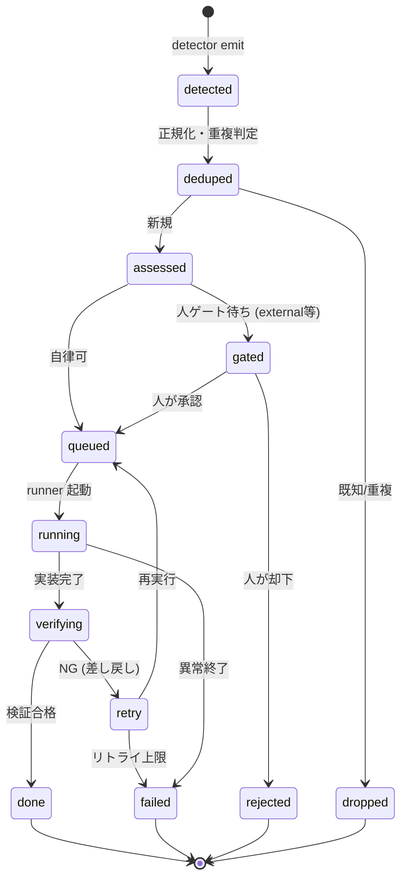
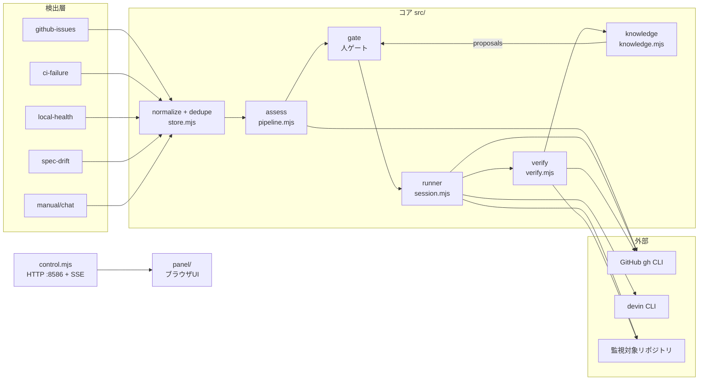
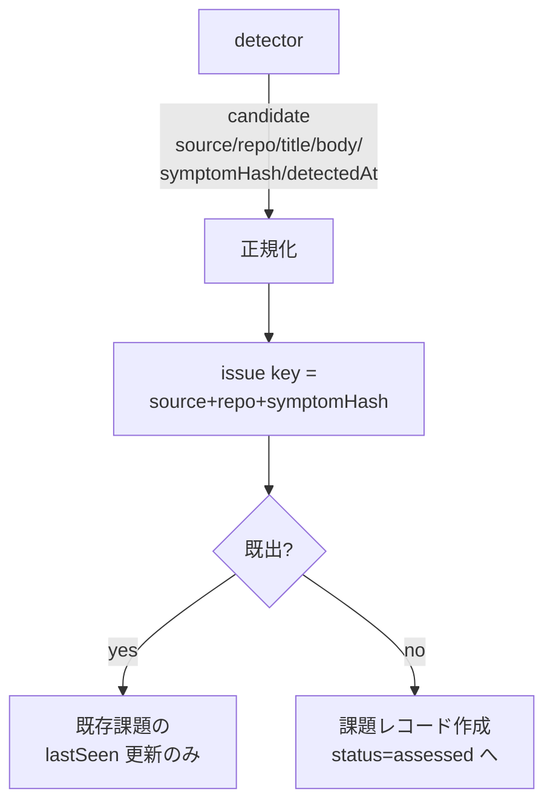
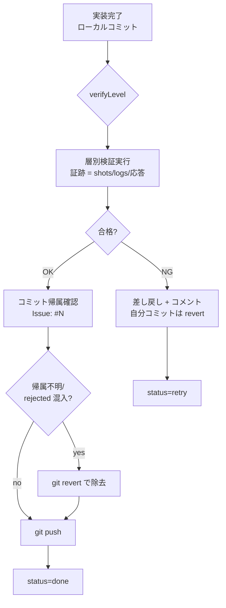
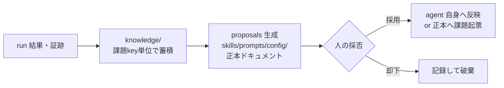
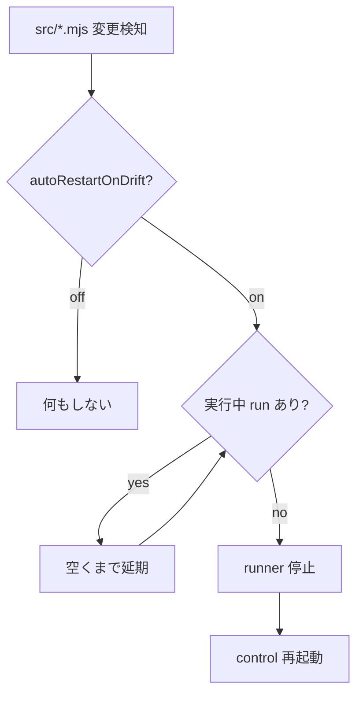

# KASUGAI Agent

課題自律ループ常駐エージェント。
「課題（現状と理想の差分）を検出 → 評価 → 対応 → 実機検証 → 学習」する閉ループを
1本のパイプラインで回す。Issue 対応・エラー自律対応・新機能追加・自己改良は
すべて同一モデルの上に乗る。

この README は **統一モデルの正本** である。実装と乖離したら図・文書を先に直す。
開発規約は `AGENTS.md`。

- バージョン: v0.2.0（旧版 agent → kasugai_agent v0.1 の知見を踏まえ全面再構築）
- 実行環境: Windows / Node.js（標準ライブラリのみ）+ gh CLI + devin CLI
- 制御ポート: `8586` / タスクスケジューラ名: `KasugaiAgentDispatcher`

---

## 1. 目的と非目的

**目的**

- 監視対象リポジトリ群の課題を継続的に検出し、人の指示なしに評価〜実装〜実機検証
  まで進める
- 実機検証（証跡採取）を義務化し、「動いたつもり」を排除する
- 処理のたびに知見を蓄積し、agent 自身・各リポジトリ正本へ還流してループ自体を
  改良する

**非目的**

- チャットだけの会話相手になること（会話は課題化の入口の1つ）
- 検証を通っていない成果物を push すること（絶対しない）

## 2. 用語

| 用語 | 定義 |
|---|---|
| **課題 (issue)** | 現状と理想の差分。全ワークの単位。安定した issue key を持つ |
| **candidate** | detector が emit した正規化済み課題候補（未評価） |
| **run** | 1課題に対する1回の処理実行（session + verify の一連） |
| **runner** | 課題を実際に処理する実行体の抽象。既定は `devin -p`（非対話セッション） |
| **verifyLevel** | L0〜L4。課題ごとに assess が決める検証深度 |
| **proposal** | 知見から生成した変更提案（skills/prompts/config/正本）。人の採否ゲートを通る |
| **人ゲート** | 自律で越えてはいけない判定地点（external 起票・proposal 採否・push 可否） |

## 3. 課題ライフサイクル



- `done` でも課題知見は残り、後続課題・proposals の入力になる
- `failed` は人の判断で `queued` に戻せる（パネル操作）
- `retry` の差し戻し回数は課題単位で記録し、上限（既定3）で `failed`

## 4. 全体構成



- **detectors は検出のみ**。起動・判定・重複排除には関与しない
- **control.mjs はハブ**。状態の唯一の正（state store）・SSE push・パネル配信・
  スケジューラ（ポーリングタイマ）を持つ。重い処理はモジュールに分離
- **pipeline.mjs がライフサイクルの state machine**。状態遷移はここだけが行う

## 5. パイプライン詳細

### 5.1 detect → normalize → dedupe



- detector は `detectors/*.mjs` に置き、統一 candidate 形式を stdout/ファイルで emit
- dedupe は入口の1箇所のみ（detector 個別に持たせない）
- GitHub Issue は `gh issue list` ポーリング。`autoTrigger` または `devin` ラベルで候補化

### 5.2 assess

課題ごとに以下を決定する（実装時はルール + LLM 判定のハイブリッド）:

- **verifyLevel**（L0〜L4）— 全課題一律に L3/L4 を要求しない
- **受入条件** — verify の合格基準として課題に紐付ける
- **自律可否** — `external` ラベル・爆破半径・対象リポジトリの設定で判定

### 5.3 gate（人ゲート）

| ゲート | 条件 | 通過方法 |
|---|---|---|
| external 起票 | `external` ラベル付き Issue | パネルで人が承認 |
| proposal 採否 | 知見還流の提案全般 | パネルで人が採否 |
| push 最終判断 | 対象リポジトリの `requirePushApproval` | パネルで承認（既定は verify 合格で自動） |

匿名起票は prompt injection の入口になり得るため、external は **評価にも進まない**
（候補一覧への表示のみ）。

### 5.4 dispatch（runner）

- runner は `session.mjs` が管理。既定実装は `devin -p` 非対話セッション
- **起動可否は論理競合ベース**（同時起動数の上限は設けない）:
  同一リポジトリの未完了 run、排他ロック中の実機リソースがある課題は待機
- セッションには課題・受入条件・知見をプロンプトとして注入
- 成果物は MAIN 運用（既定ブランチで実装 → ローカルコミット → `AI:impl-done`）

### 5.5 verify（L0〜L4）

| 層 | 内容 | 例 |
|---|---|---|
| L0 | 静的チェック | 構文・lint・差分の存在 |
| L1 | 単体動作 | テスト・ビルド・起動確認 |
| L2 | 実機実行 | 成果物を実環境で動かし応答確認 |
| L3 | 画面駆動 | UI 操作・スクリーンショット証跡 |
| L4 | 主旨照合 | Issue の意図と結果の突き合わせ |



- **push は verify だけが行う**。検証を通っていないコミットは公開しない
- 未pushコミットの帰属は `Issue: #N` トレーラで判定。帰属不明・closed・
  `devin:rejected` の混入は `git revert` で除去（`git reset` は禁止）
- 実機リソース（QGIS harness・固定ポート等）は `locks` で排他利用
- 証跡は課題キー単位で `evidence/` に保存し、Issue コメントに添付/リンク

### 5.6 learn（知見の還流）



- 生の知見は無条件蓄積、**反映は必ず proposals 経由の人ゲート**
- リポジトリ正本（`.devin/skills`・AGENTS.md）への反映は新規課題として起票し、
  通常パイプで対応する

## 6. 状態とファイル

| ファイル | 内容 | Git 管理 |
|---|---|---|
| `config.json` | 監視リポジトリ・ポート・ゲート設定 | 追跡（example から複製） |
| `state.json` | ループ全体の稼働状態 | 対象外 |
| `issues.json` | 課題レコード（status・verifyLevel・retry 回数） | 対象外 |
| `candidates.json` | 未評価の候補一覧 | 対象外 |
| `work-queue.json` | 実行待ちキュー | 対象外 |
| `knowledge/` | 課題単位の知見 | 対象外 |
| `proposals/` | 人ゲート待ちの提案 | 対象外 |
| `evidence/` | 検証証跡（shots・ログ・応答） | 対象外 |
| `locks/` | リソースロックファイル | 対象外 |
| `logs/` | 稼働ログ | 対象外 |
| `secrets.json` | API キー等 | **対象外・唯一の保管場所** |

- 状態を変更したら SSE で即時 push（常時ポーリングしない）
- 表示用フィールドを追加したら API 応答にも必ず含める

## 7. API / パネル

`control.mjs` が `:8586` で提供（loopback のみ）。

- `GET /api/state` — 全体状態 / `GET /api/issues` / `GET /api/candidates`
- `POST /api/issues/:key/dispatch` / `POST /api/issues/:key/approve` / `reject`
- `GET /api/proposals` / `POST /api/proposals/:id/accept|decline`
- `POST /api/chat` — 会話入口（manual detector へ流す）
- `POST /api/control/restart` — code drift 手動再起動
- `GET /api/events` — SSE（状態push・進行表示）

パネル（`panel/index.html`）は課題ボード・チャット・proposals・設定の4面構成を
目指す。詳細は実装時に確定する。

## 8. 自動再起動（code drift）



- 順序は必ず「実行系停止 → control 再起動」（孤児プロセスとロック競合を防ぐ）

## 9. セキュリティ

- API キー等は `secrets.json` のみ。`config.json`・ログ・プロンプト注入へ書かない
- external 起票は評価前に必ず人の目視（prompt injection 対策）
- control は loopback のみ bind。外部公開しない

## 10. ディレクトリ構成（設計）

```
kasugai_agent/
  README.md            # 統一モデル正本（本ファイル）
  AGENTS.md            # 開発規約
  config.example.json
  src/
    control.mjs        # HTTP/SSE ハブ・状態の正・スケジューラ
    pipeline.mjs       # 課題ライフサイクル state machine
    store.mjs          # JSON 永続化（state/issues/candidates/queue）
    session.mjs        # runner 抽象（devin CLI 実装）
    verify.mjs         # L0-L4 検証・証跡採取・push
    knowledge.mjs      # 知見蓄積 → proposals
    github.mjs         # gh CLI ラッパ
    locks.mjs          # リソース排他ロック
    detectors/
      github-issues.mjs
      local-health.mjs
      manual.mjs
  panel/
    index.html
  prompts/             # assess/dispatch/verify 等のプロンプトテンプレ
  docs/
    index.html         # mermaid ブラウザ表示（README と同期）
  test/
```

旧版の課題だった単一巨大ファイル（control 148KB / dispatcher 86KB）を避け、
**1ファイル1責務・状態遷移は pipeline のみ** を徹底する。

## 11. 運用

- ログオン時自動起動: タスクスケジューラ `KasugaiAgentDispatcher`（再登録は実装後）
- 監視対象は `config.json` の `repos`。初期は本リポジトリ自身のみ（自己監視で
  ループを育ててから他リポジトリへ拡大）

## 12. ロードマップ

1. **M0 設計確定** — 本 README（いまここ）
2. **M1 最小ループ** — detect(github-issues) → assess(ルールのみ) → dispatch(devin -p)
   → verify(L0/L1) → ラベル/コメント報告。パネルは課題一覧+操作のみ
3. **M2 検証強化** — L2/L3・証跡・リソースロック・帰属 revert
4. **M3 学習還流** — knowledge/proposals・人ゲート・自己監視拡大
5. **M4 パネル完成** — チャット・ボード・設定・SSE 進行表示
