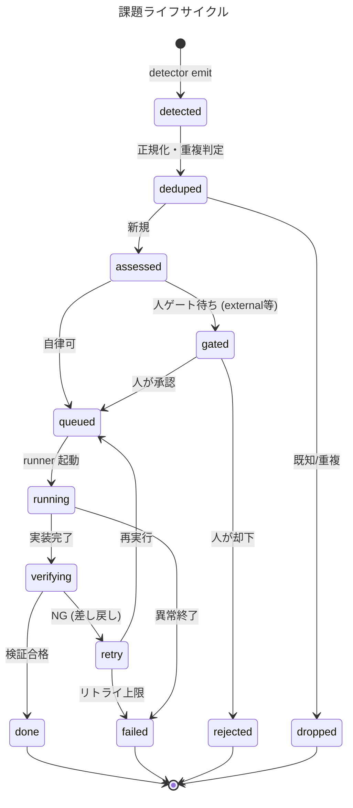
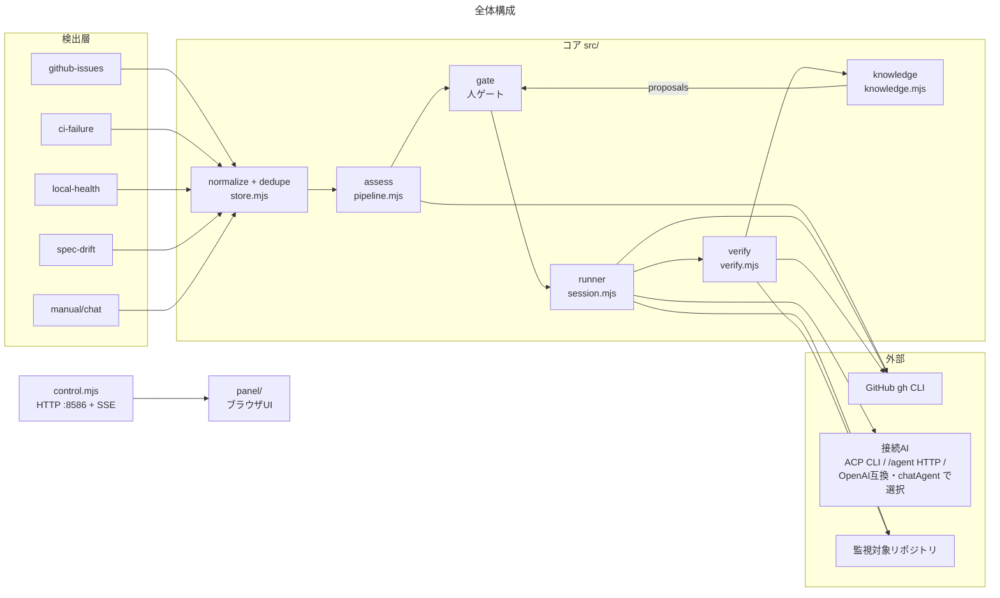
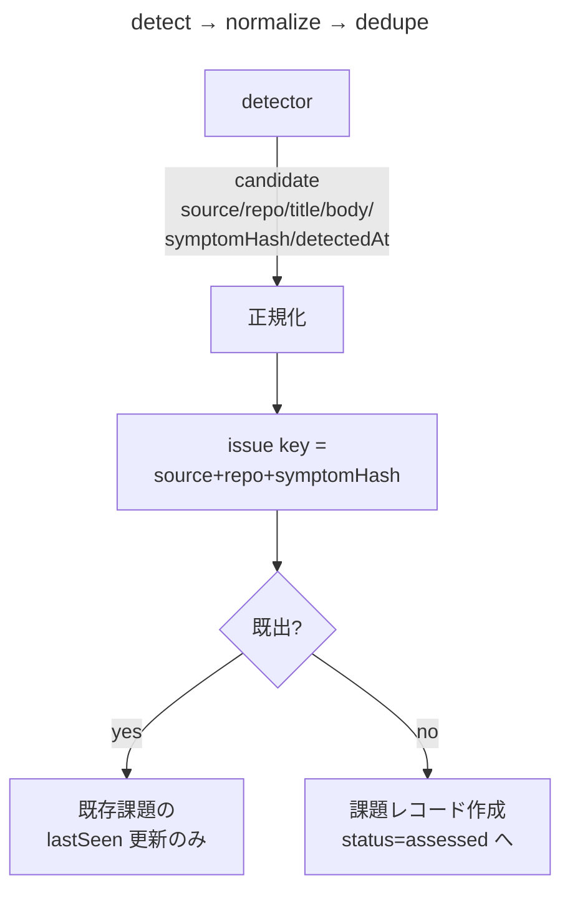
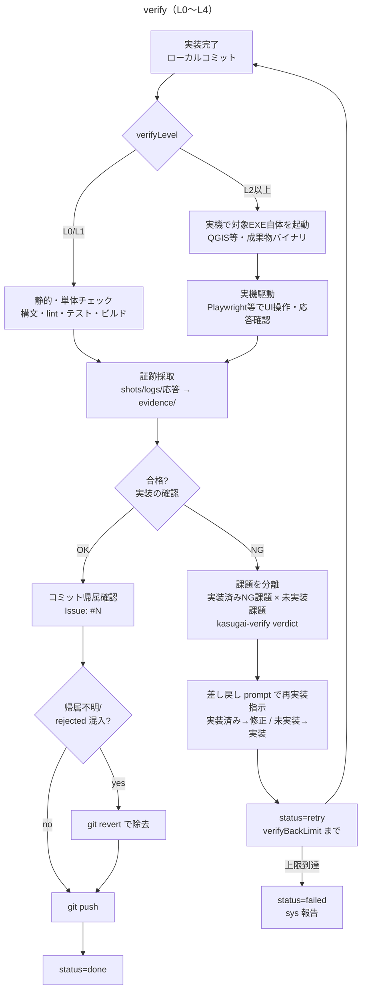
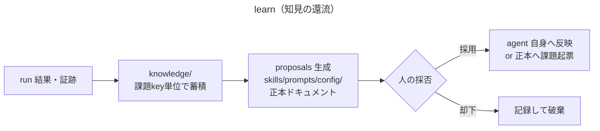
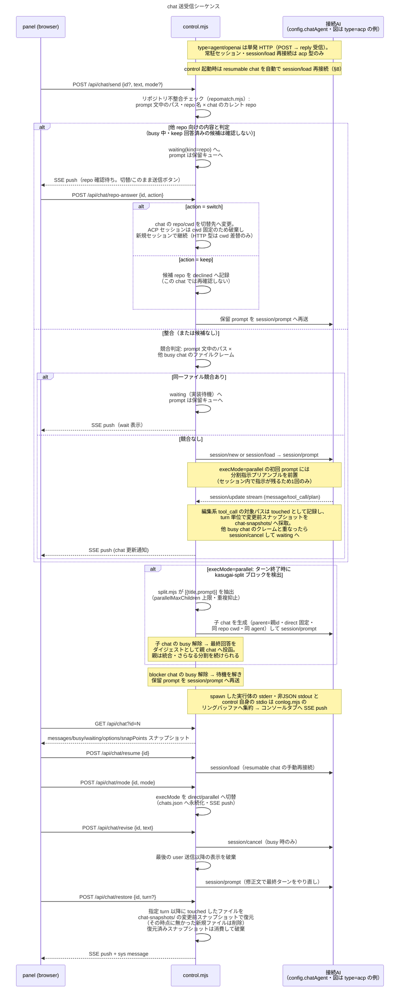
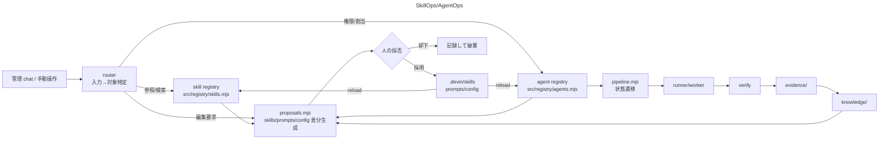
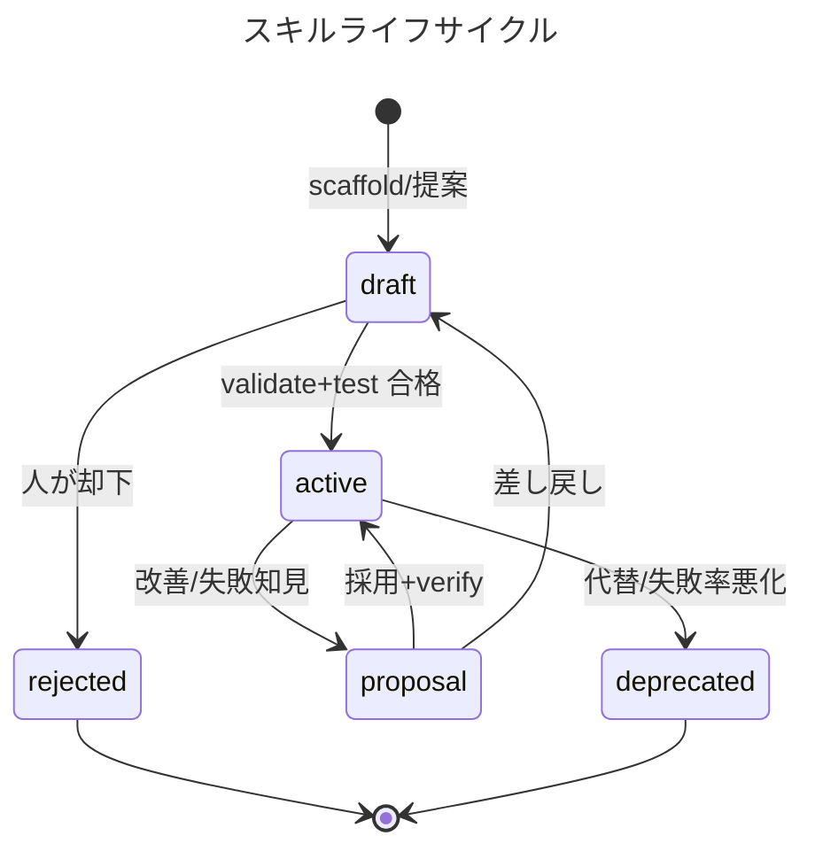
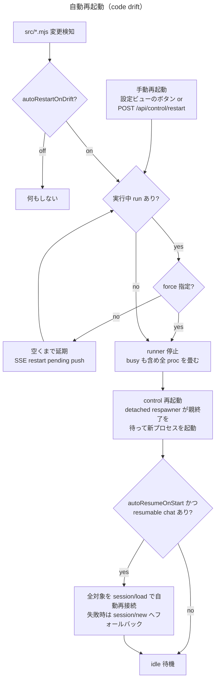

# KASUGAI Agent

課題自律ループ常駐エージェント。
「課題（現状と理想の差分）を検出 → 評価 → 対応 → 実機検証 → 学習」する閉ループを
1本のパイプラインで回す。Issue 対応・エラー自律対応・新機能追加・自己改良は
すべて同一モデルの上に乗る。

この README は **統一モデルの正本** である。実装と乖離したら図・文書を先に直す。
開発規約は `AGENTS.md`。
なお mermaid 図の正本は `diagrams/*.mmd` であり、本ファイル内の図は
`node tools/sync-diagrams.mjs` が生成する写し（直接編集禁止）。

- バージョン: v0.2.0（旧版 agent → kasugai_agent v0.1 の知見を踏まえ全面再構築）
- 実行環境: Windows / Node.js（標準ライブラリのみ）+ gh CLI + ACP 対応 CLI（devin 等）
- 制御ポート: `8586` / タスクスケジューラ名: `KasugaiAgentDispatcher`

---

## 1. 目的と非目的

**目的**

- 監視対象リポジトリ群の課題を継続的に検出し、人の指示なしに評価〜実装〜実機検証
  まで進める
- 実機検証（証跡採取）を義務化し、「動いたつもり」を排除する
- 処理のたびに知見を蓄積し、agent 自身・各リポジトリ正本へ還流してループ自体を
  改良する

**非目的**

- チャットだけの会話相手になること（会話は課題化の入口の1つ）
- 検証を通っていない成果物を push すること（絶対しない）

## 2. 用語

| 用語 | 定義 |
|---|---|
| **課題 (issue)** | 現状と理想の差分。全ワークの単位。安定した issue key を持つ |
| **candidate** | detector が emit した正規化済み課題候補（未評価） |
| **run** | 1課題に対する1回の処理実行（session + verify の一連） |
| **runner** | 課題を実際に処理する実行体の抽象。既定は `devin -p`（非対話セッション） |
| **verifyLevel** | L0〜L4。課題ごとに assess が決める検証深度 |
| **proposal** | 知見から生成した変更提案（skills/prompts/config/正本）。人の採否ゲートを通る |
| **人ゲート** | 自律で越えてはいけない判定地点（external 起票・proposal 採否・push 可否） |

## 3. 課題ライフサイクル

<!-- diagram: issue-lifecycle -->


- `done` でも課題知見は残り、後続課題・proposals の入力になる
- `failed` は人の判断で `queued` に戻せる（パネル操作）
- `retry` の差し戻し回数は課題単位で記録し、上限（既定3）で `failed`

## 4. 全体構成

<!-- diagram: architecture -->


- **detectors は検出のみ**。起動・判定・重複排除には関与しない
- **control.mjs はハブ**。状態の唯一の正（state store）・SSE push・パネル配信・
  スケジューラ（ポーリングタイマ）を持つ。重い処理はモジュールに分離
- **pipeline.mjs がライフサイクルの state machine**。状態遷移はここだけが行う

## 5. パイプライン詳細

### 5.1 detect → normalize → dedupe

<!-- diagram: detect-pipeline -->


- detector は `detectors/*.mjs` に置き、統一 candidate 形式を stdout/ファイルで emit
- dedupe は入口の1箇所のみ（detector 個別に持たせない）
- GitHub Issue は `gh issue list` ポーリング。`autoTrigger` または `devin` ラベルで候補化

### 5.2 assess

課題ごとに以下を決定する（実装時はルール + LLM 判定のハイブリッド）:

- **verifyLevel**（L0〜L4）— 全課題一律に L3/L4 を要求しない
- **受入条件** — verify の合格基準として課題に紐付ける
- **自律可否** — `external` ラベル・爆破半径・対象リポジトリの設定で判定

### 5.3 gate（人ゲート）

| ゲート | 条件 | 通過方法 |
|---|---|---|
| external 起票 | `external` ラベル付き Issue | パネルで人が承認 |
| proposal 採否 | 知見還流の提案全般 | パネルで人が採否 |
| push 最終判断 | 対象リポジトリの `requirePushApproval` | パネルで承認（既定は verify 合格で自動） |

匿名起票は prompt injection の入口になり得るため、external は **評価にも進まない**
（候補一覧への表示のみ）。

### 5.4 dispatch（runner）

- runner は `session.mjs` が管理。既定実装は `devin -p` 非対話セッション
- **起動可否は論理競合ベース**（同時起動数の上限は設けない）:
  同一リポジトリの未完了 run、排他ロック中の実機リソースがある課題は待機
- セッションには課題・受入条件・知見をプロンプトとして注入
- 成果物は MAIN 運用（既定ブランチで実装 → ローカルコミット → `AI:impl-done`）

### 5.5 verify（L0〜L4）

| 層 | 内容 | 例 |
|---|---|---|
| L0 | 静的チェック | 構文・lint・差分の存在 |
| L1 | 単体動作 | テスト・ビルド・起動確認 |
| L2 | 実機実行 | 対象EXE自体（QGIS等の成果物バイナリ）を実機で起動し応答確認 |
| L3 | 画面駆動 | Playwright等でUI操作・スクリーンショット証跡 |
| L4 | 主旨照合 | Issue の意図と結果の突き合わせ |

L2 以上の verify は **実機検証を前提とする**: 成果物のEXE自体を実環境で起動し、
Playwright 等で画面・応答を駆動確認する。「実装の確認」とはコードやビルドの
成否ではなく、実機で動く成果物として期待どおりに振る舞うことの確認をいう。

<!-- diagram: verify-levels -->


- **push は verify だけが行う**。検証を通っていないコミットは公開しない
- 未pushコミットの帰属は `Issue: #N` トレーラで判定。帰属不明・closed・
  `devin:rejected` の混入は `git revert` で除去（`git reset` は禁止）
- 実機リソース（QGIS harness・固定ポート等）は `locks` で排他利用
- 証跡は課題キー単位で `evidence/` に保存し、Issue コメントに添付/リンク

### 5.6 learn（知見の還流）

<!-- diagram: learn-flow -->


- 生の知見は無条件蓄積、**反映は必ず proposals 経由の人ゲート**
- リポジトリ正本（`.devin/skills`・AGENTS.md）への反映は新規課題として起票し、
  通常パイプで対応する

## 6. 状態とファイル

| ファイル | 内容 | Git 管理 |
|---|---|---|
| `config.json` | 監視リポジトリ・ポート・ゲート設定・接続AI（`chatAgents`/`chatAgent`） | 追跡（example から複製） |
| `state.json` | ループ全体の稼働状態 | 対象外 |
| `issues.json` | 課題レコード（status・verifyLevel・retry 回数） | 対象外 |
| `candidates.json` | 未評価の候補一覧 | 対象外 |
| `work-queue.json` | 実行待ちキュー | 対象外 |
| `knowledge/` | 課題単位の知見 | 対象外 |
| `proposals/` | 人ゲート待ちの提案 | 対象外 |
| `evidence/` | 検証証跡（shots・ログ・応答） | 対象外 |
| `locks/` | リソースロックファイル | 対象外 |
| `chat-snapshots/` | chat が変更したファイルの turn 単位変更前スナップショット | 対象外 |
| `logs/` | 稼働ログ | 対象外 |
| `secrets.json` | API キー等 | **対象外・唯一の保管場所** |

- 状態を変更したら SSE で即時 push（常時ポーリングしない）
- 表示用フィールドを追加したら API 応答にも必ず含める

## 7. API / パネル

`control.mjs` が `:8586` で提供（loopback のみ）。

- `GET /api/state` — 全体状態 / `GET /api/issues` / `GET /api/candidates`
- `GET /api/agents` / `GET /api/skills` — registry が収集した doc 一覧。
  `?repo=<slug>` で対象リポジトリの path + global 配置に絞り込む（省略時は全リポジトリ）。
  ただし `/api/skills` は global 配置の skill を一覧から除外する
  （収集・doc 本文/参照解決の対象ではある）
- `GET /api/doc?path=` — doc 本文（registry 収集済み + 参照解決済みパスのみ返す）
- `GET /api/refs?path=` — 収集済み doc が本文中で参照するファイル一覧
  （`path` は収集済み doc のみ。glob・ディレクトリ参照は実ファイルへ展開し、
  秘匿系は `denied` として返すが本文は返さない）
- `POST /api/issues/:key/dispatch` / `POST /api/issues/:key/approve` / `reject`
- `GET /api/proposals` / `POST /api/proposals/:id/accept|decline`
- `POST /api/candidates` — 手動課題化（manual detector 相当の入口）
- `GET /api/repos` — repos 一覧。`config.repos` 登録済みに加え、IDE ワークスペース
  （control の ROOT 親ディレクトリ。`config.workspaceRoot` で上書き可）直下の
  `.git` 付きディレクトリを `IDE管理下`（unregistered）として検出して返す
- `POST /api/repos` — 監視リポジトリ登録（`{path, slug?}` を `config.json` の
  `repos` へ追記。SSE `repos` で全パネルへ即時反映）
- `POST /api/repos/update` — 登録済み repo の設定更新
  （`autoTrigger` / `triggerLabel` / `requirePushApproval` → `config.json` へ反映）
- `POST /api/repos/remove` — `config.repos` からの登録解除
- `GET /api/fs/dirs?path=` — 登録フォームの path 選択用。指定ディレクトリ直下の
  サブディレクトリと `.git` 有無を返す（`path` 省略時はドライブルート一覧。
  loopback 限定の簡易ブラウザ）
- `GET /api/chat-agents` — 接続AI の一覧と active id（`type`/`exe`/`endpoint`/
  `provider`/`model`/`hasToken` 等。トークン値自体は返さない）
- `POST /api/chat-agents` — エージェント登録（`{id?, label, type?, exe?, args?,
  auth?, endpoint?, provider?, model?, project?, token?}` を `config.json` の
  `chatAgents` へ追記。`token` は `secrets.json` の `tokens` へ保存し
  config には書かない。SSE push で即時反映）
- `POST /api/chat-agents/update` / `remove` — 登録済みエージェントの更新・解除
  （remove は active 以外のみ可。update の `token` は同様に secrets へ、
  空文字で削除）
- `POST /api/chat-agents/active` — active 切替。以後の新規 chat の実行体になる
- `POST /api/chat/verify` — 検証ターンの手動起動（処理状況ビューの
  検証列カード「検証」ボタンが呼ぶ。実装を実機で確認する prompt を
  その chat のセッションへ送る）
- `POST /api/chat/close` — chat を1件削除（処理状況ビュー完了列カードの
  × と右ペイン一覧の ✕ が呼ぶ。スナップショットも除去し
  SSE `chats` で即時反映）
- `POST /api/chat/close-completed` — 完了（live）列の chat を一括削除
  （処理状況ビュー完了列ヘッダの「すべて削除」ボタンが呼ぶ。
  `{repo}` 指定時はその slug に属する chat のみ対象）
- `POST /api/control/restart` — control 手動再起動（設定ビューの
  「システム再起動」ボタンもこれを呼ぶ。実行中 run が残る間は空くまで延期し、
  `{force:true}` なら実行中の chat を中断して即時再起動する。
  SSE `restart` で pending/restarting を push）
- `GET /api/events` — SSE（状態push・チャット進行表示）
- `GET /docs/*` — マニュアルサイトの静的配信（`docs/` ディレクトリ。
  パネル左ペインの「マニュアル」ナビが中央ペイン iframe で開く。
  正本は `diagrams/docs/` で `tools/sync-docs.mjs` が生成する）

### チャット（manual detector の会話入口）

チャットは接続AIを実行体に持つ対話面。接続先は `config.json` の
**`chatAgents`**（実行体レジストリ）と **`chatAgent`**（active id）で設定し、
設定ビューからも追加・更新・解除・active 切替ができる。実行体の `type` は3種:

| type | 実行体 | 必須フィールド | 対象 |
|---|---|---|---|
| `acp` | ACP 対応 CLI を spawn し stdio JSON-RPC | `exe`/`args`/`auth` | devin（既定 `devin.exe acp`）・claude-code 等の ACP エージェント |
| `agent` | Canvas ブリッジハブ互換 `POST {endpoint}` | `endpoint`/`provider` | bridge-hub(`:8511`) 経由の copilot/devin/antigravity/汎用acp、外部エージェント |
| `openai` | OpenAI 互換 `chat/completions` | `endpoint`/`model` | OpenAI・Azure・Ollama・LM Studio・GitHub Models 等 |

- `acp`: セッション常駐（`session/new`→`session/prompt`、load で再開）。
  `auth` が `devin` は credentials.toml の API キーで authenticate、`none` は省略
- `agent`: 単発ターン。`{provider, message, project, model?, tools}` を POST し
  `{reply, actions?, error?}` を受ける。`/health` を持つ実装は疎通確認に使える
- `openai`: 単発ターン。`endpoint` は base URL（`/chat/completions` を補完）か
  フルパス。履歴は直近の user/agent メッセージから組み立てて送る
- トークン・APIキーは `secrets.json` の **`tokens`**（`{tokens:{<key>:"…"}}`）に
  置き、エントリの `tokenKey`（省略時は id）で参照する。config.json・ログ・
  プロンプトには書かない

実行体は chat 作成時の active エージェントに固定され `chats.json` に
永続化する（active 切替は以後の新規 chat に適用）。
課題レコードとは独立した会話だが、「課題化」操作で
`POST /api/candidates` へ流してパイプラインへ乗せる。

<!-- diagram: chat-sequence -->


- セッションは複数並行・ラベル付きで管理し `chats.json` に永続化
  （ACP sessionId と作成時の agent id を保持し、切断後は同一エージェントで
  `session/load` により再開。control 起動時は resumable な全 chat を
  自動再接続する — §8）
- モデル/モードは ACP `configOptions` を `session/set_config_option` で変更し、
  `acp-options.json` に永続化してセッション未開始時も選択肢を表示する
- busy 中の送信は追加指示（steer）として `session/prompt` を重ねる
- 最後の user 送信は ✎ または ↑ で入力欄へ呼び戻して修正できる。修正送信は
  `POST /api/chat/revise` が受け、busy 中は `session/cancel` してから最後の
  送信以降の表示を破棄し、修正文を `session/prompt` へ再送する（ACP に
  履歴の巻き戻しはないため「最終ターンのやり直し」として振る舞う）
- **変更復元（snapshots）**: 修正がすべて正しいとは限らないため、chat が加えた
  ファイル変更は turn（user 送信）単位で変更前スナップショットを
  `chat-snapshots/<id>/` に採取する。採取は send 時の prompt 文中パスと、
  busy 中の編集系 tool_call の対象パスが対象（tool_call 通知は変更適用前に
  届く前提の best-effort）。ヘッダの「変更復元」ボタンは復元ポイント
  （turn 単位）を選ばせ、選択 turn 以降の変更をまとめて元へ戻す
  （各ファイルの最古スナップショットへ書き戻し、当時無かった新規ファイルは
  削除）。スナップショットはディスク永続化のため、session/load で会話を
  復元した後や control 再起動後でも復元できる。復元済み分はマニフェストから
  消費される。busy 中は復元を拒否する（先に中断させる）
- 権限要求（`session/request_permission`）は allow 系を自動選択（自律実行前提）
- **実装待機（waiting）**: 同一ファイルを複数 chat が同時に編集する競合を防ぐ。
  busy 中の chat はファイルクレームを持つ（クレーム = prompt 文中の
  ファイルパス `declared` ∪ 編集系 tool_call が扱ったパス `touched`）。
  send 時に prompt 文中のパスが他 busy chat のクレームと重なれば、その
  prompt を保留して waiting に入る。実行中に tool_call が他 chat の
  クレームへ重なった場合も `session/cancel` でターンを止めて waiting に入る。
  blocker の busy が全て解けた時点で待機を解除し、保留 prompt
  （無ければ中断再開の指示）を再送する。待機中の送信は保留キューに積まれ、
  解除時にまとめて再送される。cancel で待機を手動解除できる（保留は破棄）。
  関数単位の競合はファイル単位クレームに包含して検出する
- **リポジトリ不整合チェック**: send 時に prompt 内容と chat の
  カレントリポジトリの整合を検査する（`src/repomatch.mjs`）。
  prompt 文中のパスが他の登録 repo の path 配下を指す、またはカレント
  repo 名への言及が無いまま他 repo 名に言及している場合、その送信を
  保留して waiting（`kind: 'repo'`）へ入り、パネルに
  「切り替えて送信 / このまま送信」の確認バーを出す。
  `POST /api/chat/repo-answer` の `action: 'switch'` は chat の
  repo/cwd を切替先へ変更して保留 prompt を再送する（ACP セッションは
  cwd 固定のため破棄し、新規セッションで継続。HTTP 型は cwd 差替のみ）。
  パネル側のカレント repo 選択も切替先へ追従する。
  `action: 'keep'` は候補 repo をその chat の `repoDeclined` へ記録し
  （chats.json へ永続化・同じ候補は再確認しない）、カレント repo のまま
  再送する。busy 中の steer には確認を挟まない
- **処理モード（execMode）**: chat ごとに `direct`（既定・従来どおり逐次処理）
  か `parallel` を持ち、`POST /api/chat/mode` か入力行のセレクトで切替、
  `chats.json` へ永続化する。`parallel` では初回 prompt に分割指示
  プリアンブルが前置され（セッション内に残るため1回のみ。ACP 履歴には
  載るが表示はユーザ文のみ）、エージェントは作業の中で独立タスクへ
  分割できると判断した時点で `` ```kasugai-split `` コードブロックに
  `[{title, prompt}]` を出力する。control はターン終了時に新着の agent
  メッセージを走査し（split.mjs）、ブロックを見つけると各要素を
  **子 chat**（`parent`=親 id・`direct` 固定・同 repo cwd・同 agent）として
  自動起動する。`prompt` は文脈を引き継がない独立セッションで動くため
  自己完結で書くようプリアンブルで指示する。暴走防止に
  `config.parallelMaxChildren`（既定4・親単位の累計）と
  `config.parallelMaxDepth`（既定1）の上限と、title+prompt 一致の
  重複抑止（`seenSplits` を chats.json へ永続化し再起動後の再発射も防ぐ）
  を持つ。子 chat の busy が解けると最終回答がダイジェストとして親へ
  投函され（親 busy 中は steer・waiting 中は保留キュー行き）、親が
  統合・追検討・さらなる分割を続けられる。子 chat のファイル競合は
  通常のクレーム／実装待機の経路で直列化される

パネル（`panel/index.html`）はチャットを主画面とし、課題ボード・proposals・
設定は M4 で統合する。agent/thought/plan 応答と doc 本文は Markdown として
描画し、`` ```mermaid `` コードブロックは mermaid.js で図にレンダリングする。
raw HTML は表示時にエスケープする（XSS 防止）。

画面は左・中央・右の3ペイン構成とし、左ペインを SkillOps/AgentOps の
管理面、右ペインを chat sessions / doc browser に割り当てる。
タイトル/ブランドは左ペインに固定し、その直下に**カレントリポジトリ選択**を置く。
この選択がパネル全体のスコープになる（マルチリポジトリ対応）:

- 右ペインの chat sessions / doc browser、左ペインの管理セクション
  （candidates）を選択リポジトリで絞り込む
- 新規チャットの cwd・「課題化」で登録する repo にも適用する
- 常にいずれか1リポジトリを指す。**`すべて` 選択肢は置かず**、
  未選択（全体表示）状態を作らない。選択は localStorage に永続化する
- リポジトリ名の表示はこのセレクトだけに限定する。選択リポジトリで絞られた
  一覧・画面（chat sessions・処理状況・candidates・ヘッダ status 等）では
  行ごとの repo 表示をしない（常に同一リポジトリなので冗長）
- 左ペインはカレントリポジトリの選択に専念する。監視リポジトリの登録・
  登録解除・設定編集はすべて設定ビュー（中央ペイン）で行う
- ナビ「設定」は中央ペインを設定ビューに切り替える。ビューは
  **接続AI / リポジトリ / システム** の3タブにグループ分けし、
  選択タブは localStorage に永続化する。
  「リポジトリ」タブ先頭の登録フォームにローカルパスを入力して
  `POST /api/repos` で登録する。
  path は「参照…」ボタンで選ぶこともできる（`GET /api/fs/dirs` で直下の
  サブディレクトリを辿る簡易ピッカー。`.git` 付きにはバッジを表示）。
  `config.json` の `repos` へ追記され、SSE push で左ペインの選択肢へ
  即時反映される。slug 省略時は `git remote get-url origin` から推定する
  （推定不能時はディレクトリ名）。新規登録リポジトリは `autoTrigger:false`・
  `requirePushApproval:true` の保守的既定で追加する。
  `GET /api/repos` の一覧をカード表示し、登録済みは
  `autoTrigger` / `triggerLabel` / `requirePushApproval` を編集して
  `POST /api/repos/update` で保存、`POST /api/repos/remove` で登録解除する。
  IDE ワークスペース直下の `.git` 付きディレクトリは「IDE管理下」バッジ付きで
  一覧し、登録ボタンで `POST /api/repos` へ流せる。一覧はカレントリポジトリ
  選択で絞らず全件表示する（repo 一覧そのものが表示対象）
- 「接続AI」タブ（既定タブ）では `config.json` の
  `chatAgents` に登録されたエージェント（`acp`/`agent`/`openai` 各 type の
  フィールド）の一覧・追加・更新・解除と、active（`chatAgent`）の切替を
  行う。トークンは `secrets.json` の `tokens` へ保存され `hasToken` のみ表示。
  変更は
  `POST /api/chat-agents*` → config.json へ反映され SSE push で即時表示に
  出る。active は以後に作成する chat の実行体（既存 chat は作成時の
  エージェントを保持）。active なエージェントは解除できない
  （先に別エージェントを active にする）

中央ヘッダの「最新」ボタンは `updatedAt` 最大のチャットを選択して表示する。
中央ペインのチャット画面は **チャット / コンソール** の2タブに分かれる
（選択は localStorage に永続化）。
コンソールタブは裏側プロセスの出力をモニターする画面で、
spawn した接続AI（acp 型）の stderr・非JSON stdout と
control 自身の stdio を `src/conlog.mjs` のリングバッファへ集約し、
`GET /api/console`（履歴）+ SSE `console` push（追加分）で
ライブ表示する。行は `{seq, ts, src, stream, text}` 形式で、
`src` は `#<chat id> <agent label>` または `control`。
左右ペインは境界のグリップをドラッグして幅を変更でき、
幅は localStorage に永続化して次回表示に引き継ぐ。

左ペイン上部の縦並びナビ（**AIチャット / 処理状況 / エディター / AGENTS /
SKILL / マニュアル / 設定**）のうち、AIチャット / エディター / AGENTS /
SKILL は右ペインを切り替える。AIチャットは
chat sessions 一覧に戻し、エディターはカレント repo のフォルダツリーを
展開する（dir は `GET /api/fs/tree` で lazy 展開、file 選択で
`GET /api/fs/file` の本文を中央ペインに表示。登録 repo 配下・非秘匿のみ）。
AGENTS / SKILL は
doc browser に切り替えて registry（`src/registry/agents.mjs` /
`skills.mjs`）が収集した agent 定義・ルール文書（`AGENTS.md`・
`.devin/agents`・`.devin/rules` 等）や skill 定義（各種 `skills/` 配下の
`SKILL.md`）をボタン一覧で表示する。
skill の走査範囲はリポジトリ内に加え、グローバル配置
（`%APPDATA%/devin`・`~/.config/devin`・`~/.devin`・`~/.agents`・
`~/.codeium/<channel>` の `skills/`、Devin アプリ同梱 session skills、
`~/.devin/extensions/<ext>` 配下）も含む。
global 配置の skill は収集・doc 本文/参照解決の対象だが、SKILL 一覧には
表示しない。
doc を選ぶと `GET /api/doc` で本文を取得し、中央ペインに表示する
（.md は Markdown 描画、.mmd は mermaid 図として描画。
「原文 / プレビュー」ボタンで切替可。
切替時は一覧先頭の doc を自動で開く）。
doc browser は読み取り専用で、編集・反映は proposals 経由のみ。

**処理状況** は右ペインを変えずに中央ペインだけを処理状況ビューへ切り替え、
カレントリポジトリ内の chat を 未着手 / 実行状況 / 検証 / `resumable` /
`live` の**状態別カンバン列**（横並び、この順）に配置する。
実行状況列は `busy` と `waiting`（実装待機）を1列に統合し、
各カードに **実行中 / 実行待機中** の状態ピルを明示する
（列内は 実行中 → 実行待機中 の順に並べる）。
検証列は実装ターン（ファイルを touched したターン）の終了で chat が
遷移する検証フェーズ。`config.autoVerify`（既定 true）なら終了時に
実機検証の prompt（対象 EXE 自体の起動・Playwright 等での画面駆動を
指示する VERIFY_PROMPT）を自動送信し、検証ターン中も検証列に留まる
（検証中に修正が入った場合は `retryLimit` 内で再検証）。
検証ターンは報告末尾に ```kasugai-verify ブロックで結果（verdict）を
出力する。verdict が NG なら課題を「実装済み（検証NG）」と「未実装」に
分離した差し戻し prompt を送って再実装へ戻し（`config.verifyBackLimit`
回まで、超過時は sys 報告で終了）、差し戻しターンの完了で再度検証列へ
戻る。差し戻し中は実行状況列のカードに「差戻N」ピルを表示する。
`autoVerify:false` 時や再検証待ちではカードの「検証」ボタン
（`POST /api/chat/verify`）で手動起動できる。
検証フェーズ中はチャット画面側にも状態を明示する。検証ターン中
（`verify=running`）はヘッダ表示に加え、メッセージ末尾のインジケータと
送信ボタンが「検証中」を示し、検証起動待ち（`verify=pending`）は
メッセージ末尾に「検証待ち」を出す（いずれも SSE push で即時反映）。
各列は状態名と件数を示し、
chat はカードとして現在地の列に置かれる（列は空でも常時表示し、
「今どこにあるか」を一目で追えるようにする）。
実行待機中のカードには競合元 chat と対象ファイルを併記する。
ACP プロセスも保存セッションも無い chat（未着手）も列に含める。
カードクリックで該当 chat を選択表示し、
ヘッダの「← チャット」でチャット表示へ戻る。SSE push で随時再描画する。
完了（`live`）列のカードには × ボタンを置き、押下で
`POST /api/chat/close` により chat を削除できる
（右ペイン chat sessions 一覧の ✕ と同じ操作で、ボードにも即時反映する）。
完了列のヘッダには「すべて削除」ボタンを置き（カードがある時のみ表示）、
押下で確認のうえ `POST /api/chat/close-completed` により
カレント repo の完了列 chat を一括削除する（SSE push で即時反映）。
切断・再開可（`resumable`）列の各カードには「再開」ボタンを置き、押下で
`POST /api/chat/resume` により `session/load` でその場で再接続する
（次の送信を待たない。起動時の自動再接続と同じ経路で、
load 失敗時は `session/new` へフォールバックする）。

doc が本文中で参照しているファイル（`` ` `` 囲みのパス表記・glob・
ディレクトリ参照）は、`GET /api/refs` で実ファイルへ解決する。
AGENTS はルール文書が1枚前提のため、切替時に収集した全 doc の参照を
マージし、doc 自身と「参照」群を1つの一覧として表示する。
SKILL は doc 選択時に右ペイン下部の「参照」ボタンとして一覧する。
いずれも押下で `GET /api/doc` の本文を
中央ペインへ表示する。内容の描画は panel 内の単一 `Viewer` オブジェクトに
集約されており（chat message の Markdown 描画・mermaid 後処理も同じ
ロジックを通る）、「原文 / プレビュー」ボタンで切り替える。
.md / .markdown は Markdown + mermaid 図、.mmd は mermaid 図、
.html / .htm は sandboxed iframe で描画する（それ以外は原文表示のみ）。
`secrets.json`・`.env`・鍵ファイル等の秘匿系はボタンを残すが無効表示とし
本文は返さない。未作成の参照も「未作成」ピル付きの無効表示で残す。

<!-- diagram: panel-layout -->
```mermaid
---
title: パネルレイアウト
---
flowchart LR
    L[左ペイン<br/>title + カレントrepo +<br/>縦並びナビ + 管理セクション] --> C[中央ペイン<br/>chat messages（chat/console タブ）/<br/>doc 本文（Viewer 単一オブジェクトに集約<br/>kind判定・原文/プレビュー切替・mermaid描画<br/>MD+mermaid・HTML・MMD 表示・MMD は縦横切替可<br/>mermaid 図は＋−ボタン/wheel で拡縮<br/>（カーソル位置を維持）<br/>中央配置・ドラッグで視野移動・ズーム率表示）]
    C --> R[右ペイン<br/>chat sessions（行は状態ドット+ラベルの<br/>最小表示・状態確認は処理状況ボード） /<br/>doc browser + 参照ファイル /<br/>フォルダツリー（エディター）<br/>（省略ラベルは data-tip<br/>ホバーポップアップで全文表示）]
    G[境界グリップ<br/>ドラッグで幅可変<br/>localStorage 永続化] --> L
    G --> R
    RS[カレントrepo選択<br/>左ペイン title 直下<br/>「すべて」選択肢なし<br/>repo名の表示はここのみ<br/>localStorage 永続化] -->|表示スコープ| L
    RS -->|表示スコープ| R
    RS -->|新規chatの cwd<br/>課題化の repo| C
    C -->|最新ボタン| NEW[updatedAt 最大の<br/>chat を選択]
    C -->|言語 select<br/>localStorage 永続化| I18N[panel/i18n.js<br/>i18n/*.json 辞書<br/>en がフォールバック<br/>data-i18n 属性 + t()<br/>切替時は全ペイン再描画]
    L --> M1[loop state]
    L --> M2[candidates/proposals]
    L -->|エディターナビ<br/>（処理状況の直下）| FT[フォルダツリー<br/>右ペインに展開<br/>カレントrepo の path を根<br/>dir は lazy 展開<br/>GET /api/fs/tree<br/>.git/node_modules 等は除外<br/>秘匿系は 🔒 で選択不可]
    FT -->|file 選択<br/>GET /api/fs/file<br/>（登録 repo 配下・非秘匿のみ<br/>binary は本文を返さない）| C
    L -->|縦並びナビ<br/>AIチャット/AGENTS/SKILL| R
    L -->|マニュアルナビ<br/>中央ペインを iframe 表示| C
    C -->|GET /docs/* 静的配信| MAN[docs/ マニュアルサイト<br/>正本=diagrams/docs/<br/>（1ページ1.md・frontmatter title<br/>nav.json=章立て<br/>template.html/style.css=書式<br/>Canvas docs 参考）<br/>tools/sync-docs.mjs が生成]
    L -->|git ナビ（設定下の区切り線以下・ナビ末尾）<br/>コミット=メッセージ入力→<br/>POST /api/git/commit<br/>（git add -A + commit・変更なしは noop）<br/>プッシュ=確認後<br/>POST /api/git/push（人ゲートの承認）| GIT[カレント repo で git を spawn<br/>60s timeout<br/>出力は conlog 集約<br/>→ console タブへ SSE push]
    L -->|設定ナビ<br/>タブ: 接続AI / リポジトリ / システム<br/>（登録済み + IDE管理下検出）<br/>GET /api/chat-agents<br/>GET /api/repos| C
    C -->|接続AI 追加/更新/解除<br/>active 切替<br/>POST /api/chat-agents/*| AC[config.json の<br/>chatAgents + chatAgent<br/>SSE push で即時反映]
    AC -->|新規 chat の実行体<br/>（chat 作成時に固定し<br/>chats.json へ永続化）| ACPX[接続AI 実行体<br/>acp=CLI spawn /<br/>agent=/agent HTTP /<br/>openai=chat/completions]
    ACPX -->|stderr / 非JSON stdout<br/>（acp 型の spawn のみ）| CON[conlog.mjs<br/>実行体出力 + control 自身の<br/>stdio をリングバッファ集約]
    C -->|console タブ<br/>GET /api/console +<br/>SSE console push| CON
    C -->|処理モード select<br/>（入力行の先頭・添付ボタンの左<br/>目立たせるため強調表示）<br/>POST /api/chat/mode| EM[execMode<br/>direct=逐次 /<br/>parallel=kasugai-split で<br/>子chat自動起動・結果を親へ集約<br/>sessions一覧は親子でグループ表示]
    C -->|repo設定 保存/登録解除<br/>POST /api/repos/update<br/>POST /api/repos/remove| RC[config.json の repos<br/>SSE push で即時反映]
    C -->|repo登録（設定ビューの<br/>path入力・参照ピッカー /<br/>IDE管理下の登録ボタン）<br/>POST /api/repos| RC
    C -->|path 参照<br/>GET /api/fs/dirs| FS[ローカルFSブラウザ<br/>サブdir + .git 検出<br/>loopback 限定]
    RC -->|選択肢へ追加し<br/>SSE即時反映| RS
    L -->|処理状況ナビ<br/>idle/exec/verify/resume/live<br/>の順の状態別カンバン列<br/>exec列は busy+waiting を統合<br/>カードに実行中/実行待機中ピル<br/>verify列は実装ターン終了で自動遷移<br/>（touched あり → autoVerify で検証<br/>prompt 送信・検証中も列に留まる）| C
    C -->|statusカードクリック| PICK[該当 chat を選択表示]
    C -->|検証列カードの検証ボタン<br/>POST /api/chat/verify| VR[検証ターン起動<br/>対象EXE起動+Playwright等の<br/>実機確認を指示<br/>SSE push で即時反映]
    C -->|verify=running/pending| VSH[chat 画面にも検証中/検証待ちを明示<br/>ヘッダ status＋メッセージ末尾の<br/>インジケータ＋送信ボタン<br/>SSE push で即時反映]
    C -->|完了列カードの×ボタン<br/>POST /api/chat/close| DEL[chat 削除<br/>SSE push で即時反映]
    C -->|完了列ヘッダの「すべて削除」<br/>POST /api/chat/close-completed<br/>カレントrepoの完了列を一括削除| DEL
    C -->|再開可列カードの再開ボタン<br/>POST /api/chat/resume| RLOAD[session/load で再接続<br/>SSE push で即時反映]
    R -->|doc一覧 GET /api/agents<br/>GET /api/skills<br/>SKILL は global scope を<br/>一覧から除外| REG[doc registry<br/>agents.mjs /<br/>skills.mjs]
    R -->|doc/参照ファイル選択<br/>GET /api/doc| C
    R -->|GET /api/refs<br/>AGENTS: 切替時に全doc分を<br/>マージして一覧化<br/>SKILL: doc選択時| RF[参照ファイル抽出<br/>registry/refs.mjs<br/>秘匿・未作成は無効表示]
```

### SkillOps/AgentOps（スキル/エージェント管理）

スキルとエージェントは会話の話題ではなく、台帳・権限・検証・成績を持つ
管理対象として扱う。chat UI は管理命令の入口であり、変更は proposals と
人ゲートを経て反映する。

<!-- diagram: skillops-flow -->


<!-- diagram: skill-lifecycle -->


- `skill` は `id/path/version/status/triggers/permissions/verify/stats` を持つ
- `agent` は `role/skills/model/permissions/limits(verifyLevelMax)/stats` を持つ
- router は「どの skill/agent/verifyLevel に振るか」と理由を必ず説明する
- 状態変更は SSE push、表示項目は API 応答へ含める
- 現状の registry は文書スキャンの read-only index。台帳項目（権限・成績等）は
  段階的に追加する

## 8. 自動再起動（code drift）

<!-- diagram: restart-flow -->


- 順序は必ず「実行系停止 → control 再起動」（孤児プロセスとロック競合を防ぐ）
- `src/*.mjs` の変更を `fs.watch` で検知（code drift）し、
  `autoRestartOnDrift`（既定 true）なら手動と同じ経路（busy 解消待ち →
  実行系停止 → 再起動）で自動再起動する。エディタの連続保存は
  デバウンスで1回に吸収する
- 手動再起動は設定ビューの「システム再起動」ボタンまたは
  `POST /api/control/restart`。busy/waiting な chat が残る間は空くまで延期し、
  `force` 指定なら中断して即時再起動する。延期中は SSE `restart`（pending）を
  push する。実行系停止後は detached な respawner が旧プロセス終了を待ってから
  新 control を起動する（ポート競合回避）
- 自動再起動に限らず control 起動時は、`chats.json` から復元した resumable chat
  （savedSessionId 保持・ACP プロセスなし）を全て `session/load` で自動再接続する
  （`autoResumeOnStart`、既定 true）。load 失敗時は `session/new` へフォールバックし、
  認証不能等で繋がらない場合も chat は resumable のまま残る

## 9. セキュリティ

- API キー等は `secrets.json` のみ。`config.json`・ログ・プロンプト注入へ書かない
- external 起票は評価前に必ず人の目視（prompt injection 対策）
- control は loopback のみ bind。外部公開しない

## 10. ディレクトリ構成（設計）

```
kasugai_agent/
  README.md            # 統一モデル正本（本ファイル）
  AGENTS.md            # 開発規約
  config.example.json
  src/
    control.mjs        # HTTP/SSE ハブ・状態の正・スケジューラ
    conlog.mjs         # 実行体/control のコンソール出力リングバッファ（console タブ用）
    claims.mjs         # ファイルクレーム・実装待機の競合判定
    snapshots.mjs      # chat 変更ファイルの turn 単位スナップショット・復元
    pipeline.mjs       # 課題ライフサイクル state machine
    store.mjs          # JSON 永続化（state/issues/candidates/queue）
    session.mjs        # runner 抽象（devin CLI 実装）
    verify.mjs         # L0-L4 検証・証跡採取・push
    knowledge.mjs      # 知見蓄積 → proposals
    github.mjs         # gh CLI ラッパ
    locks.mjs          # リソース排他ロック
    detectors/
      github-issues.mjs
      local-health.mjs
      manual.mjs
    registry/
      agents.mjs       # agent定義・ルール文書スキャン（read-only）
      skills.mjs       # skills/*/SKILL.md スキャン（read-only）
      refs.mjs         # doc参照ファイルの抽出・実ファイル解決（read-only）
  panel/
    index.html
  prompts/             # assess/dispatch/verify 等のプロンプトテンプレ
  diagrams/            # mermaid 図の正本（*.mmd、1図1ファイル）
    docs/              # マニュアル書式・正本（*.md + nav.json + template.html + style.css）
  docs/                # マニュアルサイト（diagrams/docs/ から生成。control が /docs/ で配信）
  tools/
    sync-diagrams.mjs  # diagrams/ → README/diagrams・docs 埋め込み同期（--check で検証）
    sync-docs.mjs      # diagrams/docs/ → docs/*.html 生成（--check で検証）
  test/
```

旧版の課題だった単一巨大ファイル（control 148KB / dispatcher 86KB）を避け、
**1ファイル1責務・状態遷移は pipeline のみ** を徹底する。

## 11. 運用

- ログオン時自動起動: タスクスケジューラ `KasugaiAgentDispatcher`（再登録は実装後）
- 監視対象は `config.json` の `repos`。初期は本リポジトリ自身のみ（自己監視で
  ループを育ててから他リポジトリへ拡大）。パネルの設定ビュー
  （左ペインナビ「設定」→ 中央ペイン）からも登録できる（`POST /api/repos`）
- 設定ビュー「システム」タブのカードに「システム再起動 / 強制再起動」ボタンを置く
  （`POST /api/control/restart`、強制は `{force:true}`。延期中・再起動中は
  画面最上部にバナー表示し、SSE 再接続で自動復帰する）

## 12. ロードマップ

1. **M0 設計確定** — 本 README（いまここ）
2. **M1 最小ループ** — detect(github-issues) → assess(ルールのみ) → dispatch(devin -p)
   → verify(L0/L1) → ラベル/コメント報告。パネルは課題一覧+操作のみ
3. **M2 検証強化** — L2/L3・証跡・リソースロック・帰属 revert
4. **M3 学習還流** — knowledge/proposals・人ゲート・自己監視拡大
5. **M4 パネル完成** — チャット・ボード・設定・SSE 進行表示
