# KASUGAI Agent

課題自律ループ常駐エージェント。
「課題（現状と理想の差分）を検出 → 評価 → 対応 → 実機検証 → 学習」する閉ループを
1本のパイプラインで回す。Issue 対応・エラー自律対応・新機能追加・自己改良は
すべて同一モデルの上に乗る。

この README は **統一モデルの正本** である。実装と乖離したら図・文書を先に直す。
開発規約は `AGENTS.md`。
なお mermaid 図の正本は `diagrams/*.mmd` であり、本ファイル内の図は
`node tools/sync-diagrams.mjs` が生成する写し（直接編集禁止）。

- バージョン: v0.2.0（旧版 agent → kasugai_agent v0.1 の知見を踏まえ全面再構築）
- 実行環境: Windows / Rust（axum + tokio。`server/` が実装正本）+ gh CLI + ACP 対応エージェント CLI（devin / copilot 等、IDE 非依存）。`tools/*.mjs` はビルド時のみ Node.js
- 制御ポート: `8586` / 自動起動名: `KasugaiAgentDispatcher`（HKCU Run キー）

---

## 1. 目的と非目的

**目的（エージェント管制塔 = oversight plane）**

- 実行は Devin / Copilot 等のエージェントに委譲し、本システムは
  **人が全体を俯瞰・判断するための管制塔**として1つの課題台帳を維持する
  （実行の安定性は専門エージェントに任せ、検出・ゲート・検証・学習をここに集約する）
- 監視対象リポジトリ群の課題を継続的に検出し、評価〜委譲〜実機検証まで進める
- **人が直接起動したものを含む Devin セッションを観測**し、停滞を検出する
  （session-watch detector）
- Copilot agent mode 等の観測 API を持たない実行経路や人の手作業も、
  **git 変更という成果物から間接監視**し、どの課題・セッションにも帰属しない
  作業を検出する（unattributed-work detector）
- 実機検証（証跡採取）を義務化し、「動いたつもり」を排除する
- 処理のたびに知見を蓄積し、agent 自身・各リポジトリ正本へ還流してループ自体を
  改良する

**非目的**

- 自らコードを書く実行エージェントになること（実装の手足は Devin / Copilot 等に委譲する）
- チャットだけの会話相手になること
- 検証を通っていない成果物を push すること（絶対しない）
- 各エージェント付属の監視 UI の単なる複製になること
  （一意な価値はエージェント横断の統一台帳・検証強制・人ゲートの集約にある）

## 2. 用語

| 用語 | 定義 |
|---|---|
| **課題 (issue)** | 現状と理想の差分。全ワークの単位。安定した issue key を持つ |
| **candidate** | detector が emit した正規化済み課題候補（未評価） |
| **run** | 1課題に対する1回の処理実行（session + verify の一連） |
| **runner** | 課題を実際に処理する実行体の抽象。既定は ACP 対応 CLI の非対話セッション（`devin acp` / `copilot --acp` 等。`chatAgents` で切替） |
| **verifyLevel** | L0〜L4。課題ごとに assess が決める検証深度 |
| **proposal** | 知見から生成した変更提案（skills/prompts/config/正本）。人の採否ゲートを通る |
| **人ゲート** | 自律で越えてはいけない判定地点（external 起票・proposal 採否・push 可否） |

## 3. 課題ライフサイクル

<!-- diagram: issue-lifecycle -->
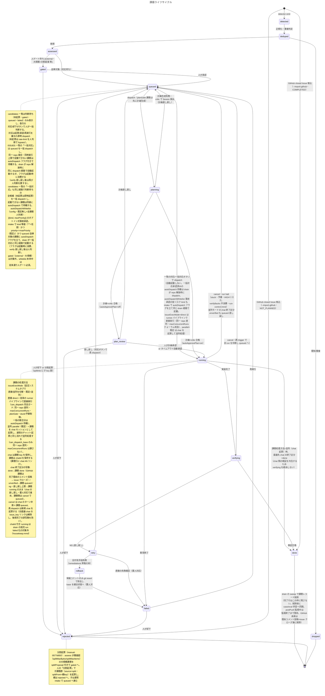

- `done` でも課題知見は残り、後続課題・proposals の入力になる
- `failed` は人の判断で `queued` に戻せる（パネル操作）
- `retry` の差し戻し回数は課題単位で記録し、上限（既定3）で `failed`
  （要人対応）。再実行は自動ループせず「処理再開」・個別「差し戻し」・
  再起動時の自動再処理で行う
- `queued` の起動は人判断のみ: 一覧の「対応」ボタン
  （`POST /api/issues/:key/dispatch`）だけが dispatch し、drain は
  queued を自動起動しない。対応しない課題は「却下」で `rejected` へ

## 4. 全体構成

<!-- diagram: architecture -->
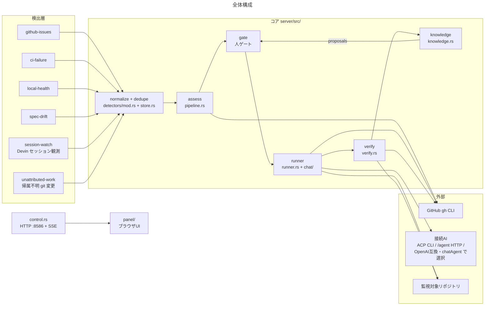

- **detectors は検出のみ**。起動・判定・重複排除には関与しない
- **control.rs はハブ**。状態の唯一の正（state store）・SSE push・パネル配信・
  スケジューラ（ポーリングタイマ）を持つ。重い処理はモジュールに分離
- **pipeline.rs がライフサイクルの state machine**。状態遷移はここだけが行う

## 5. パイプライン詳細

### 5.1 detect → normalize → dedupe

<!-- diagram: detect-pipeline -->
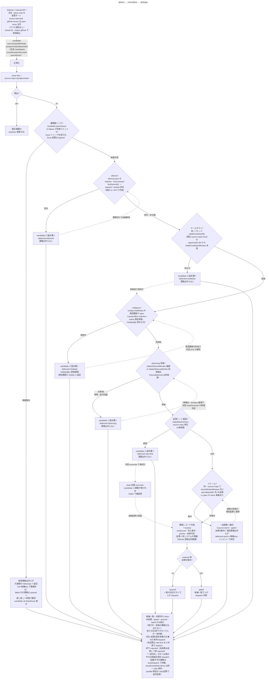

- detector は `server/src/detectors/*.rs` に置き、統一 candidate 形式を stdout/ファイルで emit
- dedupe は入口の1箇所のみ（detector 個別に持たせない）
- **silence（起票ミュート）**: `silences.json` の matcher
  （`source`/`repo`/`slug`/`kind`/`severity` の等値・未指定は任意）に合う
  candidate を `startsAt`〜`endsAt`（`endsAt` 必須）の窓内で課題化せず
  `deferred:"silenced"` で留め置く。計画作業・定期メンテ中の既知症状を
  抑える仕組みで、設定画面のシステムタブまたは
  `GET/POST /api/silences`・`POST /api/silences/remove` で作成・解除する。
  期限切れは照合対象から外れ、台帳からも自動的に除去される
- **起票クールダウン**: バケット（`intakeCooldownBy` 既定
  `["source","repo","kind"]` の等値グループ。dedupe hash とは別次元の
  「何を同一とみなすか」パラメータ）内の課題が rejected/failed へ遷移して
  から `intakeCooldownMinutes`（既定60分、0=無効）未満の再 emit は課題を
  作らず `deferred:"cooldown"` で留め置く（reject/verify NG 直後の
  once_within 抑圧）
- **verify NG 再試行の指数バックオフ**: 差し戻しで queued に戻る課題には
  `retryAfter`（`verifyBackoffMinutes` 既定5分 × 2^(verifyBacks-1)、上限
  `verifyBackoffMaxMinutes` 既定60分）を記録し、経過前の再 dispatch は
  `can_dispatch` が止める。`verifyBackLimit` 超過は failed（要人対応）
- **inhibition（課題間抑制）**: `config.inhibitRules`（Alertmanager の
  inhibit_rules 相当）。`cause` matcher に合う原因課題が open（終端以外）
  の間、`effect` matcher に合う下流候補は別課題として起票せず
  `deferred:"inhibited"`・`inhibitedBy=<原因課題key>` で留め置く。
  `match`（既定 `["repo"]`）は原因課題と候補で値が一致すべき属性。
  抑制中は原因課題の `inhibits` に候補 key を追記し、原因課題が終端へ
  落ちると次回 emit で自動解除される。候補が `inhibitedBy:<issueKey>` を
  明示する emit でも抑制できる
- **課題ストームの一括事案化**: 同一 `source`+`repo` で
  `stormWindowMinutes`（既定10分）内に `stormBatchMin`（既定5・0=無効）
  件以上の起票が集中したら、以後は個別課題を作らず1件の一括事案
  （`source:"storm"`・`status:"gated"`・自律対象外）へ候補を集約する
  （上流障害・detector 暴走のサインを1件で人レビューへ）。
  集約された候補は事案の `stormMembers` に記録され、
  `deferred:"storm:<事案key>"` で一覧に表示される。事案が終端へ
  落ちると個別起票に復帰する
- **課題の処理方法（issueExecMode）**: `issueExecMode`（設定ビューの
  システムタブ・`POST /api/control/issue-mode`。既定 `parallel`）が
  dispatch の実行形態を制御する。`parallel` は課題を委譲した chat を
  起票し通常のチャットと同じ流れで並列処理する（課題は `chatId`
  リンク付き running となり、chat 終了区分を課題へ写像:
  done→done・unverified→queued・ng/要人対応は running 継続。
  `can_dispatch_base` のみ通し、同一 repo 直列・maxConcurrentRuns は
  課さない）。`direct` は従来の runner パイプラインで直接実行し、
  `can_dispatch` 完全ガード（同一 repo 直列＋maxConcurrentRuns クォーラム）
  が効く。一括対応で起動不可の課題は引き続き autoDispatch 待機 →
  drain が repo 解放時に起動する
- **同時実行数の上限**: `maxConcurrentRuns`（既定4・0=無制限）を超える
  running|verifying の課題がある間は `can_dispatch` が dispatch を止める
  （direct モードの runner run に対する全体クォーラム。chat 委譲の
  parallel モードには適用しない）
- **observing（保留観測）**: 一過性 flap の起票を排除するため、detector
  由来の candidate は「`intakeObserveMinutes`（既定10分）継続 or
  `intakeObserveMinHits`（既定2）回再検出」を満たすまで課題化せず
  `deferred:"observing"` で留め置く。単発検出で窓内に消えた症状は課題を
  作らない。detector は emit に `count`/`durationSeconds` を載せられ、
  これが昇格判定に使われる。`observingExempt`（既定 `manual`/`derived`）
  の source と人操作（対応ボタンの強制起票）は観測せず即起票する
- **起票ストーム抑制**: `config.intakeMaxPerHour`（既定 0=無制限）を超える
  source+repo 単位の新規起票は課題を作らず candidate に `deferred:"rate-limit"`
  を付けて留め置く。drain の reconcile が窓の空いた次回以降に補起票する
  （detector 暴走時の queued 溢れ防止）
- GitHub Issue は `gh issue list` ポーリングで open issue を全件候補化
  （ラベル選別しない）。**起票＝本システムの課題（issues.json）の作成**を指し、
  GitHub Issue への登録は別機構として後続検討する
- GitHub の既存 Issue（open+closed 全件）の一括取込は
  `kasugai-agent --import-github` または `POST /api/control/import-github`。
  closed は終端課題として起票する（COMPLETED→done / NOT_PLANNED→rejected）

#### 監視系 detector（管制塔の観測網）

エージェント横断の俯瞰を担う2つの detector。どちらも観測のみで介入はせず、
検出は通常の intake 経路（observing 窓 → 候補一覧）へ乗る。

- **session-watch**: 人が Devin Desktop/CLI で直接起動したものを含む全
  Devin セッションを `%APPDATA%\Devin\cli\sessions.db` から観測し、
  live なのに `sessionWatch.stallHours`（既定12時間）活動のない停滞
  セッションを候補化する。`pollSeconds.sessionWatch`（既定300秒）

<!-- diagram: session-watch -->
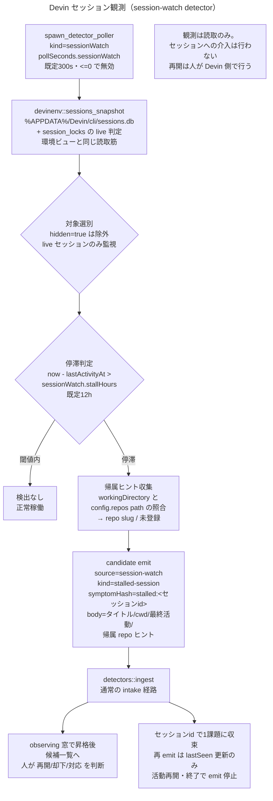

- **unattributed-work**: 登録リポジトリの git 状態を走査し、(a) 稼働中の
  セッション・chat のいずれにも帰属しない未コミット変更、
  (b) `Issue:` トレーラを持たない未 push コミットを候補化する。
  Copilot agent mode や人の手作業のようにエージェント本体を観測できない
  実行経路を、成果物から間接監視する仕組み。
  `pollSeconds.unattributedWork`（既定600秒）

<!-- diagram: unattributed-work -->
```mermaid
---
title: 帰属不明作業の検出（unattributed-work detector）
---
flowchart TD
    POLL[spawn_detector_poller<br/>kind=unattributedWork<br/>pollSeconds.unattributedWork<br/>既定600s・<=0 で無効] --> REPOS[config.repos 走査<br/>path 存在する登録 repo のみ]
    REPOS --> DIRTY[git status --porcelain<br/>未コミット変更の有無]
    REPOS --> LOG[git log @{u}..HEAD<br/>upstream がある場合のみ<br/>未 push コミット列挙]
    DIRTY --> HINT[帰属ヒント収集<br/>1. live Devin セッションで<br/>workingDirectory 一致するもの<br/>2. chats.json の busy/verify 中<br/>カレント repo の chat]
    LOG --> TRL{各コミットの<br/>Issue: トレーラ有無<br/>util::issue_trailer}
    TRL -->|トレーラ無し| UNATTR[未帰属コミット<br/>件数と先頭件名を集計]
    HINT --> EMIT1{dirty かつ<br/>帰属ヒントなし?}
    EMIT1 -->|yes| E1[candidate emit<br/>kind=uncommitted-changes<br/>symptomHash=uncommitted:<repo><br/>body=変更ファイル数・先頭数件<br/>+ wd が repo 上位の live セッションを<br/>トリアージ用ヒントとして併記]

    EMIT1 -->|帰属あり| OK1[検出なし<br/>稼働中セッションの作業]
    UNATTR --> E2[candidate emit<br/>kind=unattributed-commits<br/>symptomHash=unpushed:<repo><br/>body=件数・先頭コミット件名]
    E1 --> ING[detectors::ingest<br/>observing 窓で昇格後に起票<br/>一過性の作業中汚れは<br/>窓内解消で課題化しない]
    E2 --> ING
    ING --> DD[repo 単位で1課題に収束<br/>解消で emit 停止・再発で再検出]
    note1[Copilot agent mode 等<br/>観測APIのない実行体は<br/>成果物=git 変更から間接監視する<br/>エージェント本体は見えなくてよい]
```

### 5.2 assess

課題ごとに以下を決定する（実装時はルール + LLM 判定のハイブリッド）:

- **verifyLevel**（L0〜L4）— 全課題一律に L3/L4 を要求しない
- **受入条件** — verify の合格基準として課題に紐付ける
- **planGate** — 計画承認ゲート要否。L2 以上・爆破半径の大きい課題は
  dispatch の前に実装計画の生成・批評・承認を挟む（§5.4）
- **自律可否** — `external` ラベル・爆破半径・対象リポジトリの設定で判定
- **priority**（0〜3）— 対応順の目安。urgent/critical/security 系=3、
  ci-failure・local-health 由来や bug 系=2、既定=1、
  documentation/enhancement 系=0。一覧は状態→priority→更新時刻順に整列し、
  P2 以上をバッジ表示する
- **分割提案** — 本文が `splitMaxBytes`（既定4000）超、または
  トップレベル項目が `splitMaxItems`（既定8）超の大規模課題は
  `splitProposal` 付きで gated へ。人が「分割起票」で子課題群
  （`source=split`・`splitFrom`=親 key）へ分けると親は
  `splitInto` を記録して rejected になる（§3・manual-0577d650）
- **modelTier**（light/standard/deep）— verifyLevel と同様に課題の
  深度から実装 run のモデル帯を決める（manual-73b96b24）。
  `modelRouting.agents.<tier>` に chatAgents キーを指名すると
  その帯の実行体へ振り分ける（未設定は active 実行体）。計画生成・
  critic・diff review の単発批評は `modelRouting.criticTier`
  （既定 light）の帯を使い、実装は強力帯・批評は軽量帯でコストを
  抑える（実行予算と組み合わせるコスト管理の土台）

<!-- diagram: model-routing -->
```mermaid
---
title: モデルルーティング（深度別のモデル帯選択）
---
flowchart TD
    ISS[新規課題] --> AS[assess<br/>pipeline.rs]
    AS --> MT{rule_model_tier<br/>課題深度からモデル帯を決定<br/>modelTier で明示指定可}
    MT -->|verifyLevel&gt;=3 または<br/>priority&gt;=3 または<br/>本文&gt;=4000B| DEEP[modelTier = deep]
    MT -->|verifyLevel&lt;=1 かつ<br/>priority&lt;=1 かつ<br/>本文&lt;400B| LIGHT[modelTier = light]
    MT -->|それ以外| STD[modelTier = standard]
    DEEP --> REC[課題レコードへ記録<br/>一覧・詳細へ表示<br/>assess_preview の回帰対象]
    LIGHT --> REC
    STD --> REC
    REC --> CALL{runner の実行体呼出}
    CALL -->|実装 run<br/>start_run| TIER[課題の modelTier を解決]
    CALL -->|計画生成 / planning critic /<br/>diff review（単発批評）| CRIT[criticTier（既定 light）を解決<br/>批評系は常に軽量帯]
    TIER --> RES[resolve_agent_tier<br/>modelRouting.agents.&lt;tier&gt; に<br/>指名した chatAgents キー]
    CRIT --> RES
    RES -->|帯の agent が exe 持ち| EXE[その exe + promptArgs で<br/>spawn（-p 非対話）]
    RES -->|帯未設定・exe 無し・<br/>modelRouting 自体が無い| FB[active chatAgent へ<br/>フォールバック（従来動作）]
    EXE --> LOG[runs[].modelTier と agent exe を<br/>run 記録 / audit / trace span へ記録<br/>帯別の実行コスト母数になる]
    FB --> LOG
```

#### 5.2.1 事案（incident）集約

dedupe は完全一致の重複排除だが、複数 detector の症状が時間的・因果的に
隣接する場合は **事案（incident）** として1グループに集約する
（manual-343b5d37）。事案は `incidents.json` に記録され、課題は
`incident` フィールドで所属先を指す。

- **自動集約** — 起票された課題が既存 open 課題と関連する場合に
  グルーピングする。明示リンク（`splitFrom`）は常に同一事案へ。
  類似判定は同一 repo + `incidentWindowMinutes`（既定60分）内 +
  `cases::score` が SIMILAR_MIN 以上。相手が未所属なら新規事案を作る
- **手動 merge/unmerge** — 課題詳細の「事案へ結合」「事案から外す」
  （`POST /api/incidents/merge` / `unmerge`）。空の事案は自動削除
- **事案単位の参照・dispatch** — ISSUES 一覧は事案→課題群の2階層表示。
  事案ヘッダの dispatch は事案の queued メンバーを一括起動し、
  dispatch prompt には事案メンバー一覧が注入される

<!-- diagram: incidents -->
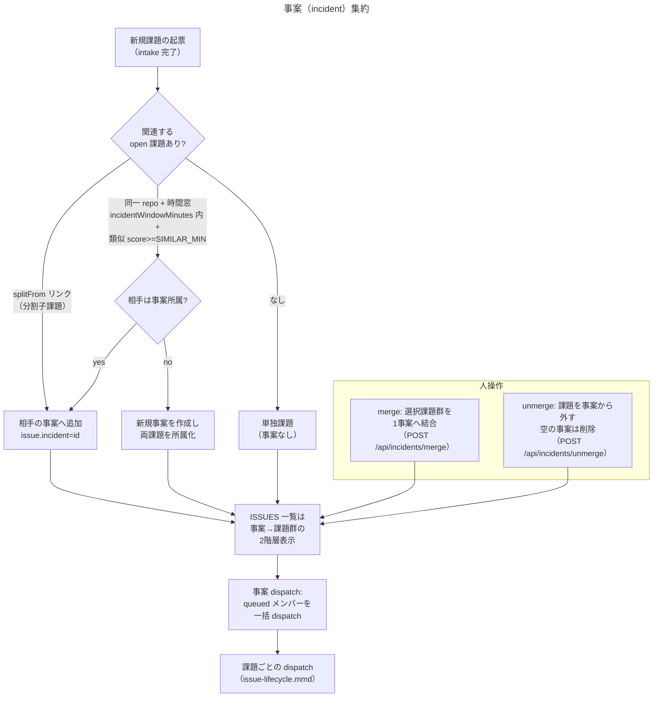

### 5.3 gate（人ゲート）

| ゲート | 条件 | 通過方法 |
|---|---|---|
| external 起票 | `external` ラベル付き Issue | パネルで人が承認 |
| 計画承認 | assess が `planGate=true` とした課題 | パネルで計画を承認（`autoApprovePlan`・`planAutoApproveMinutes` で自動承認も可） |
| proposal 採否 | 知見還流の提案全般 | パネルで人が採否 |
| push 最終判断 | 対象リポジトリの `requirePushApproval` | パネルで承認（既定は verify 合格で自動） |

匿名起票は prompt injection の入口になり得るため、external は **評価にも進まない**
（候補一覧への表示のみ）。

### 5.4 dispatch（runner）

- **dispatch は人判断のみ**: queued 課題の起動は ISSUES 一覧の「対応」
  ボタン（`POST /api/issues/:key/dispatch`）だけが行う。drain は起票
  reconcile・中断した verifying の再開・孤児 running の failed 化のみを
  担い、queued を自動起動しない
- runner は `chat/`（接続AI 実行体）が担う。既定実装は ACP 対応 CLI（devin・copilot 等）を spawn する汎用ドライバで、
  駆動する非対話セッション（`chat/acp.rs`）
- **起動可否は論理競合ベース**:
  同一リポジトリの未完了 run、排他ロック中の実機リソースがある課題は待機
- **課題キー単位の並行制御（manual-5dabae8b）**: 同一課題の run は常に1つ。
  running|verifying の課題への再 dispatch / `cancel` は in-flight run の
  `RunCtl.cancel` を立てて旧 run を中断（child kill）し `queued` へ戻してから
  起動する。人の「中断」ボタンも同じ経路で `queued` へ戻す
  （verifyBacks は消費しない）
- **課題あたりの run サイクル上限（manual-175e7229）**: `runCycleCap`
  （既定3・0=無制限）を `runs` 累計で判定し、超過は `can_dispatch` が
  Err（人へのエスカレーション）。`POST /api/issues/:key/extend` で
  `cycleCapExtend` を引き上げて再 dispatch する。verify NG の
  review↔fix 自動反復は `allowAutoLoop`（既定 OFF）の包括許可トグル
  —— ON の間だけ drain が verify NG 差し戻しの queued を自動 dispatch
  する（runCycleCap・retryAfter の制約はそのまま効く）
- **課題単位の実行予算（manual-94172864）**: assess が `issue.budget`
  `{maxSteps, maxWallMinutes, maxCostUsd}` を設定する
  （config 既定: `budgetMaxSteps`/`budgetMaxWallMinutes`/
  `budgetMaxCostUsd`。0=その上限は無効）。maxSteps は出力行数、
  maxWallMinutes は run 単位の壁時計、maxCostUsd は課題の累積費用で判定。
  上限到達は失敗ではなく run を halt して `budgetHold` を記録し
  `queued` へ戻す（LimitsExceeded を trajectory 終了理由に記録）。
  「上限延長」ボタン（POST extend）で `budgetExtend` を加算して再 dispatch
- **steering チャネル（manual-4929fc13）**: 実行中 run への方針修正入力
  （`POST /api/issues/:key/steer {text}`）。in-flight run の child stdin
  へ best-effort で注入し、常に `followUps`（kind=steer）にも記録して
  次回 dispatch prompt の「フォローアップ入力」へ入れる
- **action レベルのリスク確認（manual-cf669d09）**: verifyLevel とは別軸で、
  実行体の出力行をリスク分類（risk.rs。外部通信・ファイル削除・設定変更等。
  `riskHighPatterns` で HIGH パターン追加可）。HIGH 検出は `riskConfirm`
  （既定 on）なら run を halt して `riskHold` で人確認を要求する。
  「許可」は `riskAllowed` に記録して即 dispatch、「拒否 {reason}」は
  `riskRejected` に記録して queued で待機し、次回 prompt に却下理由を
  注入して別アプローチを促す
- **失敗 run の部分成果保全（manual-7df2ce2f）**: halt・failed 時に
  未コミット＋未push の作業を `kasugai/partial-*` branch へ保全 push
  （`git stash create` で worktree を触らずコミット化）し、詰まった点を
  `lastBlocker` に記録する。次回 dispatch prompt へ注入される
  （`partialPreserve=off` で無効化）
- **Stuck Detector（manual-1a459b0c）**: 実行体の出力行から非生産
  パターンを検出（stuck.rs。同一行4回・同一 error 行3回・同一行3連続の
  独白相当・2パターン交互6行・context window error 連続）して run を
  halt し `lastStuck` に構造化記録する。queued 差し戻し後の再 dispatch で
  前回のスタック情報を prompt へ注入する（`stuckDetect=off` で無効化）
- **計画承認ゲート（planGate）**: `planGate=true` の課題は dispatch で
  実装に入らず、先ず `planning` で実装計画のみを生成する（コード変更・
  コミットは行わない）。続けて独立コンテキストの Planning Critic が
  計画を批評し、severity+confidence 付き findings を返す。Severe かつ
  `planCriticMinConfidence`（既定0.7）以上の指摘があれば queued へ
  差し戻す。critic 合格は `plan_review` で人の承認を待ち、承認で
  `running` へ（`autoApprovePlan` かつ critic 合格なら即 running、
  `planAutoApproveMinutes` で承認待ちのタイムアウト自動承認）。
  `config.planGate=false` で機能全体を無効化できる
- セッションには課題・受入条件・知見をプロンプトとして注入
- **runbook（kind 別対処手順）**: `prompts/runbook/` に
  `<source>-<kind>.md` → `<kind>.md` → `<source>.md` の順で手順テンプレを
  探し、見つかれば「対処手順」として dispatch prompt に注入する。
  kind の粒度は learn の SKILL draft（slug=source+repo+kind）と共通で、
  runbook が事前知識・SKILL が学習蓄積の対になる
- 成果物は MAIN 運用（既定ブランチで実装 → ローカルコミット → `AI:impl-done`）

<!-- diagram: runbook -->
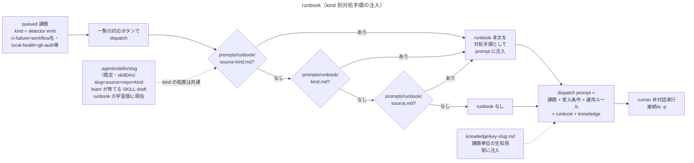

- **intake スナップショット**: 課題レコード作成時に `intakeSnapshot`
  （`{title, body, at}`）を freeze する。dispatch prompt の課題本文は
  起票時点のスナップショットを使い、起票後の追記（ci-failure 親課題
  リンク・`POST /api/issues/:key/followup`）は `followUps[]` に記録して
  run 中の課題には混入させない。未消費の followUps は次回 run の
  prompt に「フォローアップ入力」として別節で注入し、spawn 成功時に
  consumed 化する（Copilot coding agent の「assign 時点のコンテキストのみ
  見える」モデルに相当）

<!-- diagram: intake-snapshot -->
```mermaid
---
title: intake コンテキストのスナップショット
---
flowchart TD
    FILE[課題レコード作成<br/>detect-pipeline.mmd NEW] --> SNAP[intakeSnapshot を freeze<br/>{title, body, at}<br/>起票時点の課題コンテキスト]
    SNAP --> QUEUE[queued → dispatch]
    QUEUE --> PROMPT[dispatch prompt 組立<br/>runner.build_prompt]
    PROMPT --> USE[課題本文は intakeSnapshot<br/>を使う（live 本文ではない）<br/>+ 未消費 followUps を<br/>「フォローアップ入力」として別節注入]
    USE --> RUN[runner 非対話実行]
    RUN --> CONSUME[spawn 成功時に<br/>followUps を consumed<br/>（run 中は新規追記を見せない）]

    LATER[起票後の追記<br/>ci-failure 親課題リンク /<br/>POST /api/issues/:key/followup] --> FU[followUps[] へ追記<br/>{at, kind, text, ref, consumedAt}<br/>ref 同一は重複追記しない]
    FU -.->|次回 run の prompt で<br/>未消費分だけ見せる| USE
    FU -.->|run 中の課題には<br/>混入しない| PROMPT
```

- **AST 単位の構造的コンテキスト（codemap・manual-38bbe09e）**:
  dispatch prompt 組立時に `codemap::context_section` が課題本文の
  トークンと repo の構造単位（関数・impl・class 等の行範囲）を照合し、
  関連単位のスニペットを「関連コード構造（AST 単位）」として注入する。
  外部パーサは持たず言語別の軽量パターンで単位を抽出する（依存ゼロ）。
  `codeMap.enabled=false` で無効化、`codeMap.maxUnits`（既定12）・
  `maxBytes`（既定9000）・`maxFiles`・`maxFileBytes` で注入量を制御する

<!-- diagram: codemap -->
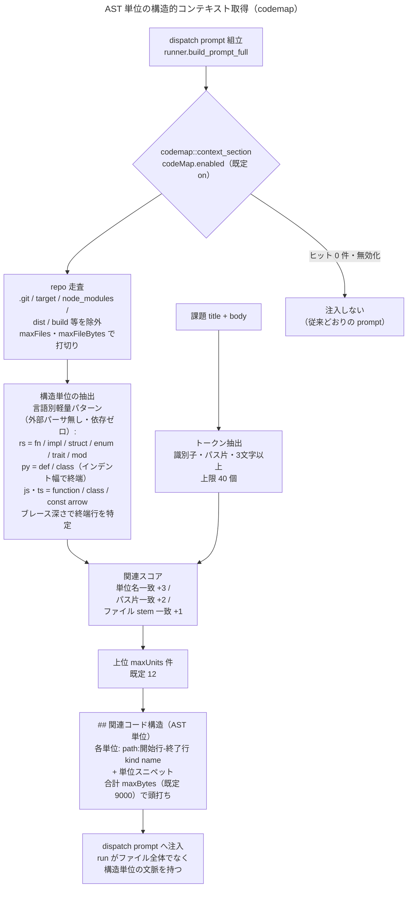

#### 5.4.1 run 制御・安全（監視・予算・steering・リスク・cancel・保全・ループcap）

run 実行中の監視・停止・人確認・保全の判断フロー。runner は child proc の
stdout/stderr を行単位で監視し、stuck・実行予算・リスク分類のいずれかが
発火したら `RunCtl.cancel` で run を halt して `queued` へ戻す。
halt は verify NG ではないため `verifyBacks` を消費せず、再 dispatch は
一覧の「対応」ボタンまたは上限延長（extend）で行う。

<!-- diagram: run-control -->
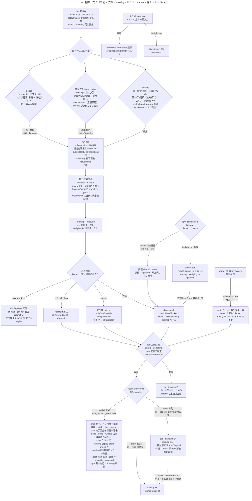

### 5.5 verify（L0〜L4）

| 層 | 内容 | 例 |
|---|---|---|
| L0 | 静的チェック | 構文・lint・差分の存在 |
| L1 | 単体動作 | テスト・ビルド・起動確認 |
| L2 | 実機実行 | 対象EXE自体（QGIS等の成果物バイナリ）を実機で起動し応答確認 |
| L3 | 画面駆動 | Playwright等でUI操作・スクリーンショット証跡 |
| L4 | 主旨照合 | Issue の意図と結果の突き合わせ |

L2 以上の verify は **実機検証を前提とする**: 成果物のEXE自体を実環境で起動し、
Playwright 等で画面・応答を駆動確認する。「実装の確認」とはコードやビルドの
成否ではなく、実機で動く成果物として期待どおりに振る舞うことの確認をいう。

<!-- diagram: verify-levels -->
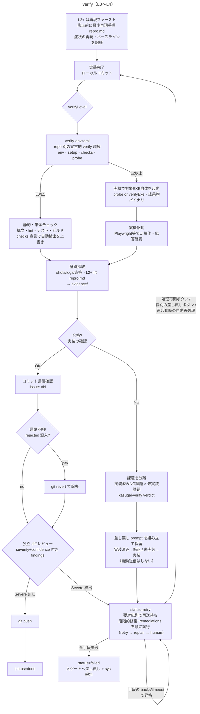

- **push は verify だけが行う**。検証を通っていないコミットは公開しない
- 未pushコミットの帰属は `Issue: #N` トレーラで判定。帰属不明・closed・
  `devin:rejected` の混入は `git revert` で除去（`git reset` は禁止）
- **独立 diff レビュー（diffReview）**: 帰属整理後・push 前に、生成系と
  独立したコンテキスト（別呼出し）で未push差分を批評する。findings は
  severity+confidence 付きで、Severe かつ `diffReviewMinConfidence`
  （既定0.7）以上の指摘があれば push せず verify NG と同じ差し戻し経路へ
  送る。`config.diffReview=false` で無効化できる
- **再現ファースト検証（reproFirst）**: L2+ 課題は実装着手前に症状を
  再現する最小手順とベースライン結果を `evidence/<key>/repro.md` に
  記録し、修正後は非再現となった結果を追記する標形にする
  （「再現成功→修正→非再現」の証跡）。repro.md が無い L2+ は verify NG。
  `config.reproFirst=false` で無効化できる
- **段階的修復（remediations）**: verify NG の差し戻しは
  `config.remediations`（対処手段の順序リスト）を軽い手段から順に試す。
  各手段は `{name, backs, timeoutMinutes?}` — 手段内の NG が `backs` 回を
  超えるか `timeoutMinutes` が経過すると次の重い手段へ昇格する
  （`retry` = 同手順の再試行、`replan` = 計画を破棄して planGate 経由で
  計画からやり直し、`human` = failed で人ゲートへ差し戻し）。
  未指定時は `[retry(verifyBackLimit), human]` で従来動作と同じ
- **自動クリーン復帰（rollback）**: 全対処手段が失敗して verify NG が
  確定した課題は `rollback` 状態を経由し、その課題に帰属する
  （`Issue: <key>` トレーラ付き）未pushコミットだけを `git revert` で
  除去してから `failed` へ送る。`git reset` は使わない
  （他課題コミットを破壊する規約違反）。push 前の帰属整理と同じ規律を
  run 打ち切り時にも適用し、base を健全状態へ戻す
- **repo 別 verify 環境（verify-env.toml）**: 各 repo ルートの
  `verify-env.toml` で verify 環境を宣言的に記述する
  （copilot-setup-steps.yml / Devin snapshot 相当）。`[env]` = 全コマンドへ
  注入する環境変数、`setup` = verify 前のセットアップコマンド列（失敗で
  verify NG）、`checks` = L1 チェック（非空なら自動検出を上書き）、
  `[probe]` = L2+ の実機起動定義（exe/args/port/timeoutSecs。config の
  verifyExe 等より優先）。宣言内容は run prompt にも注入される
- 実機リソース（QGIS harness・固定ポート等）は `locks` で排他利用
- 証跡は課題キー単位で `evidence/` に保存し、Issue コメントに添付/リンク

#### 5.5.1 push 後フォローアップループ（manual-55878990）

push 済み課題に `postPush` サブ状態（`{state, sha, branch, since, checks,
repairs, reason}`）を持たせ、`postpush.rs` が
`pollSeconds.postPush`（既定300s）で監視する（`postPushWatch=false` で
無効化）。検出は source=`post-push` の修復課題として起票し、課題詳細の
`postPush` カードに状態・pause 理由・修復課題を表示する。
監視する信号は push した sha/branch に紐付く3種:

- **CI 失敗** — `gh run list --commit <sha>` の failure run（実行中は
  `waiting` 状態として完了を待つ）
- **レビュー指摘** — その branch の open PR の CHANGES_REQUESTED
  レビュー、および sha へのコミットコメント
- **マージコンフリクト** — その branch の open PR で
  `mergeable=CONFLICTING`

修復課題の起票は `repairs[]` に記録され、`postPushMaxRepairs`（既定3）
到達または修復課題の failed/rejected で `paused` へ（理由を `reason`
に記録）。paused/checking からは課題詳細のボタンで
`postpush-resume` / `postpush-pause`（人操作）。監視窓
`postPushWatchMinutes`（既定120分）を無検出で越えるか修復課題が全て
done で `done`。修復課題は自身の push で別の postPush ループを持つ

<!-- diagram: postpush-loop -->
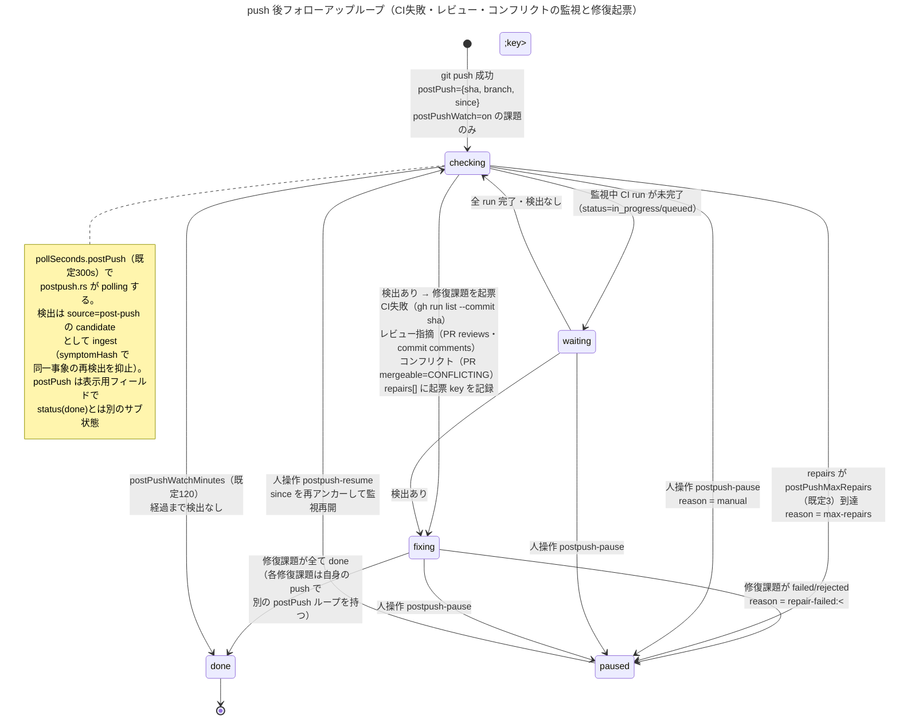

### 5.6 learn（知見の還流）

<!-- diagram: learn-flow -->
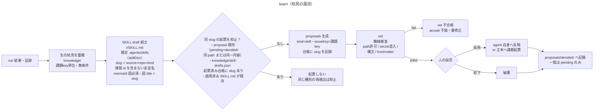

- 生の知見は課題 key 単位で `knowledge/` に無条件蓄積。SKILL draft
  （mermaid 図必須・図 title = slug）は `.agents/skills/<slug>/`（`config.skillDirs` で変更・複数配置可）へ起票し、
  **反映は必ず proposals 経由の人ゲート**
- skill 名（slug）は `source+repo+kind` の安定名（run id 等の揮発 id を
  含まない）。同じ種別の課題は同じ skill 名に収束し、同 slug の proposal
  が pending/decided にあれば再起票しない
- **vet（機械検査）**: proposals は登録時・採否時に静的検査される
  （path 許可範囲 / secret 混入 / JSON・frontmatter 構文）。
  vet 不合格は accept 不能（server/src/proposals.rs）。採否そのものは人が行う
- リポジトリ正本（skills ディレクトリ・AGENTS.md）への反映は新規課題として起票し、
  通常パイプで対応する

### 5.7 知見の参照ループ（蓄積 → 類似事例 → レッスン → 評価）

蓄積した知見は参照されて初めてループが閉じる。参照側はすべて決定的
（非 LLM）ロジックで、context collapse・プロンプト肥大を防ぐ。

<!-- diagram: case-search -->
```mermaid
---
title: 類似事例検索（CBR）と assess/run への知見参照
---
flowchart TD
    ISS[新規課題<br/>source/repo/kind/<br/>symptomHash/title] --> AS[assess<br/>pipeline.rs]
    AS --> SC[類似度スコア<br/>cases.rs・決定的・非LLM<br/>repo一致40 + kind一致20 +<br/>symptomHash一致20 +<br/>title bigram Jaccard20]
    CASES[(knowledge/cases.json<br/>終端課題の case:<br/>kind/repo/symptomHash/<br/>採用アプローチ/結果/verifyLevel)] --> SC
    ISSUES[(issues.json<br/>全課題)] --> CASES
    ISSUES --> SC
    SC --> REL[issue.related<br/>類似事例 top N・score>=50<br/>前回の fix / reject /<br/>run 成否]
    REL --> VL{成功 case と<br/>score>=70 で一致?}
    VL -->|yes| ADOPT[verifyLevel を成功 case の<br/>値に合わせ<br/>verifyLevelBasis を記録]
    VL -->|no| RULE[ルール判定のまま]
    ADOPT --> DISP
    RULE --> DISP
    REL --> DISP[dispatch prompt<br/>runner.build_prompt]
    DISP --> SEC[## 類似過去事例<br/>status・verifyLevel・title・<br/>knowledge/slug.md 抜粋・<br/>成功 case の採用アプローチ<br/>（few-shot）]
    KN[knowledge/key-slug.md<br/>課題単位の生知見] --> SEC
    SEC --> RUN[run 実行<br/>接続AI -p]
    RUN --> REC[runs[].knowledgeRefs に<br/>参照した knowledge/cases/<br/>lessons を記録<br/>（どの知見を使ったか追跡可）]
    RUN --> OUT{run 結果}
    OUT -->|done/failed/rejected| TERM[終端課題]
    TERM -->|learn_pass が<br/>case 化| CASES
```

- **類似度スコア**（`server/src/cases.rs`）: repo 一致・kind 一致・
  symptomHash 一致・title の bigram Jaccard を重み付けした決定的スコア
  （埋め込み基盤なし）。score≥50 を「類似」として top N を選ぶ
- **assess 時の知見参照**: 新規課題に `related[]`（類似事例 top N:
  前回の fix / reject / run 成否）を付記し、dispatch prompt の
  「類似過去事例」節へ注入する。参照した知見は `runs[].knowledgeRefs`
  に記録され、どの知見を使ったか追跡できる
- **case 化（CBR）**: 終端課題は `knowledge/cases.json` へ case
  （kind/repo/symptomHash/採用アプローチ/結果/verifyLevel）として蓄積。
  高一致の成功 case があれば verifyLevel をその値に合わせ
  （`verifyLevelBasis` に出典を記録）、採用アプローチは run prompt の
  few-shot に転用する

<!-- diagram: lesson-loop -->
```mermaid
---
title: 失敗レッスンループ（Reflexion 型リトライ + ACE カウンタ）
---
flowchart TD
    NG[verify NG / run failed] --> GEN[レッスン生成<br/>lessons.rs・決定的<br/>何が・なぜ失敗したか<br/>出典 run idx + 根拠<br/>verifyNote/error + 確度メタ]
    GEN --> PB[(knowledge/lessons.json<br/>ACE 型 playbook<br/>id + helpful/harmful +<br/>text + basis + confidence)]
    DISP[dispatch 時<br/>runner.build_prompt] --> SEL[注入選定・決定的非LLM<br/>同一課題の直近 1-3 件 +<br/>類似課題のレッスン上位 N 件<br/>harmful>=lessonHarmLimit は除外]
    PB --> SEL
    SEL --> PR[## 失敗レッスン<br/>「id helpful=X harmful=Y :: text」]
    PR --> RUN[run 実行<br/>接続AI -p]
    RUN --> REF[runs[].knowledgeRefs.lessons<br/>注入したレッスン id を記録]
    RUN --> OUT{run 結果}
    OUT -->|done| HELP[注入レッスンへ<br/>helpful 加算]
    OUT -->|verify NG / failed| HARM[注入レッスンへ<br/>harmful 加算]
    HELP --> PB
    HARM --> PB
    HARM --> LIM{harmful >=<br/>lessonHarmLimit?}
    LIM -->|no| PB
    LIM -->|yes| EXC[excluded=true<br/>注入対象から自動除外<br/>誤教訓による汚染を防ぐ]
    EXC --> PROP[削除 proposal 起票<br/>lessons.json から当該<br/>レッスンを除く版]
    PROP --> HG{人の採否}
    HG -->|採用| DEL[レッスン削除]
    HG -->|却下| KEEP[除外状態のまま保持]
```

- **失敗レッスン（Reflexion 型リトライ）**（`server/src/lessons.rs`）:
  verify NG / run failed のたびに「何が・なぜ失敗したか」の短いレッスンを
  決定的に生成し、出典（run idx・根拠・証跡 dir・確度メタ）を付けて
  `knowledge/lessons.json` へ蓄積。dispatch prompt には同一課題の直近
  1-3 件 + 類似課題の上位 N 件を注入し、注入分は
  `runs[].knowledgeRefs.lessons` に記録する
- **ACE 型カウンタ**: レッスンは id + helpful/harmful を持ち、注入後 run
  の成否で更新。harmful が `lessonHarmLimit`（既定2）に達したレッスンは
  注入対象から自動除外し、削除 proposal を起票（台帳汚染を止める）

<!-- diagram: consolidation -->
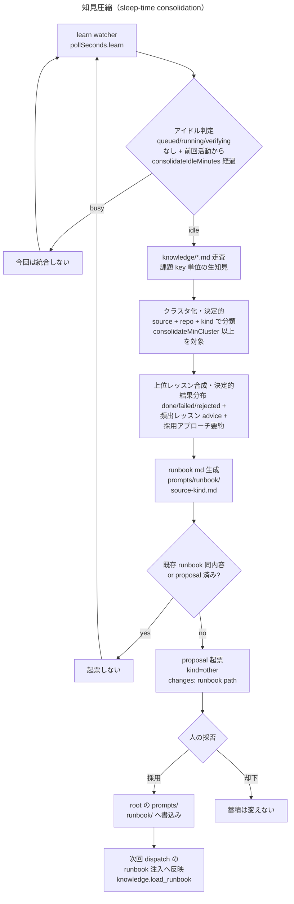

- **sleep-time consolidation**（`server/src/consolidate.rs`）: 実行系が
  アイドル（活動課題なし・`consolidateIdleMinutes` 経過）のときだけ、
  `knowledge/` の課題知見を source+kind でクラスタ化し、
  `consolidateMinCluster`（既定3）以上のクラスタから上位レッスン
  （傾向・既知の失敗パターン・成功アプローチ）を合成して
  `prompts/runbook/<source>-<kind>.md` の proposal を起票。
  出力は常に proposals 経由で人が採否し、採用時に既存の runbook 注入
  へ反映される

<!-- diagram: eval-set -->
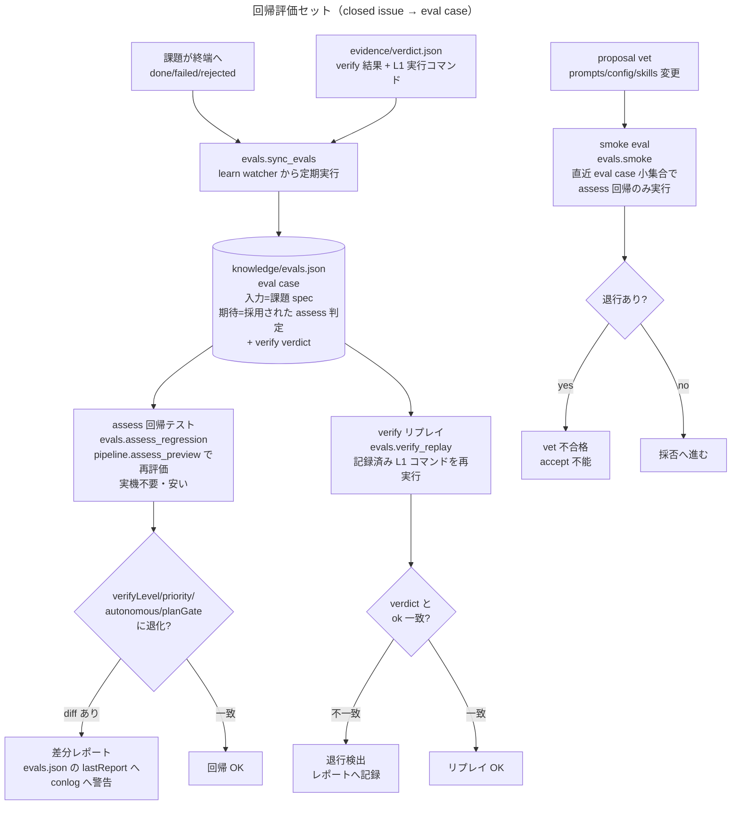

- **eval セット**（`server/src/evals.rs`）: 終端課題を `knowledge/evals.json`
  へ eval case（入力=課題 spec、期待=採用された assess 判定 +
  `evidence/verdict.json` の verify verdict）として蓄積。learn watcher が
  **assess 回帰**（`assess_preview` で再評価し判定退化を検出、実機不要）を
  定期実行して `knowledge/eval-report.json` へ残し、**verify リプレイ**
  （記録済み L1 コマンドの再実行、L0-L2 のみ）はアイドル時・1時間間隔で
  少量だけ回す。prompts/config/skills 系の変更 proposal には vet の
  `eval-smoke` 検査（直近 case の assess 回帰）が付き、退行があれば
  accept 不能になる

### 5.8 run の観測記録（trajectory）

run の証跡（`evidence/` の run.log・verify.log）は結果の証拠だが、
それとは別に **run の全過程**を trajectory として構造化記録する
（SWE-agent の `.traj` 参考）。失敗分析・SKILL draft 生成の原料になる。

<!-- diagram: observability -->
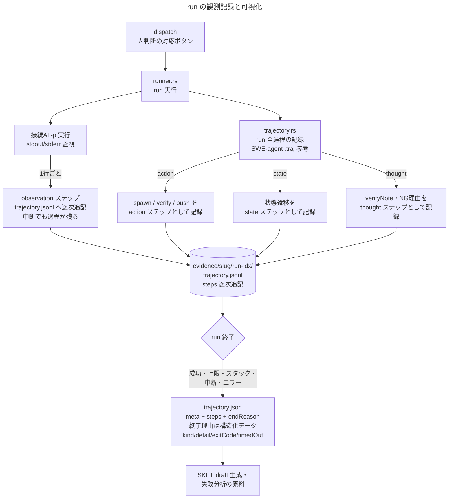

- 記録先は run 単位の artifact ディレクトリ `evidence/<slug>/run-<idx>/`。
  steps は `trajectory.jsonl` へ1行1ステップで逐次追記し
  （thought/action/observation/state の4種）、run 終了時に
  `trajectory.json` へ meta + steps + `endReason` をまとめて書き出す。
  逐次追記のため control 再起動などで中断しても過程が残る
- ステップの内訳: `action`=spawn・verify・push の実行、`observation`=実行体
  出力（stdout/stderr 1行ごと）、`state`=課題の状態遷移、
  `thought`=verifyNote・NG理由等の判定根拠
- **終了理由（endReason）の構造化**: `kind`（success / verify_ng / limit /
  stuck / aborted / error）+ `detail` + `exitCode` + `timedOut`。
  verify NG の差し戻しは `verify_ng`、差し戻し上限・タイムアウトは `limit`、
  control 再起動で追跡を失った孤児 run は drain が `aborted` を補記する

### 5.9 構造化トレース span とウォーターフォール

trajectory が「全過程の逐語記録」なら、trace は run の**構造化 span**
（OpenTelemetry GenAI semantic conventions / OpenInference 参考）。
run の各段階（plan→exec→verify→push）を span として
`evidence/<slug>/run-<idx>/trace.jsonl` へ1行1spanで追記し、
パネルの ISSUES 詳細にウォーターフォール表示する。

<!-- diagram: trace-waterfall -->
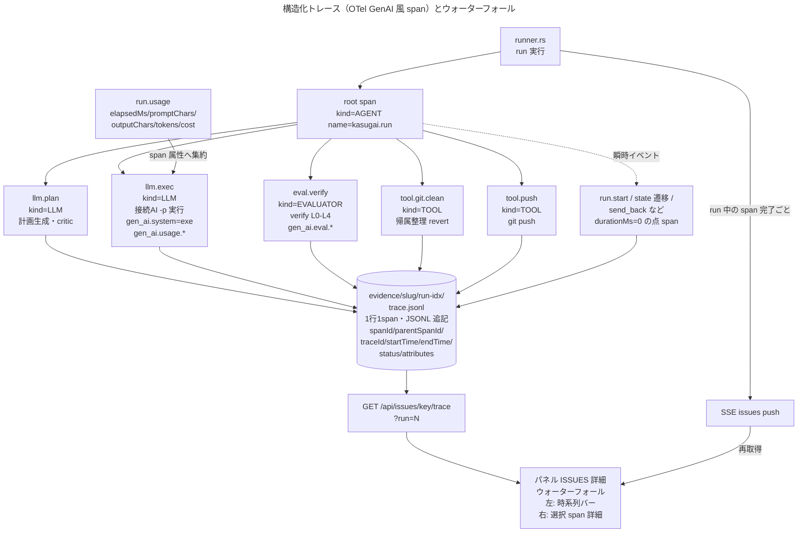

- span は `{traceId, spanId, parentSpanId, name, kind, startTime, endTime,
  durationMs, status:{code,message}, attributes}`。kind は OTel GenAI 風の
  `AGENT`（run 全体）/`LLM`（計画・実行体呼出）/`EVALUATOR`（verify）/
  `TOOL`（git clean・push）。瞬時イベントは `durationMs=0` の点 span
- `gen_ai.*` 属性: `gen_ai.system`=実行体 exe、`gen_ai.usage.*`=トークン/
  費用（対応実行体のみ）、`gen_ai.eval.*`=verify level・結果
- API は `GET /api/issues/{key}/trace?run=N`。SSE の `issues` push で
  パネルが再取得し、実行中のウォーターフォールがリアルタイムに伸長する

### 5.10 監査タイムライン（誰が・何を・根拠）

証跡 `evidence/` の成果物ログとは別に、**行動の記録**を課題単位の時系列
タイムラインとして保持する（Azure SRE Agent の action log /
PagerDuty incident timeline 参考）。人の操作（dispatch・reject・approve・
push-approve・plan-approve・followup）とシステム動作（run 開始・exec・
verify・差し戻し・push・done/failed）を同じ系列に記録する。

<!-- diagram: audit-timeline -->
```mermaid
---
title: run 単位の構造化監査タイムライン
---
flowchart TD
    H[人の操作<br/>control.rs API] -->|dispatch / reject /<br/>approve / push-approve /<br/>plan-approve / followup| EV[audit.rs<br/>record 追記]
    S[システム動作<br/>runner.rs] -->|run.start / exec / verify /<br/>send_back / push / done / failed| EV
    EV --> AJ[(evidence/slug/audit.jsonl<br/>課題単位・1行1イベント<br/>at/actor=human|system/action/<br/>run/result/detail)]
    AJ --> API[GET /api/issues/key/audit]
    API --> TL[パネル ISSUES 詳細<br/>監査タイムライン<br/>誰が・何を・根拠・<br/>verify 結果・push 有無]
    SSE[SSE issues push] -->|再取得| TL
    subgraph DETAIL[detail の例]
        D1[ dispatch: actor=human<br/>起票兼承認の即時起動]
        D2[ exec: exe + args<br/>何を実行したか]
        D3[ verify: level + ok + note<br/>根拠]
        D4[ push: ok/fail・pushedAt]
    end
```

- 記録先は `evidence/<slug>/audit.jsonl`（課題単位・1行1イベント）。
  イベントは `{at, actor(human|system), action, run, result, detail}`。
  `detail` には実行内容（exe+args）・根拠（verifyNote・critic 結果）・
  verify 結果・push 有無を構造化して持たせる
- API は `GET /api/issues/{key}/audit`。ISSUES 詳細に時系列で表示し、
  SSE push で即時更新される

### 5.11 run コスト可視化（トークン/費用/経過時間）

Devin Session Insights 参考に、run ごとのトークン量・費用・経過時間を
`runs[].usage` へ記録してパネルに表示する。verifyLevel ごとのコスト
分布が見えることで assess の深度決定を改善できる。

<!-- diagram: run-cost -->
```mermaid
---
title: run コスト記録（トークン/費用/経過時間）
---
flowchart TD
    RUN[runner.rs run 実行] --> CAP[出力バッファ<br/>stdout/stderr 監視]
    RUN --> T0[startedAt]
    RUN --> T1[endedAt]
    CAP --> PARSE[usage 抽出<br/>末尾JSON行の usage/<br/>total_cost_usd を検出<br/>対応実行体のみ]
    T0 & T1 --> USG[runs[].usage<br/>elapsedMs/promptChars/<br/>outputChars/outputLines]
    PARSE -->|あれば| USG
    USG --> ISS[issues.json<br/>GET /api/issues 応答に含む]
    ISS --> LIST[パネル ISSUES 一覧行<br/>Σ経過時間・費用]
    ISS --> CARD[ISSUES 詳細 runs カード<br/>run ごとの経過時間/<br/>トークン/費用]
    USG --> SPAN[trace span 属性<br/>gen_ai.usage.*]
    USG --> MET[/api/metrics<br/>KPI のコスト集計/]
```

- `runs[].usage` = `{elapsedMs, promptChars, outputChars, outputLines,
  tokens?, cost?}`。経過時間・入出力文字数は全実行体で記録、
  トークン/費用は出力末尾の JSON 行（`usage`・`total_cost_usd` 等）を
  検出できた実行体のみ。同じ値が trace span の `gen_ai.usage.*` と
  /api/metrics のコスト集計にも流れる
- パネルは ISSUES 一覧行に Σ経過時間・費用、ISSUES 詳細の runs
  カードに run ごとの内訳を表示する（issues API 応答に含まれるため
  SSE push で自動更新）

### 5.12 KPI ダッシュボード（成功率・MTTR・verify NG 率）

AgentOps / Weave leaderboard・SRE 式 SLI 参考に、課題/run データから
KPI を決定的に算出して `GET /api/metrics` で返し、パネルの
メトリクス画面（nav メトリクス）に表示する。**成功は verify 通過・
push 済みで厳密化**（エージェント自己申告に依らない）。

<!-- diagram: metrics -->
```mermaid
---
title: KPI ダッシュボード（/api/metrics）
---
flowchart TD
    ISSUES[(issues.json<br/>runs/verifyBacks/<br/>pushedAt/usage/<br/>symptomHash)] --> M[metrics.rs<br/>KPI 算出・決定的]
    M --> SR[成功率<br/>done/dispatch 済<br/>push 済みのみ成功]
    M --> MTTR[MTTR<br/>detectedAt→pushedAt]
    M --> NG[verify NG 率<br/>verifyBacks>0 の割合<br/>verifyLevel 別]
    M --> RET[リトライ分布<br/>verifyBacks ヒストグラム]
    M --> COST[コスト<br/>ΣelapsedMs/tokens/cost]
    M --> REJ[却下・external 率]
    M --> BR[kind/repo 別内訳<br/>成功率・件数]
    M --> REC[同一症状再発率<br/>symptomHash 重複]
    SR & MTTR & NG & RET & COST & REJ & BR & REC --> API[GET /api/metrics]
    API --> DASH[パネル メトリクス画面<br/>nav-metrics ボタン<br/>KPI カード + 内訳表]
    SSE[SSE issues push] -->|再取得| DASH
```

- 算出項目: 成功率（push 済/dispatch 済）、MTTR（detectedAt→pushedAt）、
  verify NG 率（全体 + verifyLevel 別）、リトライ分布（verifyBacks
  ヒストグラム）、課題当たり token/コスト、却下・external 率、
  kind/repo 別内訳、同一症状再発率（symptomHash 重複率）
- 集計は全課題（repo 絞込はパネル側）。SSE の `issues` push で
  メトリクス画面も再取得される

## 6. 状態とファイル

| ファイル | 内容 | Git 管理 |
|---|---|---|
| `config.json` | 監視リポジトリ・ポート・ゲート設定・接続AI（`chatAgents`/`chatAgent`） | 追跡（example から複製） |
| `state.json` | ループ全体の稼働状態 | 対象外 |
| `issues.json` | 課題レコード（status・verifyLevel・retry 回数） | 対象外 |
| `candidates.json` | 未評価の候補一覧 | 対象外 |
| `silences.json` | 起票ミュート（matcher+期限の silence 一覧） | 対象外 |
| `incidents.json` | 事案（incident）レコード（members=課題 key 群） | 対象外 |
| `work-queue.json` | 実行待ちキュー | 対象外 |
| `knowledge/` | 課題単位の知見 | 対象外 |
| `proposals/` | 人ゲート待ちの提案 | 対象外 |
| `evidence/` | 検証証跡（shots・ログ・応答） | 対象外 |
| `locks/` | リソースロックファイル | 対象外 |
| `chat-snapshots/` | chat が変更したファイルの turn 単位変更前スナップショット | 対象外 |
| `assets/` | CDN から適用したアセット（panel/docs のオーバーレイ・state.json） | 対象外 |
| `logs/` | 稼働ログ | 対象外 |
| `secrets.json` | API キー等 | **対象外・唯一の保管場所** |

- 状態を変更したら SSE で即時 push（常時ポーリングしない）
- 表示用フィールドを追加したら API 応答にも必ず含める

## 7. API / パネル

`control.rs` が `:8586` で提供（loopback のみ）。

- `GET /api/state` — 全体状態 / `GET /api/issues` / `GET /api/candidates`
- `GET /api/agents` / `GET /api/skills` — registry が収集した doc 一覧。
  `?repo=<slug>` で対象リポジトリの path + global 配置に絞り込む（省略時は全リポジトリ）。
  ただし `/api/skills` は global 配置の skill を一覧から除外する
  （収集・doc 本文/参照解決の対象ではある）
- `GET /api/doc?path=` — doc 本文（registry 収集済み + 参照解決済みパスのみ返す）
- `GET /api/refs?path=` — 収集済み doc が本文中で参照するファイル一覧
  （`path` は収集済み doc のみ。glob・ディレクトリ参照は実ファイルへ展開し、
  秘匿系は `denied` として返すが本文は返さない）
- `POST /api/issues/:key/dispatch` / `POST /api/issues/:key/approve` / `reject`
- `POST /api/issues/:key/cancel` — 実行中 run の中断（running|verifying →
  queued。同一 key の再 dispatch も同じ経路で旧 run を止める。run-control.mmd）
- `POST /api/issues/:key/steer` — `{text}` を実行中 run の stdin へ
  best-effort 注入 + followUps（kind=steer）へ記録（次回 prompt 注入）
- `POST /api/issues/:key/extend` — `{cycles?,steps?,wallMinutes?,costUsd?}` で
  runCycleCap・issue.budget の上限を延長して再 dispatch
  （省略時は config の extend* 既定増分）
- `POST /api/issues/:key/risk-ack` — `{decision:"allow"|"deny", reason?}` で
  `riskHold` の HIGH リスク行動を許可（riskAllowed 記録→即 dispatch）/
  拒否（riskRejected 記録→queued で別アプローチ待ち）
- `GET /api/proposals` / `POST /api/proposals/:id/accept|decline`
- `GET /api/repos` — repos 一覧。`config.repos` 登録済みに加え、ワークスペース
  （control の ROOT 親ディレクトリ。`config.workspaceRoot` で上書き可）直下の
  `.git` 付きディレクトリを `ワークスペース管理下`（unregistered）として検出して返す。
  GitHub を利用していないユーザーリポジトリも `ユーザー`（unregistered）として
  検出する: ワークスペース直下の `.git` 無しディレクトリ、ユーザーディレクトリ
  直下の `.git` 付きディレクトリ、`config.repoScanDirs` 各直下の全ディレクトリ
- `POST /api/repos` — 監視リポジトリ登録（`{path, slug?}` を `config.json` の
  `repos` へ追記。SSE `repos` で全パネルへ即時反映）
- `POST /api/repos/update` — 登録済み repo の設定更新
  （`requirePushApproval` → `config.json` へ反映）
- `POST /api/repos/remove` — `config.repos` からの登録解除
- `GET /api/fs/dirs?path=` — 登録フォームの path 選択用。指定ディレクトリ直下の
  サブディレクトリと `.git` 有無を返す（`path` 省略時はドライブルート一覧。
  loopback 限定の簡易ブラウザ）
- `GET /api/chat-agents` — 接続AI の一覧と active id（`type`/`exe`/`endpoint`/
  `provider`/`model`/`hasToken` 等。トークン値自体は返さない）
- `POST /api/chat-agents` — エージェント登録（`{id?, label, type?, exe?, args?,
  auth?, endpoint?, provider?, model?, project?, token?}` を `config.json` の
  `chatAgents` へ追記。`token` は `secrets.json` の `tokens` へ保存し
  config には書かない。SSE push で即時反映）
- `POST /api/chat-agents/update` / `remove` — 登録済みエージェントの更新・解除
  （remove は active 以外のみ可。update の `token` は同様に secrets へ、
  空文字で削除）
- `POST /api/chat-agents/active` — active 切替。以後の新規 chat の実行体になる
- `POST /api/chat/verify` — 検証ターンの手動起動（処理状況ビューの
  検証列カード「検証」ボタンが呼ぶ。実装を実機で確認する prompt を
  その chat のセッションへ送る）
- `POST /api/chat/rework` — 要対応列の差し戻し（同列カードの
  「差し戻し」ボタンが呼ぶ。`doneKind`・verify 系・要人対応をリセットし、
  保留の差し戻し prompt（無ければ終了区分に応じた再作業 prompt）を
  送って実行状況列へ戻す）
- `POST /api/chat/close` — chat を1件削除（処理状況ビューの
  各カードの × が呼ぶ。スナップショットも
  除去し SSE `chats` で即時反映）
- `POST /api/chat/close-completed` — 完了（live）列の chat を一括削除
  （処理状況ビュー完了列ヘッダの「すべて削除」ボタンが呼ぶ。
  対象は live 列の chat＝`doneKind=done`（実装完了）と無印。
  `{repo}` 指定時はその slug に属する chat のみ対象）
- `POST /api/chat/resume-all` — 止まった処理の一括再開（処理状況ビュー
  上部の「処理再開」ボタンが呼ぶ。差し戻し待ちは保留の差し戻し prompt を
  再送し、再開可 chat は `session/load` で再接続したうえで中断作業の
  続行 prompt を送り、未着手 chat は `session/new` で起動して保留
  prompt を再送し、検証待ちは検証ターンを起動し、ブロッカーが消えた
  実行待機は解放して保留 prompt を再送する。busy 中と repo 確認待ち・
  要人対応は対象外。`{repo}` 指定時はその slug のみ対象）
- `POST /api/control/restart` — control 手動再起動（設定ビューの
  「システム再起動」ボタンもこれを呼ぶ。実行中 run が残る間は空くまで延期し、
  `{force:true}` なら実行中の chat を中断して即時再起動する。
  SSE `restart` で pending/restarting を push）
- `POST /api/control/launch` — 環境起動（docs ナビの「環境を起動」ボタンが
  呼ぶ。`{target:"prod"}` → `server/target/release/kasugai-agent.exe`
  （無ければ現行 exe、既定 :8586）を detached 起動。対象ポートが既に応答して
  いれば `already:true` を返して起動しない。`{port}` でポート上書き可。
  判定フローは §8 末尾の図を参照）
- `GET/POST /api/control/autostart` — ログオン自動起動（HKCU Run キー
  `KasugaiAgentDispatcher`）の状態取得 / `{action:"install"|"uninstall"}`
  で登録・解除（変更は SSE `autostart` で push）
- `GET /api/events` — SSE（状態push・チャット進行表示）
- `GET /docs/*` — マニュアルサイトの静的配信（`docs/` ディレクトリ。
  パネル左ペインの「マニュアル」ナビが中央ペイン iframe で開く。
  正本は `diagrams/docs/` で `tools/sync-docs.mjs` が生成する）

### チャット

チャットは接続AIを実行体に持つ対話面。接続先は `config.json` の
**`chatAgents`**（実行体レジストリ）と **`chatAgent`**（active id）で設定し、
設定ビューからも追加・更新・解除・active 切替ができる。実行体の `type` は3種:

| type | 実行体 | 必須フィールド | 対象 |
|---|---|---|---|
| `acp` | ACP 対応 CLI を spawn し stdio JSON-RPC | `exe`/`args`/`auth`/`env` | `devin acp`・`copilot --acp`・claude-code 等の ACP エージェント |
| `agent` | Canvas ブリッジハブ互換 `POST {endpoint}` | `endpoint`/`provider` | bridge-hub(`:8511`) 経由の copilot/devin/antigravity/汎用acp、外部エージェント |
| `openai` | OpenAI 互換 `chat/completions` | `endpoint`/`model` | OpenAI・Azure・Ollama・LM Studio・GitHub Models 等 |

- `acp`: セッション常駐（`session/new`→`session/prompt`、load で再開）。
  `auth` 指定: `devin` は credentials.toml の API キーで `methodId: devin-browser`
  authenticate、`none` は省略（環境変数トークン運用のホスト向け）、その他の
  文字列は任意の `methodId` として送信。`{"methodId","tokenEnv"/"tokenSecret"}`
  オブジェクトで環境変数・secrets.json 由来のキーを使う汎用 authenticate も可。
  `env` オブジェクトは spawn 子プロセスへ環境変数を注入し、値は
  `"literal"` / `"env:VAR"`（親環境転写）/ `"secret:key"`（secrets.json
  `tokens[key]` 解決）を取れる。秘匿値は config.json に書かず `secret:` で引く
- `agent`: 単発ターン。`{provider, message, project, model?, tools}` を POST し
  `{reply, actions?, error?}` を受ける。`/health` を持つ実装は疎通確認に使える
- `openai`: 単発ターン。`endpoint` は base URL（`/chat/completions` を補完）か
  フルパス。履歴は直近の user/agent メッセージから組み立てて送る
- トークン・APIキーは `secrets.json` の **`tokens`**（`{tokens:{<key>:"…"}}`）に
  置き、エントリの `tokenKey`（省略時は id）で参照する。config.json・ログ・
  プロンプトには書かない

実行体は chat 作成時の active エージェントに固定され `chats.json` に
永続化する（active 切替は以後の新規 chat に適用）。
会話は課題レコードとは独立しており、chat 内で実行体が直接作業する。

<!-- diagram: chat-sequence -->
```mermaid
---
title: chat 送受信シーケンス
---
sequenceDiagram
    participant UI as panel (browser)
    participant C as control.rs
    participant A as 接続AI<br/>（config.chatAgent・図は type=acp の例）
    Note over C,A: type=agent/openai は単発 HTTP（POST → reply 受信）。<br/>常駐セッション・session/load 再接続は acp 型のみ
    Note over C,A: control 起動時は resumable chat を自動で session/load 再接続（§8）
    UI->>C: POST /api/chat/send {id?, text, mode?}
    Note over C: 新規 chat の execMode 既定=parallel<br/>（mode 未指定時。分割子 chat は direct 固定）
    C->>C: リポジトリ不整合チェック（repomatch.rs）:<br/>prompt 文中のパス・repo 名 × chat のカレント repo
    alt 他 repo 向けの内容と判定<br/>（busy 中・keep 回答済みの候補は確認しない）
        C->>C: waiting(kind=repo) へ。<br/>prompt は保留キューへ
        C-->>UI: SSE push（repo 確認待ち。切替/このまま送信ボタン）
        UI->>C: POST /api/chat/repo-answer {id, action}
        alt action = switch
            C->>C: chat の repo/cwd を切替先へ変更。<br/>ACP セッションは cwd 固定のため破棄し<br/>新規セッションで継続（HTTP 型は cwd 差替のみ）
        else action = keep
            C->>C: 候補 repo を declined へ記録<br/>（この chat では再確認しない）
        end
        C->>A: 保留 prompt を session/prompt へ再送
    else 整合（または候補なし）
        C->>C: 競合判定: prompt 文中のパス ×<br/>他 busy chat のファイルクレーム<br/>（conflictWait=false の並列モードでは<br/>判定自体を skip）
        alt 同一ファイル競合あり
            C->>C: waiting（実装待機）へ<br/>prompt は保留キューへ
            C-->>UI: SSE push（wait 表示）
        else 競合なし
            C->>C: 同時起動セッション枠チェック<br/>（maxConcurrentSessions・既定3・0=無制限。<br/>proc 保持 chat 数が上限未満なら通過。<br/>満杯なら最も古い idle proc を suspend——<br/>savedSessionId 保持で次回送信時に自動再開——<br/>して枠を空ける。busy または起動中<br/>（session 未確立）の proc は suspend 不可。<br/>全枠 busy なら waiting kind=capacity へ。<br/>blocker busy 解除で解放。<br/>idle suspend は送信経路のみ——resume/開始のみの<br/>再開要求は枠が無ければ spawn せず<br/>savedSessionId のまま残し、次回送信で lazy 再開。<br/>「resume が前の idle proc を逐次追い出す<br/>spawn→kill コンベア」を防ぐ）
            C->>A: session/new or session/load → session/prompt
            Note over C,A: execMode=parallel の初回 prompt には<br/>分割指示プリアンブルを前置<br/>（セッション内で指示が残るため1回のみ）
            A-->>C: session/update stream (message/tool_call/plan/usage_update)
            Note over C,A: 編集系 tool_call の対象パスは touched として記録し、<br/>turn 単位で変更前スナップショットを<br/>chat-snapshots/ へ採取。<br/>他 busy chat のクレームと重なったら<br/>session/cancel して waiting へ<br/>（並列モードでは抑止しない）
            Note over C,A: usage_update {used,size,cost?} は chat 別の<br/>コンテキスト消費量として保持。<br/>type=openai は応答 usage.total_tokens から採取<br/>（size 不明のため使用数のみ）
            C-->>UI: SSE push (chat 更新通知・ctx 消費量も随時反映)
        end
    end
    alt execMode=parallel: ターン終了時に<br/>kasugai-split ブロックを検出
        C->>C: split.rs が [{title,prompt}] を抽出（重複抑止）。<br/>parallelMaxChildren は同時実行上限:<br/>アクティブ子数（busy/待機/検証中）が<br/>上限未満なら即起動、超過分は<br/>pendingSplits 待機キューへ（chats.json 永続化）
        C->>A: 子 chat を生成（parent=親id・direct 固定・<br/>同 repo cwd・同 agent）して session/prompt
        Note over C: 子 chat の busy 解除 → 最終回答を<br/>ダイジェストとして親 chat へ投函。<br/>空いた枠で待機キューから順次起動。<br/>親は統合・さらなる分割を続けられる
    end
    Note over C: blocker chat の busy 解除 → 待機を解き<br/>保留 prompt を session/prompt へ再送
    UI->>C: POST /api/chat/parallel {on}
    Note over C: on=true で conflictWait=false を config 永続化<br/>（並列モード）＋全ての実装待機を blocker 未完了<br/>でも解放し保留/続行 prompt を即時送信<br/>（repo 確認待ちは人ゲートのため対象外）。<br/>on=false で直列ガードへ復帰（実行中は継続）
    Note over C,A: acp spawn 時は WINDSURF_EXT_HOST_PID を<br/>env から除去（devin は実親でなくこの変数の pid を<br/>親監視するため、死んだホストの値が残ると<br/>実行体が起動直後に自死する。他ホストでも無害な防御）
    Note over C,A: spawn した実行体の stderr・非JSON stdout と<br/>control 自身の stdio は conlog.rs の<br/>リングバッファへ集約 → コンソールタブへ SSE push
    UI->>C: GET /api/chat?id=N
    C-->>UI: messages/busy/waiting/options/snapPoints スナップショット
    UI->>C: POST /api/chat/resume {id}
    C->>A: session/load（resumable chat の手動再接続）
    UI->>C: POST /api/chat/start-suspended
    C->>A: resumable 全件に session/load（prompt 無しの起動のみ。<br/>同時起動枠は idle 追い出しなしで確保、<br/>枠超過分はスリープのまま残す）
    UI->>C: POST /api/chat/mode {id, mode}
    C->>C: execMode を direct/parallel へ切替<br/>（chats.json へ永続化・SSE push。既定=parallel）
    UI->>C: POST /api/chat/revise {id, text}
    C->>A: session/cancel（busy 時のみ）
    C->>C: 最後の user 送信以降の表示を破棄
    C->>A: session/prompt（修正文で最終ターンをやり直し）
    UI->>C: POST /api/chat/restore {id, turn?}
    C->>C: 指定 turn 以降に touched したファイルを<br/>chat-snapshots/ の変更前スナップショットで復元<br/>（その時点に無かった新規ファイルは削除）<br/>復元済みスナップショットは消費して破棄
    C-->>UI: SSE push + sys message
```

- セッションは複数並行・ラベル付きで管理し `chats.json` に永続化
  （ACP sessionId と作成時の agent id を保持し、切断後は同一エージェントで
  `session/load` により再開。control 起動時は resumable な全 chat を
  自動再接続する — §8）
- モデル/モードは ACP `configOptions` を `session/set_config_option` で変更し、
  `acp-options.json` に永続化してセッション未開始時も選択肢を表示する
- busy 中の送信は追加指示（steer）として `session/prompt` を重ねる
- 最後の user 送信は ✎ または ↑ で入力欄へ呼び戻して修正できる。修正送信は
  `POST /api/chat/revise` が受け、busy 中は `session/cancel` してから最後の
  送信以降の表示を破棄し、修正文を `session/prompt` へ再送する（ACP に
  履歴の巻き戻しはないため「最終ターンのやり直し」として振る舞う）
- **変更復元（snapshots）**: 修正がすべて正しいとは限らないため、chat が加えた
  ファイル変更は turn（user 送信）単位で変更前スナップショットを
  `chat-snapshots/<id>/` に採取する。採取は send 時の prompt 文中パスと、
  busy 中の編集系 tool_call の対象パスが対象（tool_call 通知は変更適用前に
  届く前提の best-effort）。ヘッダの「変更復元」ボタンは復元ポイント
  （turn 単位）を選ばせ、選択 turn 以降の変更をまとめて元へ戻す
  （各ファイルの最古スナップショットへ書き戻し、当時無かった新規ファイルは
  削除）。スナップショットはディスク永続化のため、session/load で会話を
  復元した後や control 再起動後でも復元できる。復元済み分はマニフェストから
  消費される。busy 中は復元を拒否する（先に中断させる）
- 権限要求（`session/request_permission`）は allow 系を自動選択（自律実行前提）
- **実装待機（waiting）**: 同一ファイルを複数 chat が同時に編集する競合を防ぐ。
  busy 中の chat はファイルクレームを持つ（クレーム = prompt 文中の
  ファイルパス `declared` ∪ 編集系 tool_call が扱ったパス `touched`）。
  send 時に prompt 文中のパスが他 busy chat のクレームと重なれば、その
  prompt を保留して waiting に入る。実行中に tool_call が他 chat の
  クレームへ重なった場合も `session/cancel` でターンを止めて waiting に入る。
  blocker の busy が全て解けた時点で待機を解除し、保留 prompt
  （無ければ中断再開の指示）を再送する。待機中の送信は保留キューに積まれ、
  解除時にまとめて再送される。cancel で待機を手動解除できる（保留は破棄）。
  関数単位の競合はファイル単位クレームに包含して検出する
- **リポジトリ不整合チェック**: send 時に prompt 内容と chat の
  カレントリポジトリの整合を検査する（`server/src/repomatch.rs`）。
  prompt 文中のパスが他の登録 repo の path 配下を指す、またはカレント
  repo 名への言及が無いまま他 repo 名に言及している場合、その送信を
  保留して waiting（`kind: 'repo'`）へ入り、パネルに
  「切り替えて送信 / このまま送信」の確認バーを出す。
  `POST /api/chat/repo-answer` の `action: 'switch'` は chat の
  repo/cwd を切替先へ変更して保留 prompt を再送する（ACP セッションは
  cwd 固定のため破棄し、新規セッションで継続。HTTP 型は cwd 差替のみ）。
  パネル側のカレント repo 選択も切替先へ追従する。
  `action: 'keep'` は候補 repo をその chat の `repoDeclined` へ記録し
  （chats.json へ永続化・同じ候補は再確認しない）、カレント repo のまま
  再送する。busy 中の steer には確認を挟まない
- **処理モード（execMode）**: chat ごとに `parallel`（既定）か
  `direct`（従来どおり逐次処理）を持ち、`POST /api/chat/mode` か入力行のセレクトで切替、
  `chats.json` へ永続化する。`parallel` では初回 prompt に分割指示
  プリアンブルが前置され（セッション内に残るため1回のみ。ACP 履歴には
  載るが表示はユーザ文のみ）、エージェントは作業の中で独立タスクへ
  分割できると判断した時点で `` ```kasugai-split `` コードブロックに
  `[{title, prompt}]` を出力する。control はターン終了時に新着の agent
  メッセージを走査し（split.rs）、ブロックを見つけると各要素を
  **子 chat**（`parent`=親 id・`direct` 固定・同 repo cwd・同 agent）として
  自動起動する。`prompt` は文脈を引き継がない独立セッションで動くため
  自己完結で書くようプリアンブルで指示する。暴走防止に
  `config.parallelMaxDepth`（既定1）の上限と、title+prompt 一致の
  重複抑止（`seenSplits` を chats.json へ永続化し再起動後の再発射も防ぐ）
  を持つ。`config.parallelMaxChildren`（既定4）は親あたりの
  **同時実行上限**で、アクティブな子 chat（busy／実装待機／検証中）が
  上限に達している間に出た分割は `pendingSplits` 待機キューに積まれ
  （chats.json へ永続化）、子 chat の完了で枠が空くたび順次起動される。
  子 chat の busy が解けると最終回答がダイジェストとして親へ
  投函され（親 busy 中は steer・waiting 中は保留キュー行き）、親が
  統合・追検討・さらなる分割を続けられる。子 chat のファイル競合は
  通常のクレーム／実装待機の経路で直列化される

パネル（`panel/index.html`）はチャットを主画面とし、課題ボード・proposals・
設定は M4 で統合する。agent/thought/plan 応答と doc 本文は Markdown として
描画し、`` ```mermaid `` コードブロックは mermaid.js で図にレンダリングする。
raw HTML は表示時にエスケープする（XSS 防止）。

画面は左・中央・右の3ペイン構成とし、左ペインを SkillOps/AgentOps の
管理面とする。右ペインは常時表示で、エディター/AGENTS/SKILL 選択時は
doc browser / フォルダツリー、それ以外（右ペインに出すものがない時）は
管理セクション（loop state / candidates / issues / proposals）に
割り当てる。chat の切替は処理状況ボードが担う。
タイトル/ブランドは左ペインに固定し、その直下に**カレントリポジトリ選択**を置く。
この選択がパネル全体のスコープになる（マルチリポジトリ対応）:

- 右ペインの doc browser・管理セクション
  （candidates）を選択リポジトリで絞り込む
- 新規チャットの cwd にも適用する
- 常にいずれか1リポジトリを指す。**`すべて` 選択肢は置かず**、
  未選択（全体表示）状態を作らない。選択は localStorage に永続化する
- リポジトリ名の表示はこのセレクトだけに限定する。選択リポジトリで絞られた
  一覧・画面（candidates・doc 一覧・ヘッダ status 等）では
  行ごとの repo 表示をしない（常に同一リポジトリなので冗長）。
  処理状況ボードだけは全 repo の chat を表示し、カレント repo 外の
  カードには repo ピルを付す
- 左ペインはカレントリポジトリの選択に専念する。監視リポジトリの登録・
  登録解除・設定編集はすべて設定ビュー（中央ペイン）で行う
- ナビ「設定」は中央ペインを設定ビューに切り替える。ビューは
  **接続AI / リポジトリ / システム** の3タブにグループ分けし、
  選択タブは localStorage に永続化する。
  「リポジトリ」タブ先頭の登録フォームにローカルパスを入力して
  `POST /api/repos` で登録する。
  path は「参照…」ボタンで選ぶこともできる（`GET /api/fs/dirs` で直下の
  サブディレクトリを辿る簡易ピッカー。`.git` 付きにはバッジを表示）。
  `config.json` の `repos` へ追記され、SSE push で左ペインの選択肢へ
  即時反映される。slug 省略時は `git remote get-url origin` から推定する
  （推定不能時はディレクトリ名）。新規登録リポジトリは
  `requirePushApproval:true` の保守的既定で追加する。
  `GET /api/repos` の一覧をカード表示し、登録済みは
  `requirePushApproval` を編集して
  `POST /api/repos/update` で保存、`POST /api/repos/remove` で登録解除する。
  ワークスペース直下の `.git` 付きディレクトリは「ワークスペース管理下」バッジ付きで
  一覧し、登録ボタンで `POST /api/repos` へ流せる。
  GitHub を使わないユーザーリポジトリも「ユーザー」バッジ付きで検出する
  （ワークスペース直下の `.git` 無しディレクトリ・ユーザーディレクトリ直下の
  `.git` 付きディレクトリ・`config.repoScanDirs` 各直下の全ディレクトリ）。
  一覧はカレントリポジトリ
  選択で絞らず全件表示する（repo 一覧そのものが表示対象）
- 「接続AI」タブ（既定タブ）では `config.json` の
  `chatAgents` に登録されたエージェント（`acp`/`agent`/`openai` 各 type の
  フィールド）の一覧・追加・更新・解除と、active（`chatAgent`）の切替を
  行う。トークンは `secrets.json` の `tokens` へ保存され `hasToken` のみ表示。
  変更は
  `POST /api/chat-agents*` → config.json へ反映され SSE push で即時表示に
  出る。active は以後に作成する chat の実行体（既存 chat は作成時の
  エージェントを保持）。active なエージェントは解除できない
  （先に別エージェントを active にする）

中央ヘッダの「＋ 新規チャット」ボタンは新規 chat 画面を開き、
「最新」ボタンは `updatedAt` 最大のチャットを選択して表示する。
中央ペインのチャット画面は **チャット / コンソール** の2タブに分かれる
（選択は localStorage に永続化）。
コンソールタブは裏側プロセスの出力をモニターする画面で、
spawn した接続AI（acp 型）の stderr・非JSON stdout と
control 自身の stdio を `server/src/conlog.rs` のリングバッファへ集約し、
`GET /api/console`（履歴）+ SSE `console` push（追加分）で
ライブ表示する。行は `{seq, ts, src, stream, text}` 形式で、
`src` は `#<chat id> <agent label>` または `control`。
左右ペインは境界のグリップをドラッグして幅を変更でき、
幅は localStorage に永続化して次回表示に引き継ぐ。

左ペイン上部の縦並びナビ（**処理状況 / AIチャット / エディター / AGENTS /
SKILL / マニュアル / 設定**）のうち、エディター / AGENTS / SKILL は
右ペインを doc browser に切り替えて表示する。AIチャットは
doc/ツリー表示を閉じて右ペインを管理セクションへ戻し、チャット表示へ戻る。
エディターはカレント repo のフォルダツリーを
展開する（dir は `GET /api/fs/tree` で lazy 展開、file 選択で
`GET /api/fs/file` の本文を中央ペインに表示。登録 repo 配下・非秘匿のみ）。
AGENTS / SKILL は
doc browser に切り替えて registry（`server/src/registry/agents.rs` /
`skills.rs`）が収集した agent 定義・ルール文書（`AGENTS.md`・
`.devin/agents`・`.devin/rules` 等）や skill 定義（各種 `skills/` 配下の
`SKILL.md`）をボタン一覧で表示する。
skill の走査範囲はリポジトリ内に加え、グローバル配置
（`%APPDATA%/devin`・`~/.config/devin`・`~/.devin`・`~/.agents`・
`~/.codeium/<channel>` の `skills/`、Devin アプリ同梱 session skills、
`~/.devin/extensions/<ext>` 配下）も含む。
global 配置の skill は収集・doc 本文/参照解決の対象だが、SKILL 一覧には
表示しない。
doc を選ぶと `GET /api/doc` で本文を取得し、中央ペインに表示する
（.md は Markdown 描画、.mmd は mermaid 図として描画。
「原文 / プレビュー」ボタンで切替可。
切替時は一覧先頭の doc を自動で開く）。
doc browser は読み取り専用で、編集・反映は proposals 経由のみ。

**処理状況**（起動時の初期表示）は右ペインを変えずに中央ペインだけを
処理状況ビューへ切り替え、
全 repo の chat を 未着手 / 実行状況 / 検証 / `resumable` /
要対応 / `live` の**状態別カンバン列**（横並び、この順）に配置する。
実行状況列は `busy` と `waiting`（実装待機）を1列に統合し、
各カードに **実行中 / 実行待機中** の状態ピルを明示する
（列内は 実行中 → 実行待機中 の順に並べる）。
検証列は実装ターン（ファイルを touched したターン）の終了で chat が
遷移する検証フェーズ。`config.autoVerify`（既定 true）なら終了時に
実機検証の prompt（対象 EXE 自体の起動・Playwright 等での画面駆動を
指示する VERIFY_PROMPT）を自動送信し、検証ターン中も検証列に留まる
（検証中に修正が入った場合は `retryLimit` 内で再検証）。
検証ターンは報告末尾に ```kasugai-verify ブロックで結果（verdict）を
出力する。verdict が NG なら課題を「実装済み（検証NG）」と「未実装」に
分離した差し戻し prompt を組み立てて**保留**し、chat は要対応列で
再送待ちに止まる（自動送信はしない。再送はボードの「処理再開」・
カードの「差し戻し」ボタン、または再起動時の自動再処理で行い、
`config.verifyBackLimit` 回まで繰り返す）。差し戻しターンの完了で
再度検証列へ戻る。差し戻し中は実行状況列のカードに「差戻N」ピルを
表示する。差し戻し上限に達したものは `ng` で確定し、カードに
「要人対応」ピルを付して人の判断を待つ（要人対応は処理再開の対象外。
カードの「差し戻し」で人手の再作業は可能）。
検証フェーズを解消した時点の終了区分（`doneKind`）で
完了の内訳を分ける: 検証合格は `done`（実装完了→ `live` 列）、
差し戻し上限到達・再送待ちの検証NGは `ng`、verdict を取得できずに
終了したものは `unverified`（この2つと差し戻し再送待ち・要人対応が
要対応列へ）。実装ターンを経ずに終了したものは無印で、操作不要の
入力待ちセッションとして `live` 列へ置く（要対応列には
人の操作が必要なものだけを残す）。要対応列のカードには区分ピルと
「差し戻し」
ボタンを置き、押下で `POST /api/chat/rework` により保留の差し戻し
prompt（無ければ終了区分に応じた再作業 prompt）を送って実行状況列へ
戻す（× ボタンでの個別削除も可）。
`autoVerify:false` 時や再検証待ちではカードの「検証」ボタン
（`POST /api/chat/verify`）で手動起動できる。
検証フェーズ中はチャット画面側にも状態を明示する。検証ターン中
（`verify=running`）はヘッダ表示に加え、メッセージ末尾のインジケータと
送信ボタンが「検証中」を示し、検証起動待ち（`verify=pending`）は
メッセージ末尾に「検証待ち」を出す（いずれも SSE push で即時反映）。
各列は状態名と件数を示し、
chat はカードとして現在地の列に置かれる（列は空でも常時表示し、
「今どこにあるか」を一目で追えるようにする）。
実行待機中のカードには競合元 chat と対象ファイルを併記する。
ACP プロセスも保存セッションも無い chat（未着手）も列に含める。
起動失敗（実行体の spawn・session/new 等の失敗）で未送信になった
prompt は chat に保留され、開始・処理再開で再送される。
列内はカレント repo のカードを先頭に並べ、他 repo のカードには
repo ピルを付す（クリックでカレント repo を切り替えて開く）。
カードクリックで該当 chat を選択表示し（chat の切替はこのボードで行う）、
ヘッダの「← チャット」でチャット表示へ戻る。SSE push で随時再描画する。
全カードに × ボタンを置き（右下にアクションボタンがあるカードでは右上）、
押下で `POST /api/chat/close` により chat を削除できる
（SSE push でボードにも即時反映する）。
完了列のヘッダには「すべて削除」ボタンを置き（カードがある時のみ表示）、
押下で確認のうえ `POST /api/chat/close-completed` により
カレント repo の完了列 chat（`doneKind=done`・無印のもの）を一括削除する
（要対応列の chat は残る。SSE push で即時反映）。
切断・再開可（`resumable`）列の各カードには「再開」ボタンを置き、押下で
`POST /api/chat/resume` により `session/load` でその場で再接続する
（次の送信を待たない。起動時の自動再接続と同じ経路で、
load 失敗時は `session/new` へフォールバックする）。
未着手（`idle`）列の各カードには「開始」ボタンを置き、押下で同じく
`POST /api/chat/resume` により `session/new` で起動し、
起動失敗で保留されていた prompt があれば再送する。
ボード上部には「＋ 新規チャット」（新規 chat 画面を開く）と
「処理再開」ボタンを置き（停止中の件数を併記・0件は無効）、
押下で確認のうえ `POST /api/chat/resume-all` により止まった処理を一括再開する
（差し戻し待ちは保留の差し戻し prompt を再送、再開可 chat は再接続＋
中断作業の続行 prompt 送信、未着手 chat は `session/new` で起動して
保留 prompt を再送、検証待ちは検証ターン起動、ブロッカーが消えた
実行待機は解放して保留 prompt を再送。実行中の chat と repo 確認待ち・
要人対応は対象外）。

doc が本文中で参照しているファイル（`` ` `` 囲みのパス表記・glob・
ディレクトリ参照）は、`GET /api/refs` で実ファイルへ解決する。
AGENTS はルール文書が1枚前提のため、切替時に収集した全 doc の参照を
マージし、doc 自身と「参照」群を1つの一覧として表示する。
SKILL は doc 選択時に右ペイン下部の「参照」ボタンとして一覧する。
いずれも押下で `GET /api/doc` の本文を
中央ペインへ表示する。内容の描画は panel 内の単一 `Viewer` オブジェクトに
集約されており（chat message の Markdown 描画・mermaid 後処理も同じ
ロジックを通る）、「原文 / プレビュー」ボタンで切り替える。
.md / .markdown は Markdown + mermaid 図、.mmd は mermaid 図、
.html / .htm は sandboxed iframe で描画する（それ以外は原文表示のみ）。
`secrets.json`・`.env`・鍵ファイル等の秘匿系はボタンを残すが無効表示とし
本文は返さない。未作成の参照も「未作成」ピル付きの無効表示で残す。

<!-- diagram: panel-layout -->
```mermaid
---
title: パネルレイアウト
---
flowchart LR
    L[左ペイン<br/>title + カレントrepo +<br/>縦並びナビ<br/>（セッション/メトリクス/AIチャット/エディター/<br/>AGENTS/SKILL/マニュアル/開発環境/設定の順。<br/>初期表示はセッション）] --> C[中央ペイン<br/>chat messages（chat/console タブ）/<br/>doc 本文（Viewer 単一オブジェクトに集約<br/>kind判定・原文/プレビュー切替・mermaid描画<br/>MD+mermaid・HTML・MMD 表示・MMD は縦横切替可<br/>mermaid 図は＋−ボタン/wheel で拡縮<br/>（カーソル位置を維持）<br/>中央配置・ドラッグで視野移動・ズーム率表示）]
    C --> R[右ペイン<br/>管理セクション / doc browser + 参照ファイル /<br/>フォルダツリー（エディター）<br/>（エディター/AGENTS/SKILL 選択時は doc browser。<br/>表示するものがない時は管理セクションを<br/>表示し、ペイン自体は常時表示。<br/>省略ラベルは data-tip<br/>ホバーポップアップで全文表示）]
    G[境界グリップ<br/>ドラッグで幅可変<br/>localStorage 永続化] --> L
    G --> R
    RS[カレントrepo選択<br/>左ペイン title 直下<br/>「すべて」選択肢なし<br/>repo名の表示はここのみ<br/>localStorage 永続化] -->|表示スコープ| L
    RS -->|表示スコープ| R
    RS -->|新規chatの cwd<br/>スコープ外の chat選択・doc表示の解除<br/>（実行中chatはバックグラウンド継続）| C
    C -->|ヘッダレイアウト<br/>1行目=タイトル（概要）が全幅<br/>（タイトル前に処理状態ピル。<br/>削除ボタン表示時はタイトルと1行目を共有）<br/>2行目=plink/status/最新/◀▶ページング/<br/>options/言語select/操作ボタン| HD[flex-wrap で<br/>自然折返し]
    C -->|タイトル前の状態ピル| CPILL[ボードの列区分と同じ色で<br/>現在の処理状態を表示<br/>（実行中/実行待機中/検証中/<br/>検証待ち/要対応など）<br/>SSE push で即時反映]
    C -->|最新ボタン| NEW[updatedAt 最大の<br/>chat を選択]
    C -->|ヘッダの◀戻る/進む▶ボタン<br/>（新規画面からは 進む=先頭・戻る=末尾）| PAGE[status 順（旧処理状況の並び）で<br/>前後の chat を選択<br/>（列順 idle→exec→verify→resume→<br/>unresolved→live。他repoのchatは<br/>カレントrepo切替を兼ねる）]
    C -->|ヘッダの＋新規チャットボタン| NEWC[新規 chat 画面へ<br/>（chat の切替は左ペイン一覧で行う）]
    C -->|言語 select<br/>localStorage 永続化| I18N[panel/i18n.js<br/>i18n/*.json 辞書<br/>en がフォールバック<br/>data-i18n 属性 + t()<br/>切替時は全ペイン再描画]
    C -->|設定システムタブの<br/>タイムゾーン入力<br/>（IANA名・空欄=ブラウザ既定<br/>datalist に代表ゾーン）<br/>localStorage 永続化| TZ[表示タイムゾーン<br/>fmtTs/fmtTm が Intl で変換<br/>chat・console・一覧の時刻表示<br/>保存 ts は UTC のまま]
    R --> M1[loop state<br/>version/port/repos/chats/candidates<br/>+ KPI（status別件数・done率・MTTR）<br/>行ラベルは i18n 辞書で言語化]
    R --> M2[candidates/issues/proposals<br/>candidates は人の判断待ちのみ表示<br/>（未起票・gated・queued・failed。<br/>起票は自動が既定で実行中・終端の<br/>課題行は出さない）<br/>candidate 行は起票済み課題の status を併記<br/>rate-limit 保留の candidate は<br/>deferred ピルで明示<br/>全行に 対応/却下ボタン:<br/>対応=起票/承認/再実行を兼ねた即時 dispatch<br/>（未起票は rate-limit を人判断で bypass）<br/>却下=rejected（未起票は起票して即 rejected）<br/>proposal カードはクリックで<br/>中央ペインへ詳細表示<br/>queued issue は対応ボタンで即時 dispatch<br/>candidates/issues 各セクションの<br/>「一括対応」ボタンは表示中の判断待ち行を<br/>一括 dispatch（起動不可は autoDispatch 待機）<br/>課題処理方法（issueExecMode・設定システムタブ。<br/>既定=並列）: 直接=runner パイプライン（同一repo直列）/<br/>並列=chat セッション起票で並列処理<br/>（課題は chatId を持ち行に chat #N リンクバッジ。<br/>chat は課題 key を持ち終了区分を課題へ写像。<br/>done 課題行は drain の sweep が issues.json から<br/>削除しこの枠に残さない（完了表示は委譲 chat<br/>カードが担う。postPush 監視中は監視終了まで残存。<br/>GitHub 由来は理由コメント+issue クローズ後に削除）<br/>issue 行は priority バッジ（P2/P3）を併記<br/>GitHub Issue 由来の行は GitHub #番号の<br/>リンクバッジを併記（dispatch 後は<br/>manual と同一パイプライン）<br/>一覧は状態→priority→更新時刻順に整列<br/>status・source・kind の表示は<br/>i18n 辞書で言語化（未知の値は原文）<br/>各行の body/rationale は<br/>data-tip ホバーでポップアップ表示]
    M2 -->|proposal カードクリック<br/>詳細（vet 検査結果・changes 本文・<br/>採否ボタン）を中央ペインに表示| C
    L -->|エディターナビ<br/>（AIチャットの直下）| FT[フォルダツリー<br/>右ペインに展開<br/>カレントrepo の path を根<br/>dir は lazy 展開<br/>GET /api/fs/tree<br/>.git/node_modules 等は除外<br/>秘匿系は 🔒 で選択不可]
    FT -->|file 選択<br/>GET /api/fs/file<br/>（登録 repo 配下・非秘匿のみ<br/>binary は本文を返さない）| C
    L -->|AIチャットナビ<br/>doc/ツリー表示を閉じて<br/>chat 表示へ戻す| C
    L -->|縦並びナビ<br/>AGENTS/SKILL| R
    L -->|マニュアルナビ<br/>中央ペインを iframe 表示| C
    C -->|GET /docs/* 静的配信| MAN[docs/ マニュアルサイト<br/>正本=diagrams/docs/<br/>（1ページ1.md・frontmatter title<br/>nav.json=章立て<br/>template.html/style.css=書式<br/>Canvas docs 参考）<br/>tools/sync-docs.mjs が生成]
    L -->|セッションナビ<br/>（ナビ先頭・初期表示。1本に統合）<br/>中央ペインにエージェントタブ<br/>（Devin / Copilot）＋カンバン<br/>状況（turn 列・lastNote・failedTools）<br/>と統一ツールバー（維持操作）<br/>（共通テンプレ agent-sessions.mmd）| SESS["devinenv.rs + copilotenv.rs<br/>GET /api/&lt;agent&gt;-sessions<br/>POST delete / cleanup /<br/>vacuum・done / undone<br/>（詳細は devin-sessions.mmd・<br/>copilot-sessions.mmd）"]
    SESS -->|操作後は GET で再描画| C
    L -->|git ナビ（設定下の区切り線以下・ナビ末尾）<br/>コミット=メッセージ入力→<br/>POST /api/git/commit<br/>（git add -A + commit・変更なしは noop）<br/>プッシュ=確認後<br/>POST /api/git/push（人ゲートの承認）| GIT[カレント repo で git を spawn<br/>60s timeout<br/>出力は conlog 集約<br/>→ console タブへ SSE push]
    L -->|設定ナビ<br/>タブ: 接続AI / リポジトリ / システム<br/>（登録済み + ワークスペース管理下検出 + ユーザー検出:<br/>ワークスペース/repoScanDirs 直下の .git 無し dir・<br/>ユーザーディレクトリ/repoScanDirs 直下の .git dir<br/>※GitHub 非依存のローカル repo も対象）<br/>リポジトリタブ内はサブタブでグループ化<br/>（slug の GitHub owner ごと /<br/>ユーザー / (owner なし)。選択は永続化・<br/>グループ説明は data-tip ポップアップ）<br/>GET /api/chat-agents<br/>GET /api/repos| C
    C -->|接続AI 追加/更新/解除<br/>active 切替<br/>POST /api/chat-agents/*| AC[config.json の<br/>chatAgents + chatAgent<br/>SSE push で即時反映]
    AC -->|新規 chat の実行体<br/>（chat 作成時に固定し<br/>chats.json へ永続化）| ACPX[接続AI 実行体<br/>acp=CLI spawn /<br/>agent=/agent HTTP /<br/>openai=chat/completions]
    ACPX -->|stderr / 非JSON stdout<br/>（acp 型の spawn のみ）| CON[conlog.rs<br/>実行体出力 + control 自身の<br/>stdio をリングバッファ集約]
    C -->|console タブ<br/>GET /api/console +<br/>SSE console push| CON
    C -->|処理モード select<br/>（入力行の先頭・添付ボタンの左<br/>目立たせるため強調表示）<br/>POST /api/chat/mode| EM[execMode<br/>（既定=parallel）<br/>direct=逐次 /<br/>parallel=kasugai-split で<br/>子chat自動起動・結果を親へ集約<br/>同時実行上限超過分は<br/>pendingSplits待機キュー・<br/>子完了で順次起動<br/>ボードの子chatカードは↳印で識別]
    C -->|repo設定 保存/登録解除<br/>POST /api/repos/update<br/>POST /api/repos/remove| RC[config.json の repos<br/>SSE push で即時反映]
    C -->|設定システムタブの<br/>課題処理方法 select<br/>（直接=direct / 並列=parallel・既定並列）<br/>POST /api/control/issue-mode| IMD[issueExecMode<br/>config.json 永続化<br/>direct=runner パイプラインで直接実行<br/>（同一 repo の active 課題がある間<br/>dispatch 停止=直列・maxConcurrentRuns<br/>クォーラム有効） /<br/>parallel=chat 起票で並列処理<br/>（課題は chatId リンクを持ち<br/>chat 終了区分を課題へ写像）<br/>SSE push で即時反映]
    C -->|設定システムタブの<br/>同時起動セッション数 input<br/>POST /api/control/session-limit| SLM[maxConcurrentSessions<br/>既定3・0=無制限<br/>config.json 永続化<br/>proc 保持 chat 数の上限。<br/>超過起動は最古 idle proc を<br/>suspend（savedSessionId 保持で<br/>次回送信時に自動再開）して枠確保、<br/>全枠 busy なら capacity 待機<br/>SSE push で即時反映]
    C -->|repo登録（設定ビューの<br/>path入力・参照ピッカー /<br/>ワークスペース管理下の登録ボタン）<br/>POST /api/repos| RC
    C -->|path 参照<br/>GET /api/fs/dirs| FS[ローカルFSブラウザ<br/>サブdir + .git 検出<br/>loopback 限定]
    RC -->|選択肢へ追加し<br/>SSE即時反映| RS
    C -->|statusカードクリック| PICK[該当 chat を選択表示<br/>選択時は最終行へスクロール<br/>（SSE 更新の追尾は末尾付近のみ）]
    C -->|検証列カードの検証ボタン<br/>POST /api/chat/verify| VR[検証ターン起動<br/>対象EXE起動+Playwright等の<br/>実機確認を指示<br/>SSE push で即時反映]
    C -->|verify=running/pending| VSH[chat 画面にも検証中/検証待ちを明示<br/>ヘッダ status＋メッセージ末尾の<br/>インジケータ＋送信ボタン<br/>SSE push で即時反映]
    C -->|doneKind 確定（検証フェーズ解消）| VEND[chat 末尾に終了区分をピル表示<br/>実装完了=done / 検証NG上限=ng /<br/>未検証=unverified<br/>（busy・verify待ちの表示より優先度は低い）<br/>SSE push で即時反映]
    C -->|各列カードの×ボタン<br/>（全カード・ホバー表示。<br/>右下にボタンがあるカードは右上）<br/>POST /api/chat/close| DEL[chat 削除<br/>SSE push で即時反映]
    C -->|chat画面ヘッダの削除ボタン<br/>（タイトル前・処理が終わった chat のみ表示。<br/>実行中・検証中・要対応では非表示。<br/>内容確認後にその場で削除）<br/>POST /api/chat/close| DEL
    C -->|完了列ヘッダの「すべて削除」<br/>POST /api/chat/close-completed<br/>カレントrepoの完了列を一括削除<br/>（live列=doneKind=done・無印が対象。<br/>要対応列は残る）| DEL
    C -->|要対応列カードの差し戻しボタン<br/>POST /api/chat/rework| RWK[保留の差し戻しpromptがあればそれを、<br/>無ければ終了区分に応じた再作業promptを送信<br/>doneKind/verify系・要人対応をリセットし<br/>exec列へ戻す<br/>SSE push で即時反映]
    C -->|再開可列カードの再開ボタン・<br/>未着手列カードの開始ボタン<br/>POST /api/chat/resume| RLOAD[session/load で再接続<br/>saved sid 無しは session/new で起動<br/>未送信の保留promptがあれば再送<br/>SSE push で即時反映]
    C -->|ボード上部の「処理再開」ボタン<br/>（停止中の件数を併記・0件は無効）<br/>POST /api/chat/resume-all| RALL[止まった処理を一括再開<br/>差し戻し待ち→保留の差し戻しprompt再送<br/>再開可→session/load再接続+<br/>中断作業の続行prompt送信<br/>未着手→session/newで起動+<br/>起動失敗で保留のprompt再送<br/>検証待ち→検証ターン起動<br/>ブロッカー消失の実行待機→<br/>解放して保留prompt再送<br/>（busy中・repo確認待ち・要人対応は触らない）<br/>SSE push で即時反映]
    C -->|ボード上部の「スリープ起動」ボタン<br/>（スリープ中の件数を併記・0件は無効）<br/>POST /api/chat/start-suspended| SUSP[スリープ中セッションを一括起動<br/>resumable（acp・proc無・savedSessionId有）<br/>全件に ensure_session→session/load のみ<br/>prompt は送らない（busy化しない）。<br/>同時起動枠は idle追い出しなしで確保し<br/>枠超過分はスリープのまま残す<br/>（次回送信時に lazy 再開）<br/>SSE push で即時反映]
    C -->|実行状況列ヘッダの「並列」ボタン<br/>（待機件数を併記・ON中は強調）<br/>POST /api/chat/parallel {on}| PAR[並列モード切替<br/>on→conflictWait=false を config 永続化し<br/>全ての実装待機を blocker 未完了でも<br/>解放して即時送信（repo確認待ちは除く）<br/>以後の送信・FileTouch 競合も待機しない<br/>off→直列ガードへ復帰（実行中は継続）<br/>SSE push で即時反映]
    R -->|doc一覧 GET /api/agents<br/>GET /api/skills<br/>SKILL は global scope を<br/>一覧から除外| REG[doc registry<br/>agents.rs /<br/>skills.rs]
    R -->|doc/参照ファイル選択<br/>GET /api/doc| C
    R -->|GET /api/refs<br/>AGENTS: 切替時に全doc分を<br/>マージして一覧化<br/>SKILL: doc選択時| RF[参照ファイル抽出<br/>registry/refs.rs<br/>秘匿・未作成は無効表示]
```

### SkillOps/AgentOps（スキル/エージェント管理）

スキルとエージェントは会話の話題ではなく、台帳・権限・検証・成績を持つ
管理対象として扱う。chat UI は管理命令の入口であり、変更は proposals と
人ゲートを経て反映する。

<!-- diagram: skillops-flow -->
```mermaid
---
title: SkillOps/AgentOps
---
flowchart LR
    U[管理 chat / 手動操作] --> RT[router<br/>入力→対象特定]
    SR[skill registry<br/>server/src/registry/skills.rs]
    AR[agent registry<br/>server/src/registry/agents.rs]
    PR[proposals.rs<br/>skills/prompts/config 差分生成]
    HG{人の採否}
    CONF[.agents/skills<br/>prompts/config]
    PIPE[pipeline.rs<br/>状態遷移]
    RUN[runner/worker]
    VER[verify]
    EV[evidence/]
    KN[knowledge/]
    RT -->|参照/検索| SR
    RT -->|権限/割当| AR
    RT -->|編集要求| PR
    SR --> PR
    AR --> PR
    PR --> HG
    HG -->|採用| CONF
    HG -->|却下| DROP[記録して破棄]
    CONF -->|reload| SR
    CONF -->|reload| AR
    AR --> PIPE
    PIPE --> RUN --> VER
    VER --> EV --> KN --> PR
```

<!-- diagram: skill-lifecycle -->
```mermaid
---
title: スキルライフサイクル
---
stateDiagram-v2
    [*] --> draft : scaffold/提案
    draft --> active : validate+test 合格
    draft --> rejected : 人が却下
    active --> proposal : 改善/失敗知見
    proposal --> active : 採用+verify
    proposal --> draft : 差し戻し
    active --> deprecated : 代替/失敗率悪化
    rejected --> [*]
    deprecated --> [*]
```

- `skill` は `id/path/version/status/triggers/permissions/verify/stats` を持つ
- `agent` は `role/skills/model/permissions/limits(verifyLevelMax)/stats` を持つ
- router は「どの skill/agent/verifyLevel に振るか」と理由を必ず説明する
- 状態変更は SSE push、表示項目は API 応答へ含める
- 現状の registry は文書スキャンの read-only index。台帳項目（権限・成績等）は
  段階的に追加する

### エージェントセッション管理（環境維持）

接続AI エージェント（Devin・Copilot）のローカルセッション残骸を軽く保つ
ための保守ビュー群。パネル側は **共通テンプレ**（集計バー・ツールバー・
一覧/完了タブ・セッション表）を `showAgentEnv(agent)` で共有し、
エージェント別の差は API 応答の `caps`・行 `badges` で吸収する。
将来のアダプタ追加は「同じ shape を返す API＋ナビ1ボタン」で済む。

<!-- diagram: agent-sessions -->
```mermaid
---
title: エージェントセッション管理（共通テンプレート・カンバン）
---
flowchart LR
    NAV[左ペイン セッションナビ<br/>1本に統合] --> VIEW[中央ペイン<br/>エージェントセッションビュー<br/>showAgentSessions]
    VIEW --> ATAB[エージェントタブ<br/>Devin / Copilot /（将来拡張）<br/>内情はタブで詳細化]
    VIEW --> BAR[集計バー<br/>sessions / live / sleeping /<br/>store サイズ / 孤立数]
    VIEW --> TB[統一ツールバー<br/>再読込・スリープ一括削除・<br/>孤立掃除・VACUUM<br/>caps で非対応操作を隠す<br/>（ボタン体系は全エージェント共通）]
    VIEW --> KAN[カンバン列<br/>実行中・報告済み・中断・終了・<br/>判定なし・完了<br/>列は turn の和集合から動的生成<br/>空列は半分幅で残す<br/>2件以上は件数比例で幅拡大]
    KAN --> CARD[簡素カード（処理状況と同じ<br/>.bcol/.bcard 構造）<br/>title・ピル live・hidden・<br/>failedTools・badges・活動時刻のみ]
    CARD --> API["GET /api/&lt;agent&gt;-sessions<br/>共通応答 shape"]
    API --> SHAPE["sessions: id/title/workingDirectory/<br/>lastActivityAt/live/hidden/turn/<br/>lastNote/failedTools/badges/done<br/>counts/store(bytes)/caps"]
    TB --> OPS["POST /api/&lt;agent&gt;-sessions/<br/>delete・cleanup・vacuum・<br/>done・undone（live 中は拒否）"]
    CARD -->|クリック| CHAT["POST /api/&lt;agent&gt;-sessions/attach<br/>{id} → kasugai chat として開く<br/>（saved_session_id=外部 sid の<br/>chat を作成し boardOpen へ遷移。<br/>トランスクリプトは履歴に流し込み。<br/>既アタッチ chat は再利用。<br/>session cwd → repo はパス前方一致で解決、<br/>登録 repo 外なら repo=null=スコープ不問で表示。<br/>attach_src を記録し GET /api/chat 時に<br/>注入区間を外部トランスクリプトで再同期<br/>＝live 追従・再起動後の再注入。<br/>session/load 確立後は ACP replay が正本のため<br/>注入区間を除去し attach_src を解除）"]
    CHAT --> ACP["本格 AI チャット（既存 chat UI）<br/>初回送信時に ACP session/load で<br/>実セッションへ接続 → そのまま会話継続<br/>ストリーミング・権限・モード・<br/>snapshot 等すべて既存機能のまま。<br/>loadSession 非対応なら新規扱い<br/>（履歴表示は残る）"]
    KAN --> DONE2["完了マークはカード上の<br/>✓/↩ ボタン（caps.done のみ）"]
    ENVWATCH[spawn_watchers の外部セッション監視<br/>5s 周期で各アダプタの一覧を<br/>id+lastActivityAt+title で diff。<br/>変化時に SSE envsessions → セッション<br/>画面が開いていれば自動再描画。<br/>attach 済み chat は対象 sid の<br/>lastActivityAt 変化時のみ sync_attach<br/>＝外部で進行中の会話も開いたまま追従。<br/>外部側のタイトル変更は chat ラベルへ反映<br/>（「[agent] title」形を維持している場合のみ<br/>＝ユーザーの手動改名は上書きしない）。<br/>一覧から sid が消失（＝外部削除）したら<br/>sys メッセージで通知し attach_src を解除<br/>＝注入履歴は残すが以後の同期は止める。<br/>一覧自体が空の周回は一時的な読み取り<br/>失敗とみなし削除伝播しない。<br/>同時編集検出: kasugai が session/load で<br/>保持中の sid が外部一覧にあり、chat が<br/>busy でないのに lastActivityAt が進んだら<br/>外部書き込み（自分の書き込みは busy 中<br/>のみ）→ sys 警告を chat ごとに1回。<br/>busy 解除後 60s は settle 期間で除外]
    ENVWATCH --> ADEV
    ENVWATCH --> ACOP
    ENVWATCH -.->|SSE envsessions| VIEW
    ENVWATCH -.->|SSE chat| CHAT
    API --> ADEV[devinenv.rs<br/>Devin アダプタ<br/>→ devin-sessions.mmd]
    API --> ACOP[copilotenv.rs<br/>Copilot アダプタ<br/>→ copilot-sessions.mmd]
    API -.-> AEXT[将来のアダプタ<br/>同じ shape を返すだけで<br/>タブ・カンバン・操作を再利用]
    KAN --> DONEF["&lt;agent&gt;-done.json<br/>完了台帳 → 完了列"]
    OPS --> REF[応答後に GET で再描画<br/>状態と画面の乖離を残さない]
    REF --> KAN
```

- `GET /api/devin-sessions` — セッション一覧（id/title/workingDirectory/
  lastActivityAt/hidden/live）＋ **ターン状態**（turn: answered=応答完了 /
  working=実行中 / interrupted=中断 / unknown）＋ 最終応答抜粋 lastNote ＋
  失敗ツール数 failedTools ＋ 件数集計（sessions/live/sleeping）＋
  孤立ファイル数（orphanLocks/orphanSummaries）＋ DB サイズ
  （dbBytes/walBytes）。live 判定は `session_locks/<id>.lock` への
  バイトロック試行で行う。turn は `message_nodes` の末尾を遡り
  通知系 system ノードを読み飛ばして判定する — `answered` は
  「エージェントが報告を終えた」意味であり、指示の実現性は
  lastNote の内容を人が確認する（機械的な完了保証ではない）
- `POST /api/devin-sessions/delete` — `{ids:[...]}` のセッションを
  sessions.db から削除（message_nodes 等の関連行は session_id で連鎖削除。
  FTS は delete トリガーが連動）。live 中の id は拒否して skipped に返す。
  対象の lock/summary ファイルも除去
- `POST /api/devin-sessions/cleanup` — 孤立した lock / summary
  （`<adjective>-<noun>.md` 形で残存セッションに対応しないもの）を掃除
- `POST /api/devin-sessions/vacuum` — `sessions.db` を VACUUM で縮小。
  `bytesBefore/bytesAfter` を返す
- `POST /api/devin-sessions/open` — `{id}` のセッション workingDirectory で
  `devin desktop <wd>` を起動し Devin Desktop で開く
- `POST /api/devin-sessions/prompt` — `{id,text}` を `devin -r <id> -p` で
  detached 非対話実行（`logs/devin-prompt-<id>.log`。exe は
  `chatAgents.devin.exe`、**`devin auth login` 済みが前提**）
- パネル左ペイン「Devin」ナビが中央ペインに一覧と操作ボタンを出す。
  操作後は GET で再描画して状態と画面の乖離を残さない

#### Copilot セッション管理（環境維持）

GitHub Copilot CLI のローカルセッション。対象は `~/.copilot/`
（`session-state/<uuid>/`・`open-sessions-state.json`）。同じ共通テンプレに
`/api/copilot-sessions` で載せる。DB 台帳を持たず session-state の
ディレクトリが実体のため VACUUM は非対応（`caps.vacuum=false`）。

- `GET /api/copilot-sessions` — `session-state/<uuid>/` を列挙し、
  `events.jsonl` を解析（`session.start` → cwd/model/startTime、
  最初の `user.message` → title、末尾イベント → turn）。
  live 判定は `.session-operation-locks/<id>.lock` のバイトロック試行
  ＋ `open-sessions-state.json` のエントリ（working フラグも併記）。
  turn: answered / working / interrupted / closed（session.shutdown 末尾）
- `POST /api/copilot-sessions/delete` — `{ids}` の `session-state/<id>/`
  を丸ごと削除（live 中は拒否して skipped へ）
- `POST /api/copilot-sessions/cleanup` — dir 無しの孤立 lock・
  open-state エントリを除去
- `POST /api/copilot-sessions/open` — `{id}` のセッション workingDirectory
  で `copilot app` を起動し Copilot アプリで開く
- `POST /api/copilot-sessions/prompt` — `{id,text}` を
  `copilot -p <text> --resume=<id> --allow-all-tools` で detached 非対話実行
  （`logs/copilot-prompt-<id>.log`）
- `POST /api/copilot-sessions/done`・`/undone` — `copilot-done.json` 台帳で
  完了タブへ移す（live 中は拒否）

<!-- diagram: copilot-sessions -->
```mermaid
---
title: Copilot セッション管理（環境維持）
---
flowchart LR
    NAV[セッションナビ → Copilot タブ] --> VIEW[中央ペイン<br/>Copilot セッションビュー<br/>共通テンプレ agent-sessions.mmd]
    VIEW --> GET[GET /api/copilot-sessions]
    GET --> DIR[("~/.copilot/<br/>session-state/&lt;uuid&gt;/")]
    GET --> LK[.session-operation-locks/<br/>&lt;id&gt;.lock<br/>LockFile バイトロック試行<br/>= live 判定]
    GET --> OS[open-sessions-state.json<br/>openedAt/refreshedAt/working<br/>= 開いている live セッション]
    DIR --> EV[events.jsonl 解析<br/>head: session.start → cwd/model/<br/>startTime・最初の user.message → title<br/>tail: 末尾イベント → turn 判定]
    EV --> TURN[turn 判定<br/>assistant.message 末尾 → answered<br/>session.shutdown 末尾 → closed<br/>user/tool 末尾 → working（live のみ）<br/>非 live の途中 → interrupted<br/>tool.execution_end 失敗数 → failedTools]
    EV --> NOTE[lastNote = 最終 assistant.message<br/>の content または最初の<br/>toolRequests[].arguments.message]
    VIEW --> DEL[POST /api/copilot-sessions/delete<br/>{ids} → session-state/&lt;id&gt; ごと削除<br/>live 中は拒否]
    VIEW --> CLS[POST /api/copilot-sessions/cleanup<br/>dir 無しの孤立 lock /<br/>open-state エントリを除去]
    VIEW --> DONEOP[POST .../done・/undone<br/>copilot-done.json 台帳]
    VIEW --> NOVAC[VACUUM は非対応<br/>caps.vacuum=false<br/>（DB 台帳を持たず<br/>session-state dir が実体）]
    VIEW --> ATT[POST /api/copilot-sessions/attach<br/>{id} → saved_session_id 付き<br/>kasugai chat を作成<br/>（トランスクリプトを履歴に流し込み）<br/>→ chatSelect で本格 AI チャット]
    DEL --> REF[応答後に GET で再描画]
    CLS --> REF
    DONEOP --> REF
    REF --> VIEW
```

<!-- diagram: devin-sessions -->
```mermaid
---
title: Devin セッション管理（環境維持）
---
flowchart LR
    NAV[セッションナビ → Devin タブ] --> VIEW[中央ペイン<br/>Devin セッション管理ビュー]
    VIEW --> GET[GET /api/devin-sessions<br/>sessions・live判定・<br/>孤立ファイル数・DBサイズ]
    GET --> DB[(Devin CLI<br/>%APPDATA%/Devin/cli/<br/>sessions.db)]
    GET --> LK[session_locks/<br/>&lt;id&gt;.lock<br/>LockFile バイトロック試行<br/>= live 判定]
    GET --> SM[summaries/<br/>&lt;id&gt;.md]
    DB --> TURN[ターン状態判定<br/>message_nodes 末尾を遡り最初の実ノードで判定<br/>（通知系 system ノードは読み飛ばし）:<br/>assistant+finish=stop → answered<br/>user/tool 末尾 or tool_calls 途中 → working<br/>割込マーカー or 非liveの途中 → interrupted<br/>※ answered は報告済みの意味。<br/>指示の実現性は lastNote で人が確認]
    DB --> NOTE[最終応答抜粋 lastNote<br/>最後の assistant ノード冒頭<br/>+ tool_call_state 失敗数 failedTools]
    VIEW --> DONE[POST /api/devin-sessions/done<br/>{ids} を完了化<br/>live 中は拒否<br/>sessions.db は触らない]
    VIEW --> UNDONE[POST /api/devin-sessions/undone<br/>{ids} を一覧へ戻す]
    VIEW --> DEL[POST /api/devin-sessions/delete<br/>{ids} 行削除<br/>live 中は拒否<br/>FTS は delete トリガーで連動]
    VIEW --> CLS[POST /api/devin-sessions/cleanup<br/>孤立 lock/summary を除去]
    VIEW --> VAC[POST /api/devin-sessions/vacuum<br/>sessions.db を VACUUM]
    VIEW --> ATT[POST /api/devin-sessions/attach<br/>{id} → saved_session_id 付き<br/>kasugai chat を作成<br/>（トランスクリプトを履歴に流し込み:<br/>user=本文/assistant=thinking→thought・<br/>本文→agent・tool_calls→tool 行<br/>※tool 結果行・system は除外）<br/>→ chatSelect で本格 AI チャット]
    DONE --> DF[devin-done.json<br/>kasugai_agent root<br/>done: id→ doneAt/title/wd]
    UNDONE --> DF
    DF --> GET2[GET 応答の各 session に<br/>done/doneAt を付与。<br/>DB 消滅 id は読み時に purge]
    GET2 --> VIEW
    VIEW --> TABS[タブ: 一覧（!done）/ 完了（done）<br/>完了タブは戻す・削除ボタン]
    DEL --> DB
    CLS --> LK
    CLS --> SM
    VAC --> DB
    DEL --> DF2[削除時は done エントリも除去]
    DF2 --> DF
    DONE --> REF[応答後に GET で再描画<br/>（状態と画面の乖離を残さない）]
    UNDONE --> REF
    DEL --> REF
    CLS --> REF
    VAC --> REF
```

## 8. 自動再起動（code drift）

<!-- diagram: restart-flow -->
```mermaid
---
title: 自動再起動（code drift）
---
flowchart TD
    WATCH[実行 exe の更新検知<br/>（cargo build 成果物の mtime）] --> EN{autoRestartOnDrift?}
    EN -->|off| END[何もしない]
    MAN[手動再起動<br/>設定ビューのボタン or<br/>POST /api/control/restart] --> BUSY
    EN -->|on| BUSY{実行中 run（busy）あり?<br/>実行待機（waiting）は含まない}
    BUSY -->|yes| FORCE{force 指定?}
    FORCE -->|no| DEFER[空くまで延期<br/>SSE restart pending push]
    FORCE -->|yes| STOP[runner 停止<br/>busy も含め全 proc を畳む<br/>待機状態・保留 prompt は<br/>chats.json へ persist]
    BUSY -->|no| STOP
    DEFER --> BUSY
    STOP --> RSP{respawner 起動}
    RSP -->|失敗| ABORT[再起動を中止<br/>exit せず SSE で失敗を通知]
    RSP -->|ok| START[control 再起動<br/>detached respawner が親終了を<br/>待って新プロセスを起動]
    START --> RSM{autoResumeOnStart?}
    RSM -->|yes| LOAD[resumable chat を session/load で<br/>自動再接続<br/>失敗時は session/new へフォールバック]
    LOAD --> RPROC[停止中の処理を自動再処理:<br/>差し戻し待ち→保留 prompt 再送 /<br/>検証待ち→検証ターン起動 /<br/>宙ぶら待機→解放して再送 /<br/>未着手の保留 prompt→起動して再送<br/>（再開可への続行 prompt・<br/>要人対応・repo 確認待ちは除く）]
    RSM -->|no| READY[idle 待機]
    RPROC --> READY
```

- 順序は必ず「実行系停止 → control 再起動」（孤児プロセスとロック競合を防ぐ）
- 実行中 exe の更新を監視して検知（code drift。Rust はコンパイル言語のため、
  ソース保存ではなく `cargo build` の成果物更新が契機）し、
  `autoRestartOnDrift`（既定 true）なら手動と同じ経路（busy 解消待ち →
  実行系停止 → 再起動）で自動再起動する。連続した更新は
  デバウンスで1回に吸収する
- 手動再起動は設定ビューの「システム再起動」ボタンまたは
  `POST /api/control/restart`。busy/waiting な chat が残る間は空くまで延期し、
  `force` 指定なら中断して即時再起動する。延期中は SSE `restart`（pending）を
  push する。実行系停止後は detached な respawner が旧プロセス終了を待ってから
  新 control を起動する（ポート競合回避）
- 自動再起動に限らず control 起動時は、`chats.json` から復元した resumable chat
  （savedSessionId 保持・ACP プロセスなし）を全て `session/load` で自動再接続する
  （`autoResumeOnStart`、既定 true）。load 失敗時は `session/new` へフォールバックし、
  認証不能等で繋がらない場合も chat は resumable のまま残る
- 同じく `autoResumeOnStart` 下で、停止中の処理は起動時に自動で再処理する:
  差し戻し待ちは保留 prompt を再送、検証待ちは検証ターン起動、
  宙ぶらの実行待機は解放して再送、未着手の保留 prompt は起動して再送
  （再開可への続行 prompt・要人対応・repo 確認待ちは対象外）

### 環境起動（docs ナビの起動ボタン）

<!-- diagram: env-launch -->
```mermaid
---
title: 環境起動（docs ナビの起動ボタン）
---
flowchart TD
    BTN[docs ナビの起動ボタン] --> UP{対象ポート応答?}
    UP -->|yes| OPEN[そのまま対象ポートを開く]
    UP -->|no| API[POST /api/control/launch]
    API --> APIOK{応答?}
    APIOK -->|yes| PS[detached spawn<br/>server/target/release/kasugai-agent.exe<br/>無ければ現行 exe・PORT=8586]
    APIOK -->|API 無し・失敗<br/>（control 全停止・旧版・静的配信）| PROTO[kasugai-agent:launch?port=..<br/>へ遷移（カスタムプロトコル）]
    PROTO --> PROTREG{protocol 登録済み?<br/>exe が起動時に HKCU 自己登録}
    PROTREG -->|yes| URI[exe --uri で起動<br/>同一 launch_env ロジックへ]
    PROTREG -->|未登録| WARN[起動不可をボタン上に表示<br/>exe または npm run dev が必要]
    URI --> PS
    PS --> WAIT[ブラウザ側で対象ポートの<br/>応答をポーリング]
    WAIT -->|応答 or タイムアウト| OPEN

    subgraph COLD[冷起動の入口（control 全停止時）]
        TS[ログオン自動起動<br/>HKCU Run キー KasugaiAgentDispatcher<br/>ログオンで prod 常駐<br/>--install-task / パネル設定で登録]
        MANUAL[exe 直起動 / npm run dev<br/>（tools/dev.mjs: 対象ポートの占有を強制停止→cargo run。<br/>通常版・開発版とも :8586。検証の並走は PORT= で適宜指定）]
        PROTO2[kasugai-agent:// プロトコル<br/>（本図のフォールバック経路）]
    end
```

- docs ナビの「環境を起動」ボタンは
  `POST /api/control/launch` を呼び、対象ポートの応答を待ってからそのポートを
  新規タブで開く。**起動は稼働中の control が行う**ため、control が落ちている
  状態では `kasugai-agent:launch?port=..` プロトコルへフォールバックし、
  OS に登録済みのハンドラ（exe が起動時に `HKCU\Software\Classes\kasugai-agent`
  へ自己登録）が `kasugai-agent.exe --uri` で同一ロジックを起動する。
  プロトコル未登録（exe 未起動の環境）では起動できずボタン上に警告を表示する。
  冷起動の入口はログオン自動起動（Run キー）・exe 直起動・`npm run dev`・
  プロトコル経由の4系統

### 開発環境の起動管理（dev-envs）

<!-- diagram: dev-envs -->
```mermaid
---
title: 開発環境の起動管理（dev-envs）
---
flowchart TD
    CFG[config.devEnvironments<br/>id/label/cwd/command/port/url を登録] --> LIST
    VIEW[パネル「開発環境」ビュー] -->|GET /api/dev-envs| LIST[環境一覧<br/>port への TCP 接続で alive 判定<br/>logs/devenv-id.log の末尾を同梱]
    LIST --> CARD[環境カード<br/>label + 状態 pill + port + command + url]
    CARD -->|起動ボタン| LAUNCH[POST /api/dev-envs/launch id]
    CARD -->|停止ボタン| STOP[POST /api/dev-envs/stop id]
    CARD -->|開くボタン| OPEN[env.url を新規タブで開く]
    LAUNCH --> UP{対象 port 応答?}
    UP -->|yes| ALREADY[already=true<br/>二重起動しない]
    UP -->|no| KILL[port 占有プロセスを<br/>netstat 列挙→taskkill /F /T<br/>dev.mjs と同じ解放手順]
    KILL --> SPAWN[cmd /c &lt;command&gt; を detached spawn<br/>cwd=env.cwd・stdout/stderr→logs/devenv-id.log]
    SPAWN --> SSE1[SSE devenvs push]
    STOP --> KILL
    STOP --> SSE2[SSE devenvs push]
    SSE1 --> REFRESH[パネルは GET /api/dev-envs を再取得<br/>状態 pill を即時反映]
    SSE2 --> REFRESH
    subgraph NOTE[設計上の位置づけ]
        N1[対象は Rust+Cargo 等のローカル dev 環境。<br/>command は cmd /c 経由で任意<br/>cargo run / npm run dev / python run.py 等]
        N2[起動判定は port の TCP 応答のみ。<br/>url 未指定なら http://127.0.0.1:port/ を開く]
        N3[env-launch.mmd の「環境起動」は kasugai-agent<br/>自身の prod 起動であり本機構とは別系統]
    end
```

- パネル左ナビの「開発環境」ボタンが `GET /api/dev-envs` で
  `config.devEnvironments[]`（`{id,label,cwd,command,port,url,env?}`）を
  一覧し、各カードの「起動」「停止」「開く」で dev 環境を管理する。
  対象は Rust+Cargo 等のローカル dev 環境で、`command` は `cmd /c`
  （POSIX は `sh -c`）経由なので `cargo run`・`npm run dev`・`python run.py`
  等をそのまま登録できる
- 起動は `POST /api/dev-envs/launch` が行い、対象 port が応答済みなら
  二重起動しない（`already:true`）。応答していなければ port 占有プロセスを
  `netstat` 列挙→`taskkill /F /T` で解放（`tools/dev.mjs` と同じ手順）してから
  detached spawn する。stdout/stderr は `logs/devenv-<id>.log` へ追記し、
  カードに末尾を表示する
- 停止は `POST /api/dev-envs/stop` が同じ port 占有解放手順を行う
- 子プロセスには親の `PORT` 環境変数を継がせない（`env_remove`。子が
  PORT を読むとコンテナ判定やポート衝突を招くため）。個別指定は
  環境ごとの `env` オブジェクトで行う。起動/停止後は SSE `devenvs` を
  push し、パネルは一覧を再取得して状態 pill を即時反映する
- `env-launch.mmd` の「環境起動」（kasugai-agent 自身の prod 起動）とは
  別系統。自身の port を指定した環境の停止は自分自身を殺さない
  （自 PID は taskkill 対象から除外）

## 9. セキュリティ

- API キー等は `secrets.json` のみ。`config.json`・ログ・プロンプト注入へ書かない
- external 起票は評価前に必ず人の目視（prompt injection 対策）
- control は loopback のみ bind。外部公開しない

## 10. ディレクトリ構成（設計）

```
kasugai_agent/
  README.md            # 統一モデル正本（本ファイル）
  AGENTS.md            # 開発規約
  config.example.json
  server/              # Rust 実装（cargo ワークスペース。kasugai-agent.exe）
    src/
      main.rs          # エントリ・状態初期化・drift 監視・自動再接続
      config.rs        # config.json/secrets/chats 等の汎用 JSON 永続化
      control.rs       # HTTP/SSE ハブ・状態の正・スケジューラ
      conlog.rs        # 実行体/control のコンソール出力リングバッファ（console タブ用）
      claims.rs        # ファイルクレーム・実装待機の競合判定
      snapshots.rs     # chat 変更ファイルの turn 単位スナップショット・復元
      repomatch.rs     # prompt とカレントリポジトリの不整合検出
      split.rs         # parallel モードの課題分割（kasugai-split 抽出）
      chat/            # runner 抽象 = 接続AI 実行体
        mod.rs         #   Chat 共通面（Core 表示状態・send/cancel/ensure_session）
        acp.rs         #   ACP 対応 CLI spawn（devin CLI 等）・session/* JSON-RPC
        http.rs        #   /agent HTTP・OpenAI 互換の単発実行体
      pipeline.rs      # 課題ライフサイクル state machine（intake=dedupe・遷移の唯一の正）
      store.rs         # 課題系 JSON 永続化（issues/candidates/work-queue）・issue key/symptomHash
      runner.rs        # 課題 run の実行体（dispatch→run→verify→push・retry 差し戻し。drain は reconcile/再開のみ）
      verify.rs        # L0-L4 検証 prompt・kasugai-verify 結果判定・差し戻し
      housekeep.rs     # drain 定期 retention 掃除（housekeep.mmd・§11）
      heartbeat.rs     # デッドマンスイッチ heartbeat（外部 ping・heartbeat.mmd・§11）
      detector_health.rs # detector 沈黙検知 meta 監視台帳（detector-health.mmd・§11）
      knowledge.rs     # 知見蓄積 → proposals
      proposals.rs     # proposals 格納・vet（機械検査・採否の前提）
      github.rs        # gh CLI ラッパ
      launch.rs        # 環境起動・自動起動 Run キー・kasugai-agent: プロトコル
      assets.rs        # CDN アセット取得・sha256 検証・assets/<ch>/ 適用
      locks.rs         # リソース排他ロック（locks/<name>.lock。verify L2+ の実機排他）
      util.rs          # パス正規化・時刻・git 実行等の横断ユーティリティ
      devinenv.rs      # Devin CLI セッション台帳の読取・環境維持（devin-sessions.mmd）
      detectors/
        mod.rs         #   ingest 入口（candidates.json dedupe → pipeline::intake）
        github_issues.rs
        ci_failure.rs
        local_health.rs
        spec_drift.rs   #   図・正本ドキュメントと実装の乖離検出（sync --check・§10 対応）
        session_watch.rs #  Devin セッション観測・停滞検出（session-watch.mmd）
        unattributed_work.rs # 帰属不明 git 変更の検出（unattributed-work.mmd）
      registry/
        agents.rs      # agent定義・ルール文書スキャン（read-only）
        skills.rs      # skills/*/SKILL.md スキャン（read-only）
        refs.rs        # doc参照ファイルの抽出・実ファイル解決（read-only）
  src/                 # 旧版 *.mjs 資産（移植元。実装正本は server/、新規変更しない）
  panel/
    index.html
  prompts/             # assess/dispatch/verify 等のプロンプトテンプレ
  diagrams/            # mermaid 図の正本（*.mmd、1図1ファイル）
    docs/              # マニュアル書式・正本（*.md + nav.json + template.html + style.css）
  docs/                # マニュアルサイト（diagrams/docs/ から生成。control が /docs/ で配信）
  tools/
    sync-diagrams.mjs  # diagrams/ → README/diagrams・docs 埋め込み同期（--check で検証）
    sync-docs.mjs      # diagrams/docs/ → docs/*.html 生成（--check で検証）
  test/
```

旧版の課題だった単一巨大ファイル（control 148KB / dispatcher 86KB）を避け、
**1ファイル1責務・状態遷移は pipeline のみ** を徹底する。

## 11. 運用

- ログオン時自動起動: HKCU Run キー `KasugaiAgentDispatcher`（ログオンで現行
  exe を起動）。タスクスケジューラは非管理者登録不可のため Run キーを使う。
  登録/解除は `kasugai-agent --install-task` / `--uninstall-task`、または
  設定ビュー「システム」タブの自動起動カード
  （`GET/POST /api/control/autostart`）から行う
- 監視対象は `config.json` の `repos`。初期は本リポジトリ自身のみ（自己監視で
  ループを育ててから他リポジトリへ拡大）。パネルの設定ビュー
  （左ペインナビ「設定」→ 中央ペイン）からも登録できる（`POST /api/repos`）
- 設定ビュー「システム」タブのカードに「システム再起動 / 強制再起動」ボタンを置く
  （`POST /api/control/restart`、強制は `{force:true}`。延期中・再起動中は
  画面最上部にバナー表示し、SSE 再接続で自動復帰する）
- **retention**: `config.retentionDays`（既定 0=掃除しない）を超えて古い
  `evidence/<key-slug>`（終端課題=done/failed/rejected/dropped のもののみ）と
  `logs/*.log` を drain 定期 tick で削除する。進行中課題の証跡は保持する
- **loop KPI**: 右ペイン loop state カードに、選択リポジトリの課題を集計した
  status 別件数・done 率・MTTR（検出→done の平均）を併記する
- **dead man's switch heartbeat**（heartbeat.mmd）: agent 自身の死を外部へ
  通知する経路（loopback 完結のため監視対象パイプラインでは自己破壊を
  報告できない）。稼働中は `secrets.json` の `heartbeatUrl` へ
  `config.heartbeatMinutes`（既定5・<=0 で無効）間隔で単純 GET ping を
  送る。送信先未設定時は無効のまま（外部サービス登録は人が行う）。
  ping 途絶 = agent 全停止として外部サービス側が通知する。
  runner/verify/drain とは別経路の独立タスクで、最終 ping の成否は
  `/api/state` の `heartbeat` と loop state カードに出る

<!-- diagram: heartbeat -->
```mermaid
---
title: デッドマンスイッチ heartbeat（agent 自身の死の外部通知）
---
flowchart LR
    HB[heartbeat タスク<br/>server/src/heartbeat.rs<br/>control 起動時に spawn。<br/>runner/verify/drain の<br/>監視対象パイプラインとは別経路] --> CFG{secrets.heartbeatUrl 設定済<br/>かつ heartbeatMinutes>0?}
    CFG -->|no| IDLE[無効のまま待機<br/>60s ごとに secrets/config を再読込<br/>外部サービス登録は人が行う]
    IDLE -.-> HB
    CFG -->|yes| PING[GET ping<br/>timeout 15s<br/>成否は heartbeat status に記録]
    PING --> SLEEP[heartbeatMinutes 経過で次回 ping<br/>ping 成否の変化時のみ SSE push]
    SLEEP -.-> HB
    PING --> EXT[外部 heartbeat サービス<br/>healthchecks.io /<br/>Dead Man's Snitch 互換の単純 GET]
    EXT -->|ping 途絶 = agent 全停止| ALERT[外部サービス側で通知<br/>loopback 完結のパイプラインを<br/>通らない唯一の外部経路]
```

- **detector 沈黙検知**（detector-health.mmd）: 「検出0件」自体が異常に
  なり得るための meta 監視。detector ごとの最終実行時刻（lastRunAt）と
  最終 emit 時刻（lastEmitAt）を `detector-health.json` 台帳に記録し、
  `detectorSilentMinutes`（既定30・<=0 で無効）を超えて emit のない
  detector を `source=local-health` の meta candidate（kind=detector-silent /
  実行停止は detector-stopped）として emit する。lastRunAt≠lastEmitAt の
  区別で「検出0件・正常」と「detector 停止・異常」を分け、安定
  symptomHash で detector ごと1課題に収束する。状態は `/api/state` の
  `detectorHealth` と loop state カードに出る。watch 系 detector
  （sessionWatch / unattributedWork）は emit 無しが正常状態（異常時のみ
  emit）のため沈黙判定を免除し、stopped 判定のみ適用する

<!-- diagram: detector-health -->
```mermaid
---
title: detector 沈黙検知（meta 監視台帳）
---
flowchart LR
    POLL[spawn_detector_poller<br/>issues / ciFailure / specDrift /<br/>health / sessionWatch /<br/>unattributedWork<br/>pollSeconds.&lt;kind&gt; 周期] --> RUN[poll 実行<br/>返却 = 実行成功<br/>panic/タスク死は記録停止]
    RUN --> LED[detector_health.rs 台帳<br/>detector-health.json<br/>lastRunAt = 毎回更新<br/>lastEmitAt = candidates 1件以上<br/>の時のみ更新<br/>firstSeenAt / runs / emits]
    RUN --> ING[detectors::ingest<br/>検出候補を intake へ]
    LED --> CHK{沈黙判定<br/>detectorSilentMinutes<br/>既定30・&lt;=0 で無効}
    CHK -->|lastRunAt が停滞<br/>= poller 死亡・クラッシュ<br/>・起動失敗| STOP[detector 停止として emit<br/>kind=detector-stopped<br/>hash=detector-stopped:&lt;kind&gt;]
    CHK -->|lastRunAt は新しいが<br/>lastEmitAt が停滞<br/>= 実行継続・検出0件<br/>※watch 系（sessionWatch /<br/>unattributedWork）は emit 無しが<br/>正常状態のため沈黙判定を免除<br/>（stopped 判定は全 kind で有効）| SIL[detector 沈黙として emit<br/>kind=detector-silent<br/>hash=detector-silent:&lt;kind&gt;<br/>未 emit は firstSeenAt 起点]
    CHK -->|閾値内| OK[正常<br/>lastRunAt ≠ lastEmitAt で<br/>0件検出・正常 と<br/>detector 停止・異常 を区別]
    STOP --> META[source=local-health の<br/>meta candidate として ingest<br/>通常の intake 経路で起票]
    SIL --> META
    META --> DD[source+repo+symptomHash で<br/>detector ごと1課題に収束<br/>再 emit は lastSeen 更新のみ]
```

<!-- diagram: housekeep -->
```mermaid
---
title: housekeeping（drain の定期整備）
---
flowchart LR
    TICK[drain 定期 tick] --> REC[起票 reconcile<br/>candidate → intake<br/>deferred 分も窓が開けば起票]
    TICK --> ORPH[中断 verify の再開・<br/>孤児 running の failed 化<br/>（chatId 付き=並列委譲課題は対象外。<br/>委譲先 chat が課題寿命を管理。<br/>リンク切れのみ queued 差し戻し）]
    TICK --> RET[retention<br/>config.retentionDays<br/>0=掃除しない]
    RET -->|期限切れ| EV[evidence/key-slug<br/>終端課題のみ<br/>done/failed/rejected/dropped]
    RET -->|期限切れ| LG[logs/*.log]
    EV --> KEEP[進行中課題の証跡は<br/>保持したまま]
```

## 12. ロードマップ

1. **M0 設計確定** — 本 README（いまここ）
2. **M1 最小ループ** — detect(github-issues) → assess(ルールのみ) → dispatch(ACP runner)
   → verify(L0/L1) → ラベル/コメント報告。パネルは課題一覧+操作のみ
3. **M2 検証強化** — L2/L3・証跡・リソースロック・帰属 revert
4. **M3 学習還流** — knowledge/proposals・人ゲート・自己監視拡大
5. **M4 パネル完成** — チャット・ボード・設定・SSE 進行表示

## 13. 配布とアセット更新（CDN）

- 配布の基本は **zip 一式**（exe + `config.example.json` + `panel/` + `docs/` +
  `prompts/`）。exe 隣接に `config.json` があるとそこを root とみなす
  （`server/src/main.rs` の配布版判定）。exe 単体では動かない
- 上乗せとして **CDN からのアセット更新**を持つ。CDN はランタイムに直接
  配信させず「取得 → sha256 検証 → `assets/<ch>/` へ配置 → そこから
  loopback でローカル配信」。panel の JS は制御 API 全権を持つ信頼コード
  なので、検証なしの外部配信はしない
- `assets/<ch>/` が存在すれば `serve_static` が `panel/`・`docs/` より優先して
  配信する（オーバーレイ）。更新で repo の `panel/`・`docs/` は汚れない
- `GET /api/assets`（状態）/ `POST /api/assets/check`（確認+自動適用）/
  `POST /api/assets/apply`（手動適用）/ `POST /api/assets/rollback`（1世代戻し）
- manifest は `{minExeVersion, channels:{<ch>:{version, files:{<rel>:<sha256>}}}}`。
  exe 版が `minExeVersion` 未満なら適用せず通知のみ（版スキュー防止）
- `prompts` など行動系チャネルは `assetAutoApply.<ch>` 既定 off で
  **proposal 起票→人の採否**。採用時に proposal 適用が root 配下へ書込む
- config: `cdnBaseUrl`（空=無効）/ `cdnCheckMinutes`（0=手動のみ）/
  `cdnManifestSha256`（manifest ピン・任意）/ `assetAutoApply`

<!-- diagram: asset-update -->
```mermaid
---
title: アセット更新（CDN 配布）
---
flowchart TD
    TRIG[更新確認<br/>起動時 / 定期 cdnCheckMinutes /<br/>POST /api/assets/check] --> EN{cdnBaseUrl 設定?}
    EN -->|未設定| SKIP[何もしない<br/>（ZIP・ローカル配布のみ）]
    EN -->|設定済| MF[manifest.json 取得<br/>channels / version / minExeVersion /<br/>files + sha256]
    MF -->|取得失敗| KEEP[現行継続<br/>オフライン耐性・lastError を SSE push]
    MF --> PIN{cdnManifestSha256<br/>ピン指定あり?}
    PIN -->|あり・不一致| KEEP
    PIN -->|なし or 一致| CMP{exe version >=<br/>minExeVersion?}
    CMP -->|no| NEED[exe 更新が必要<br/>SSE assets で通知のみ・適用しない]
    CMP -->|yes| DIFF{チャネルごと<br/>remote != installed?}
    DIFF -->|同一| DONE[最新・何もしない]
    DIFF -->|差分あり| GATE{assetAutoApply.&#60;ch&#62;?}
    GATE -->|on<br/>panel/docs 既定| DL[.staging/&#60;ch&#62;/ へ全ファイル DL<br/>各 sha256 を検証]
    DL -->|1件でも不一致| DISCARD[staging 破棄・現行維持]
    DL -->|全件一致| SWAP[assets/&#60;ch&#62;/ を差替<br/>現行は &#60;ch&#62;.bak/ へ退避]
    SWAP --> SSE[installed 版を assets/state.json へ記録<br/>SSE assets push<br/>都度ディスク配信なので再起動不要]
    GATE -->|off<br/>prompts 既定=人ゲート| PROP[proposal 起票<br/>kind=prompt・changes=prompts/*<br/>同 version の起票済なら重複しない]
    PROP --> HUMAN{人の採否}
    HUMAN -->|採用| APPLY[proposal 適用<br/>root 配下へ書込み]
    HUMAN -->|却下| DROP[記録して破棄]
    SSE -.->|rollback API| RB[&#60;ch&#62;.bak/ を復元<br/>version/prevVersion を入替<br/>巻き戻した版を held＝自動適用抑制<br/>（より新しい版が来れば解除）]
```
