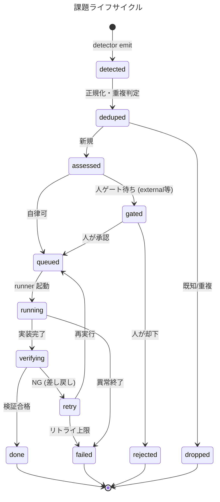
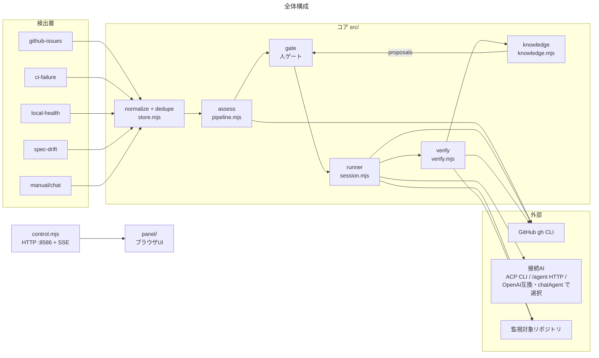
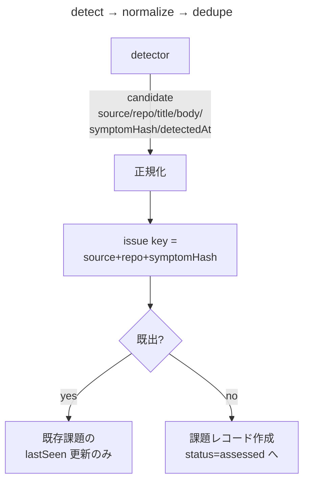
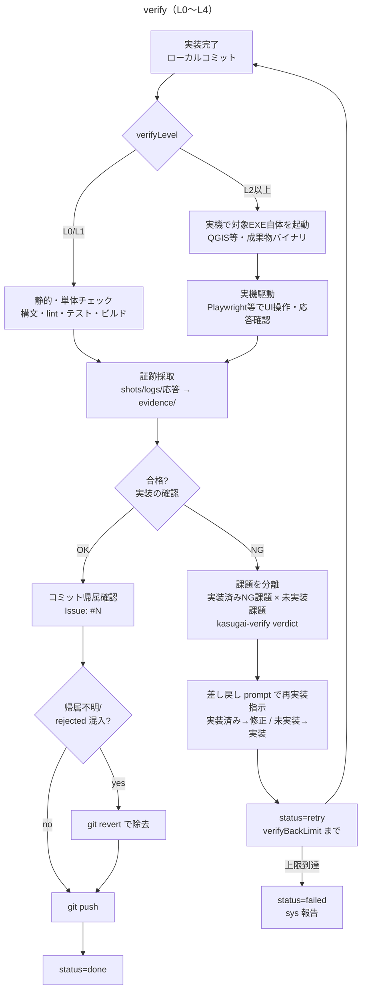
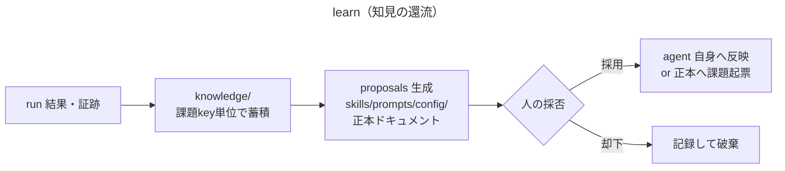
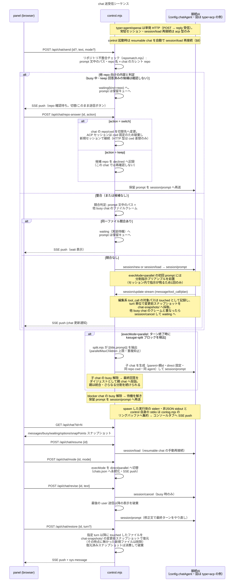
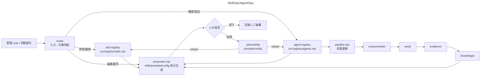
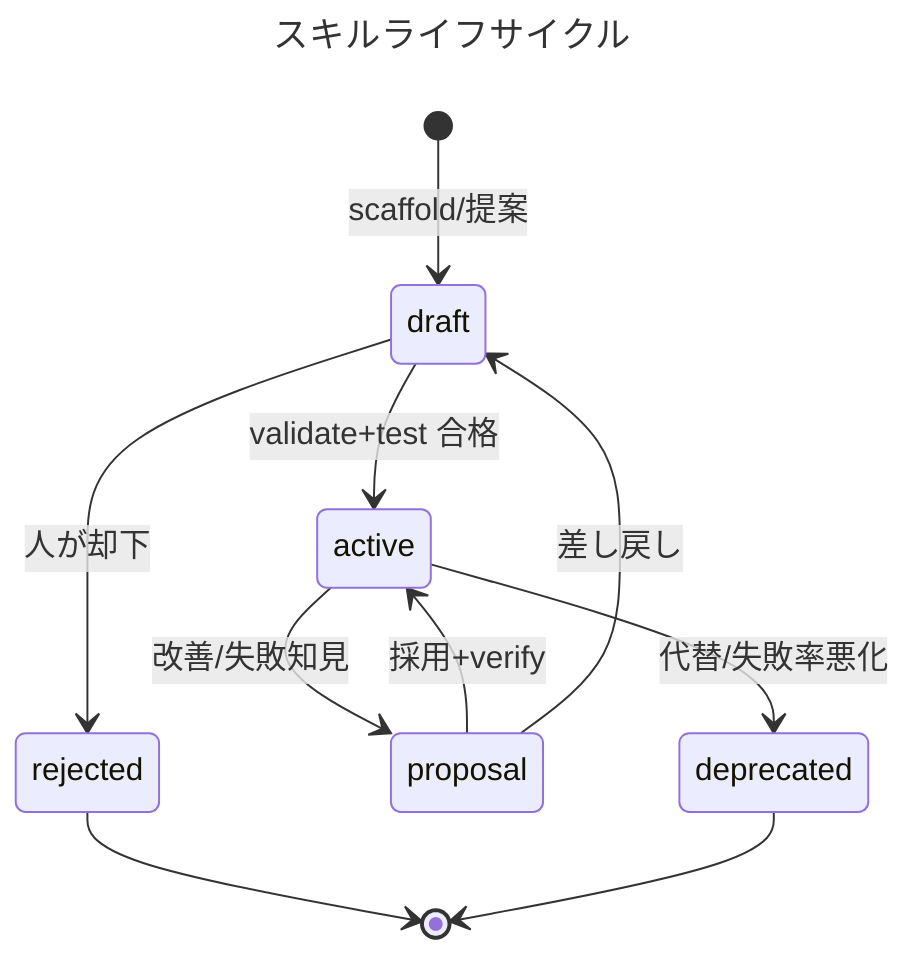
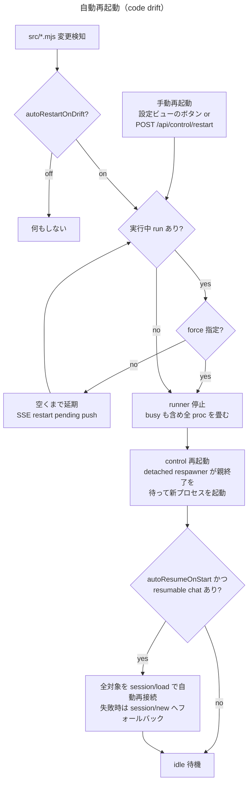

本ページの mermaid 図は `diagrams/*.mmd`（1図1ファイル・正本）を
`tools/sync-diagrams.mjs` が埋め込んだ写しです。図を直すときは `.mmd`
だけを編集し、sync を実行します（`--check` で乖離を検出）。

## 課題ライフサイクル

<!-- diagram: issue-lifecycle -->


## 全体構成

<!-- diagram: architecture -->


## detect → normalize → dedupe

<!-- diagram: detect-pipeline -->


## verify（L0〜L4 / push 統合）

<!-- diagram: verify-levels -->


## learn（知見の還流）

<!-- diagram: learn-flow -->


## chat 送受信シーケンス

<!-- diagram: chat-sequence -->


## パネルレイアウト

<!-- diagram: panel-layout -->
```mermaid
---
title: パネルレイアウト
---
flowchart LR
    L[左ペイン<br/>title + カレントrepo +<br/>縦並びナビ + 管理セクション] --> C[中央ペイン<br/>chat messages（chat/console タブ）/<br/>doc 本文（Viewer 単一オブジェクトに集約<br/>kind判定・原文/プレビュー切替・mermaid描画<br/>MD+mermaid・HTML・MMD 表示・MMD は縦横切替可<br/>mermaid 図は＋−ボタン/wheel で拡縮<br/>（カーソル位置を維持）<br/>中央配置・ドラッグで視野移動・ズーム率表示）]
    C --> R[右ペイン<br/>chat sessions（行は状態ドット+ラベルの<br/>最小表示・状態確認は処理状況ボード） /<br/>doc browser + 参照ファイル /<br/>フォルダツリー（エディター）<br/>（省略ラベルは data-tip<br/>ホバーポップアップで全文表示）]
    G[境界グリップ<br/>ドラッグで幅可変<br/>localStorage 永続化] --> L
    G --> R
    RS[カレントrepo選択<br/>左ペイン title 直下<br/>「すべて」選択肢なし<br/>repo名の表示はここのみ<br/>localStorage 永続化] -->|表示スコープ| L
    RS -->|表示スコープ| R
    RS -->|新規chatの cwd<br/>課題化の repo| C
    C -->|最新ボタン| NEW[updatedAt 最大の<br/>chat を選択]
    C -->|言語 select<br/>localStorage 永続化| I18N[panel/i18n.js<br/>i18n/*.json 辞書<br/>en がフォールバック<br/>data-i18n 属性 + t()<br/>切替時は全ペイン再描画]
    L --> M1[loop state]
    L --> M2[candidates/proposals]
    L -->|エディターナビ<br/>（処理状況の直下）| FT[フォルダツリー<br/>右ペインに展開<br/>カレントrepo の path を根<br/>dir は lazy 展開<br/>GET /api/fs/tree<br/>.git/node_modules 等は除外<br/>秘匿系は 🔒 で選択不可]
    FT -->|file 選択<br/>GET /api/fs/file<br/>（登録 repo 配下・非秘匿のみ<br/>binary は本文を返さない）| C
    L -->|縦並びナビ<br/>AIチャット/AGENTS/SKILL| R
    L -->|マニュアルナビ<br/>中央ペインを iframe 表示| C
    C -->|GET /docs/* 静的配信| MAN[docs/ マニュアルサイト<br/>正本=diagrams/docs/<br/>（1ページ1.md・frontmatter title<br/>nav.json=章立て<br/>template.html/style.css=書式<br/>Canvas docs 参考）<br/>tools/sync-docs.mjs が生成]
    L -->|git ナビ（設定下の区切り線以下・ナビ末尾）<br/>コミット=メッセージ入力→<br/>POST /api/git/commit<br/>（git add -A + commit・変更なしは noop）<br/>プッシュ=確認後<br/>POST /api/git/push（人ゲートの承認）| GIT[カレント repo で git を spawn<br/>60s timeout<br/>出力は conlog 集約<br/>→ console タブへ SSE push]
    L -->|設定ナビ<br/>タブ: 接続AI / リポジトリ / システム<br/>（登録済み + IDE管理下検出）<br/>GET /api/chat-agents<br/>GET /api/repos| C
    C -->|接続AI 追加/更新/解除<br/>active 切替<br/>POST /api/chat-agents/*| AC[config.json の<br/>chatAgents + chatAgent<br/>SSE push で即時反映]
    AC -->|新規 chat の実行体<br/>（chat 作成時に固定し<br/>chats.json へ永続化）| ACPX[接続AI 実行体<br/>acp=CLI spawn /<br/>agent=/agent HTTP /<br/>openai=chat/completions]
    ACPX -->|stderr / 非JSON stdout<br/>（acp 型の spawn のみ）| CON[conlog.mjs<br/>実行体出力 + control 自身の<br/>stdio をリングバッファ集約]
    C -->|console タブ<br/>GET /api/console +<br/>SSE console push| CON
    C -->|処理モード select<br/>（入力行の先頭・添付ボタンの左<br/>目立たせるため強調表示）<br/>POST /api/chat/mode| EM[execMode<br/>direct=逐次 /<br/>parallel=kasugai-split で<br/>子chat自動起動・結果を親へ集約<br/>sessions一覧は親子でグループ表示]
    C -->|repo設定 保存/登録解除<br/>POST /api/repos/update<br/>POST /api/repos/remove| RC[config.json の repos<br/>SSE push で即時反映]
    C -->|repo登録（設定ビューの<br/>path入力・参照ピッカー /<br/>IDE管理下の登録ボタン）<br/>POST /api/repos| RC
    C -->|path 参照<br/>GET /api/fs/dirs| FS[ローカルFSブラウザ<br/>サブdir + .git 検出<br/>loopback 限定]
    RC -->|選択肢へ追加し<br/>SSE即時反映| RS
    L -->|処理状況ナビ<br/>idle/exec/verify/resume/live<br/>の順の状態別カンバン列<br/>exec列は busy+waiting を統合<br/>カードに実行中/実行待機中ピル<br/>verify列は実装ターン終了で自動遷移<br/>（touched あり → autoVerify で検証<br/>prompt 送信・検証中も列に留まる）| C
    C -->|statusカードクリック| PICK[該当 chat を選択表示]
    C -->|検証列カードの検証ボタン<br/>POST /api/chat/verify| VR[検証ターン起動<br/>対象EXE起動+Playwright等の<br/>実機確認を指示<br/>SSE push で即時反映]
    C -->|verify=running/pending| VSH[chat 画面にも検証中/検証待ちを明示<br/>ヘッダ status＋メッセージ末尾の<br/>インジケータ＋送信ボタン<br/>SSE push で即時反映]
    C -->|完了列カードの×ボタン<br/>POST /api/chat/close| DEL[chat 削除<br/>SSE push で即時反映]
    C -->|完了列ヘッダの「すべて削除」<br/>POST /api/chat/close-completed<br/>カレントrepoの完了列を一括削除| DEL
    C -->|再開可列カードの再開ボタン<br/>POST /api/chat/resume| RLOAD[session/load で再接続<br/>SSE push で即時反映]
    R -->|doc一覧 GET /api/agents<br/>GET /api/skills<br/>SKILL は global scope を<br/>一覧から除外| REG[doc registry<br/>agents.mjs /<br/>skills.mjs]
    R -->|doc/参照ファイル選択<br/>GET /api/doc| C
    R -->|GET /api/refs<br/>AGENTS: 切替時に全doc分を<br/>マージして一覧化<br/>SKILL: doc選択時| RF[参照ファイル抽出<br/>registry/refs.mjs<br/>秘匿・未作成は無効表示]
```

## SkillOps/AgentOps

<!-- diagram: skillops-flow -->


## スキルライフサイクル

<!-- diagram: skill-lifecycle -->


## 自動再起動（code drift）

<!-- diagram: restart-flow -->

