本ページの mermaid 図は `diagrams/*.mmd`（1図1ファイル・正本）を
`tools/sync-diagrams.mjs` が埋め込んだ写しです。図を直すときは `.mmd`
だけを編集し、sync を実行します（`--check` で乖離を検出）。

## 課題ライフサイクル

<!-- diagram: issue-lifecycle -->
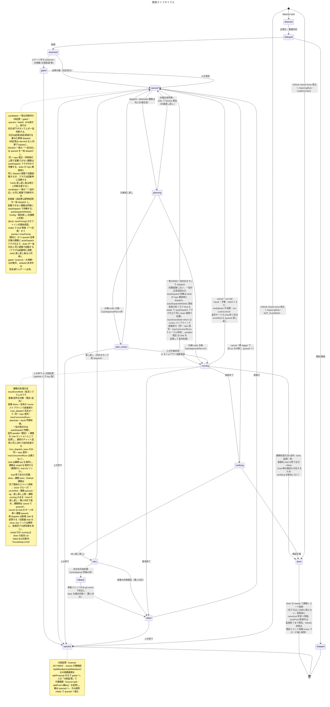

## 全体構成

<!-- diagram: architecture -->
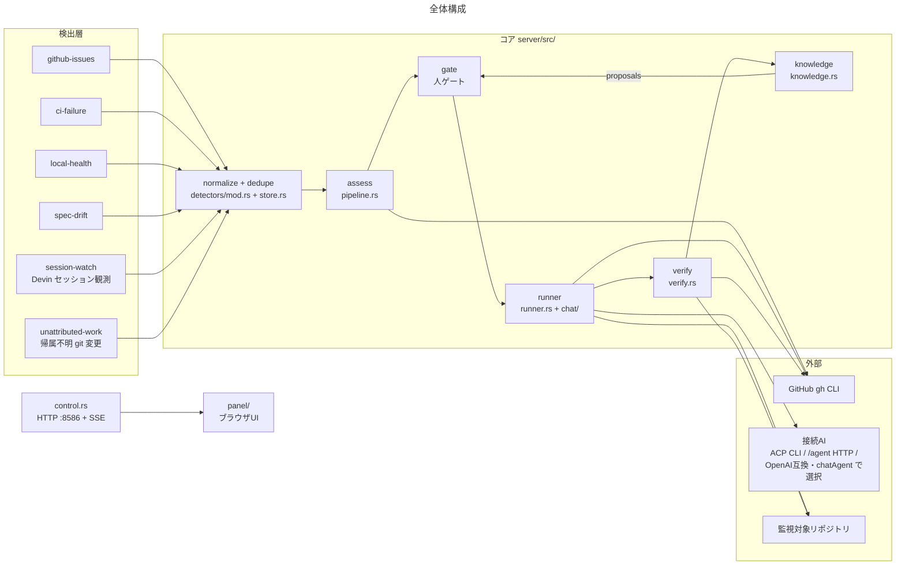

## detect → normalize → dedupe

<!-- diagram: detect-pipeline -->
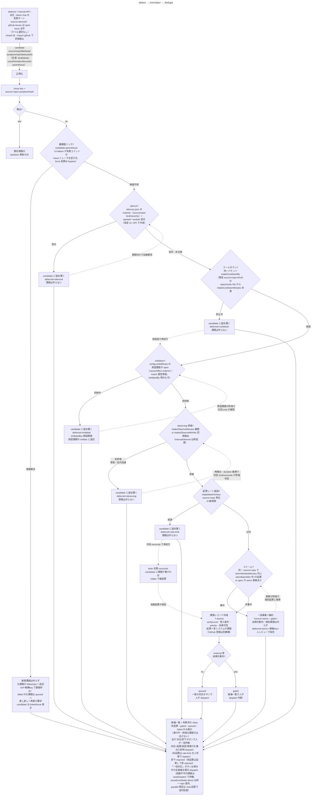

## run 制御・安全（監視・予算・steering・リスク・cancel・保全・ループcap）

<!-- diagram: run-control -->
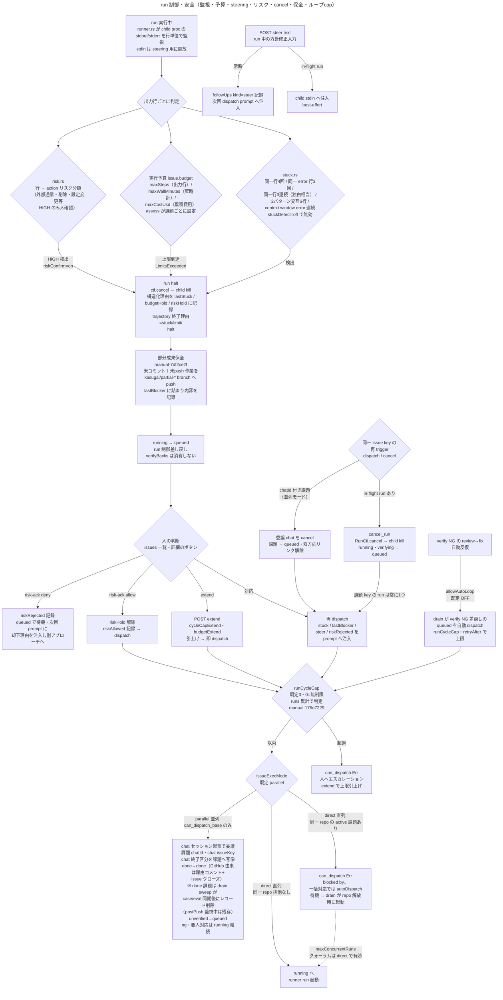

## verify（L0〜L4 / push 統合）

<!-- diagram: verify-levels -->
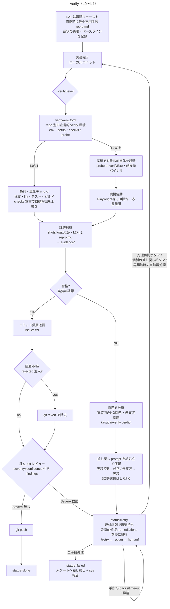

## learn（知見の還流）

<!-- diagram: learn-flow -->
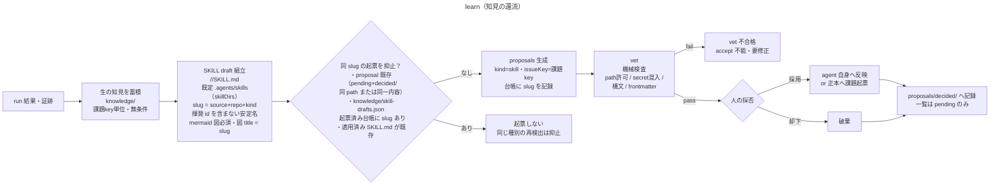

## chat 送受信シーケンス

<!-- diagram: chat-sequence -->
```mermaid
---
title: chat 送受信シーケンス
---
sequenceDiagram
    participant UI as panel (browser)
    participant C as control.rs
    participant A as 接続AI<br/>（config.chatAgent・図は type=acp の例）
    Note over C,A: type=agent/openai は単発 HTTP（POST → reply 受信）。<br/>常駐セッション・session/load 再接続は acp 型のみ
    Note over C,A: control 起動時は resumable chat を自動で session/load 再接続（§8）
    UI->>C: POST /api/chat/send {id?, text, mode?}
    Note over C: 新規 chat の execMode 既定=parallel<br/>（mode 未指定時。分割子 chat は direct 固定）
    C->>C: リポジトリ不整合チェック（repomatch.rs）:<br/>prompt 文中のパス・repo 名 × chat のカレント repo
    alt 他 repo 向けの内容と判定<br/>（busy 中・keep 回答済みの候補は確認しない）
        C->>C: waiting(kind=repo) へ。<br/>prompt は保留キューへ
        C-->>UI: SSE push（repo 確認待ち。切替/このまま送信ボタン）
        UI->>C: POST /api/chat/repo-answer {id, action}
        alt action = switch
            C->>C: chat の repo/cwd を切替先へ変更。<br/>ACP セッションは cwd 固定のため破棄し<br/>新規セッションで継続（HTTP 型は cwd 差替のみ）
        else action = keep
            C->>C: 候補 repo を declined へ記録<br/>（この chat では再確認しない）
        end
        C->>A: 保留 prompt を session/prompt へ再送
    else 整合（または候補なし）
        C->>C: 競合判定: prompt 文中のパス ×<br/>他 busy chat のファイルクレーム<br/>（conflictWait=false の並列モードでは<br/>判定自体を skip）
        alt 同一ファイル競合あり
            C->>C: waiting（実装待機）へ<br/>prompt は保留キューへ
            C-->>UI: SSE push（wait 表示）
        else 競合なし
            C->>C: 同時起動セッション枠チェック<br/>（maxConcurrentSessions・既定3・0=無制限。<br/>proc 保持 chat 数が上限未満なら通過。<br/>満杯なら最も古い idle proc を suspend——<br/>savedSessionId 保持で次回送信時に自動再開——<br/>して枠を空ける。busy または起動中<br/>（session 未確立）の proc は suspend 不可。<br/>全枠 busy なら waiting kind=capacity へ。<br/>blocker busy 解除で解放。<br/>idle suspend は送信経路のみ——resume/開始のみの<br/>再開要求は枠が無ければ spawn せず<br/>savedSessionId のまま残し、次回送信で lazy 再開。<br/>「resume が前の idle proc を逐次追い出す<br/>spawn→kill コンベア」を防ぐ）
            C->>A: session/new or session/load → session/prompt
            Note over C,A: execMode=parallel の初回 prompt には<br/>分割指示プリアンブルを前置<br/>（セッション内で指示が残るため1回のみ）
            A-->>C: session/update stream (message/tool_call/plan/usage_update)
            Note over C,A: 編集系 tool_call の対象パスは touched として記録し、<br/>turn 単位で変更前スナップショットを<br/>chat-snapshots/ へ採取。<br/>他 busy chat のクレームと重なったら<br/>session/cancel して waiting へ<br/>（並列モードでは抑止しない）
            Note over C,A: usage_update {used,size,cost?} は chat 別の<br/>コンテキスト消費量として保持。<br/>type=openai は応答 usage.total_tokens から採取<br/>（size 不明のため使用数のみ）
            C-->>UI: SSE push (chat 更新通知・ctx 消費量も随時反映)
        end
    end
    alt execMode=parallel: ターン終了時に<br/>kasugai-split ブロックを検出
        C->>C: split.rs が [{title,prompt}] を抽出（重複抑止）。<br/>parallelMaxChildren は同時実行上限:<br/>アクティブ子数（busy/待機/検証中）が<br/>上限未満なら即起動、超過分は<br/>pendingSplits 待機キューへ（chats.json 永続化）
        C->>A: 子 chat を生成（parent=親id・direct 固定・<br/>同 repo cwd・同 agent）して session/prompt
        Note over C: 子 chat の busy 解除 → 最終回答を<br/>ダイジェストとして親 chat へ投函。<br/>空いた枠で待機キューから順次起動。<br/>親は統合・さらなる分割を続けられる
    end
    Note over C: blocker chat の busy 解除 → 待機を解き<br/>保留 prompt を session/prompt へ再送
    UI->>C: POST /api/chat/parallel {on}
    Note over C: on=true で conflictWait=false を config 永続化<br/>（並列モード）＋全ての実装待機を blocker 未完了<br/>でも解放し保留/続行 prompt を即時送信<br/>（repo 確認待ちは人ゲートのため対象外）。<br/>on=false で直列ガードへ復帰（実行中は継続）
    Note over C,A: acp spawn 時は WINDSURF_EXT_HOST_PID を<br/>env から除去（devin は実親でなくこの変数の pid を<br/>親監視するため、死んだホストの値が残ると<br/>実行体が起動直後に自死する。他ホストでも無害な防御）
    Note over C,A: spawn した実行体の stderr・非JSON stdout と<br/>control 自身の stdio は conlog.rs の<br/>リングバッファへ集約 → コンソールタブへ SSE push
    UI->>C: GET /api/chat?id=N
    C-->>UI: messages/busy/waiting/options/snapPoints スナップショット
    UI->>C: POST /api/chat/resume {id}
    C->>A: session/load（resumable chat の手動再接続）
    UI->>C: POST /api/chat/start-suspended
    C->>A: resumable 全件に session/load（prompt 無しの起動のみ。<br/>同時起動枠は idle 追い出しなしで確保、<br/>枠超過分はスリープのまま残す）
    UI->>C: POST /api/chat/mode {id, mode}
    C->>C: execMode を direct/parallel へ切替<br/>（chats.json へ永続化・SSE push。既定=parallel）
    UI->>C: POST /api/chat/revise {id, text}
    C->>A: session/cancel（busy 時のみ）
    C->>C: 最後の user 送信以降の表示を破棄
    C->>A: session/prompt（修正文で最終ターンをやり直し）
    UI->>C: POST /api/chat/restore {id, turn?}
    C->>C: 指定 turn 以降に touched したファイルを<br/>chat-snapshots/ の変更前スナップショットで復元<br/>（その時点に無かった新規ファイルは削除）<br/>復元済みスナップショットは消費して破棄
    C-->>UI: SSE push + sys message
```

## パネルレイアウト

<!-- diagram: panel-layout -->
```mermaid
---
title: パネルレイアウト
---
flowchart LR
    L[左ペイン<br/>title + カレントrepo +<br/>縦並びナビ<br/>（セッション/メトリクス/AIチャット/エディター/<br/>AGENTS/SKILL/マニュアル/開発環境/設定の順。<br/>初期表示はセッション）] --> C[中央ペイン<br/>chat messages（chat/console タブ）/<br/>doc 本文（Viewer 単一オブジェクトに集約<br/>kind判定・原文/プレビュー切替・mermaid描画<br/>MD+mermaid・HTML・MMD 表示・MMD は縦横切替可<br/>mermaid 図は＋−ボタン/wheel で拡縮<br/>（カーソル位置を維持）<br/>中央配置・ドラッグで視野移動・ズーム率表示）]
    C --> R[右ペイン<br/>管理セクション / doc browser + 参照ファイル /<br/>フォルダツリー（エディター）<br/>（エディター/AGENTS/SKILL 選択時は doc browser。<br/>表示するものがない時は管理セクションを<br/>表示し、ペイン自体は常時表示。<br/>省略ラベルは data-tip<br/>ホバーポップアップで全文表示）]
    G[境界グリップ<br/>ドラッグで幅可変<br/>localStorage 永続化] --> L
    G --> R
    RS[カレントrepo選択<br/>左ペイン title 直下<br/>「すべて」選択肢なし<br/>repo名の表示はここのみ<br/>localStorage 永続化] -->|表示スコープ| L
    RS -->|表示スコープ| R
    RS -->|新規chatの cwd<br/>スコープ外の chat選択・doc表示の解除<br/>（実行中chatはバックグラウンド継続）| C
    C -->|ヘッダレイアウト<br/>1行目=タイトル（概要）が全幅<br/>（タイトル前に処理状態ピル。<br/>削除ボタン表示時はタイトルと1行目を共有）<br/>2行目=plink/status/最新/◀▶ページング/<br/>options/言語select/操作ボタン| HD[flex-wrap で<br/>自然折返し]
    C -->|タイトル前の状態ピル| CPILL[ボードの列区分と同じ色で<br/>現在の処理状態を表示<br/>（実行中/実行待機中/検証中/<br/>検証待ち/要対応など）<br/>SSE push で即時反映]
    C -->|最新ボタン| NEW[updatedAt 最大の<br/>chat を選択]
    C -->|ヘッダの◀戻る/進む▶ボタン<br/>（新規画面からは 進む=先頭・戻る=末尾）| PAGE[status 順（旧処理状況の並び）で<br/>前後の chat を選択<br/>（列順 idle→exec→verify→resume→<br/>unresolved→live。他repoのchatは<br/>カレントrepo切替を兼ねる）]
    C -->|ヘッダの＋新規チャットボタン| NEWC[新規 chat 画面へ<br/>（chat の切替は左ペイン一覧で行う）]
    C -->|言語 select<br/>localStorage 永続化| I18N[panel/i18n.js<br/>i18n/*.json 辞書<br/>en がフォールバック<br/>data-i18n 属性 + t()<br/>切替時は全ペイン再描画]
    C -->|設定システムタブの<br/>タイムゾーン入力<br/>（IANA名・空欄=ブラウザ既定<br/>datalist に代表ゾーン）<br/>localStorage 永続化| TZ[表示タイムゾーン<br/>fmtTs/fmtTm が Intl で変換<br/>chat・console・一覧の時刻表示<br/>保存 ts は UTC のまま]
    R --> M1[loop state<br/>version/port/repos/chats/candidates<br/>+ KPI（status別件数・done率・MTTR）<br/>行ラベルは i18n 辞書で言語化]
    R --> M2[candidates/issues/proposals<br/>candidates は人の判断待ちのみ表示<br/>（未起票・gated・queued・failed。<br/>起票は自動が既定で実行中・終端の<br/>課題行は出さない）<br/>candidate 行は起票済み課題の status を併記<br/>rate-limit 保留の candidate は<br/>deferred ピルで明示<br/>全行に 対応/却下ボタン:<br/>対応=起票/承認/再実行を兼ねた即時 dispatch<br/>（未起票は rate-limit を人判断で bypass）<br/>却下=rejected（未起票は起票して即 rejected）<br/>proposal カードはクリックで<br/>中央ペインへ詳細表示<br/>queued issue は対応ボタンで即時 dispatch<br/>candidates/issues 各セクションの<br/>「一括対応」ボタンは表示中の判断待ち行を<br/>一括 dispatch（起動不可は autoDispatch 待機）<br/>課題処理方法（issueExecMode・設定システムタブ。<br/>既定=並列）: 直接=runner パイプライン（同一repo直列）/<br/>並列=chat セッション起票で並列処理<br/>（課題は chatId を持ち行に chat #N リンクバッジ。<br/>chat は課題 key を持ち終了区分を課題へ写像。<br/>done 課題行は drain の sweep が issues.json から<br/>削除しこの枠に残さない（完了表示は委譲 chat<br/>カードが担う。postPush 監視中は監視終了まで残存。<br/>GitHub 由来は理由コメント+issue クローズ後に削除）<br/>issue 行は priority バッジ（P2/P3）を併記<br/>GitHub Issue 由来の行は GitHub #番号の<br/>リンクバッジを併記（dispatch 後は<br/>manual と同一パイプライン）<br/>一覧は状態→priority→更新時刻順に整列<br/>status・source・kind の表示は<br/>i18n 辞書で言語化（未知の値は原文）<br/>各行の body/rationale は<br/>data-tip ホバーでポップアップ表示]
    M2 -->|proposal カードクリック<br/>詳細（vet 検査結果・changes 本文・<br/>採否ボタン）を中央ペインに表示| C
    L -->|エディターナビ<br/>（AIチャットの直下）| FT[フォルダツリー<br/>右ペインに展開<br/>カレントrepo の path を根<br/>dir は lazy 展開<br/>GET /api/fs/tree<br/>.git/node_modules 等は除外<br/>秘匿系は 🔒 で選択不可]
    FT -->|file 選択<br/>GET /api/fs/file<br/>（登録 repo 配下・非秘匿のみ<br/>binary は本文を返さない）| C
    L -->|AIチャットナビ<br/>doc/ツリー表示を閉じて<br/>chat 表示へ戻す| C
    L -->|縦並びナビ<br/>AGENTS/SKILL| R
    L -->|マニュアルナビ<br/>中央ペインを iframe 表示| C
    C -->|GET /docs/* 静的配信| MAN[docs/ マニュアルサイト<br/>正本=diagrams/docs/<br/>（1ページ1.md・frontmatter title<br/>nav.json=章立て<br/>template.html/style.css=書式<br/>Canvas docs 参考）<br/>tools/sync-docs.mjs が生成]
    L -->|セッションナビ<br/>（ナビ先頭・初期表示。1本に統合）<br/>中央ペインにエージェントタブ<br/>（Devin / Copilot）＋カンバン<br/>状況（turn 列・lastNote・failedTools）<br/>と統一ツールバー（維持操作）<br/>（共通テンプレ agent-sessions.mmd）| SESS["devinenv.rs + copilotenv.rs<br/>GET /api/&lt;agent&gt;-sessions<br/>POST delete / cleanup /<br/>vacuum・done / undone<br/>（詳細は devin-sessions.mmd・<br/>copilot-sessions.mmd）"]
    SESS -->|操作後は GET で再描画| C
    L -->|git ナビ（設定下の区切り線以下・ナビ末尾）<br/>コミット=メッセージ入力→<br/>POST /api/git/commit<br/>（git add -A + commit・変更なしは noop）<br/>プッシュ=確認後<br/>POST /api/git/push（人ゲートの承認）| GIT[カレント repo で git を spawn<br/>60s timeout<br/>出力は conlog 集約<br/>→ console タブへ SSE push]
    L -->|設定ナビ<br/>タブ: 接続AI / リポジトリ / システム<br/>（登録済み + ワークスペース管理下検出 + ユーザー検出:<br/>ワークスペース/repoScanDirs 直下の .git 無し dir・<br/>ユーザーディレクトリ/repoScanDirs 直下の .git dir<br/>※GitHub 非依存のローカル repo も対象）<br/>リポジトリタブ内はサブタブでグループ化<br/>（slug の GitHub owner ごと /<br/>ユーザー / (owner なし)。選択は永続化・<br/>グループ説明は data-tip ポップアップ）<br/>GET /api/chat-agents<br/>GET /api/repos| C
    C -->|接続AI 追加/更新/解除<br/>active 切替<br/>POST /api/chat-agents/*| AC[config.json の<br/>chatAgents + chatAgent<br/>SSE push で即時反映]
    AC -->|新規 chat の実行体<br/>（chat 作成時に固定し<br/>chats.json へ永続化）| ACPX[接続AI 実行体<br/>acp=CLI spawn /<br/>agent=/agent HTTP /<br/>openai=chat/completions]
    ACPX -->|stderr / 非JSON stdout<br/>（acp 型の spawn のみ）| CON[conlog.rs<br/>実行体出力 + control 自身の<br/>stdio をリングバッファ集約]
    C -->|console タブ<br/>GET /api/console +<br/>SSE console push| CON
    C -->|処理モード select<br/>（入力行の先頭・添付ボタンの左<br/>目立たせるため強調表示）<br/>POST /api/chat/mode| EM[execMode<br/>（既定=parallel）<br/>direct=逐次 /<br/>parallel=kasugai-split で<br/>子chat自動起動・結果を親へ集約<br/>同時実行上限超過分は<br/>pendingSplits待機キュー・<br/>子完了で順次起動<br/>ボードの子chatカードは↳印で識別]
    C -->|repo設定 保存/登録解除<br/>POST /api/repos/update<br/>POST /api/repos/remove| RC[config.json の repos<br/>SSE push で即時反映]
    C -->|設定システムタブの<br/>課題処理方法 select<br/>（直接=direct / 並列=parallel・既定並列）<br/>POST /api/control/issue-mode| IMD[issueExecMode<br/>config.json 永続化<br/>direct=runner パイプラインで直接実行<br/>（同一 repo の active 課題がある間<br/>dispatch 停止=直列・maxConcurrentRuns<br/>クォーラム有効） /<br/>parallel=chat 起票で並列処理<br/>（課題は chatId リンクを持ち<br/>chat 終了区分を課題へ写像）<br/>SSE push で即時反映]
    C -->|設定システムタブの<br/>同時起動セッション数 input<br/>POST /api/control/session-limit| SLM[maxConcurrentSessions<br/>既定3・0=無制限<br/>config.json 永続化<br/>proc 保持 chat 数の上限。<br/>超過起動は最古 idle proc を<br/>suspend（savedSessionId 保持で<br/>次回送信時に自動再開）して枠確保、<br/>全枠 busy なら capacity 待機<br/>SSE push で即時反映]
    C -->|repo登録（設定ビューの<br/>path入力・参照ピッカー /<br/>ワークスペース管理下の登録ボタン）<br/>POST /api/repos| RC
    C -->|path 参照<br/>GET /api/fs/dirs| FS[ローカルFSブラウザ<br/>サブdir + .git 検出<br/>loopback 限定]
    RC -->|選択肢へ追加し<br/>SSE即時反映| RS
    C -->|statusカードクリック| PICK[該当 chat を選択表示<br/>選択時は最終行へスクロール<br/>（SSE 更新の追尾は末尾付近のみ）]
    C -->|検証列カードの検証ボタン<br/>POST /api/chat/verify| VR[検証ターン起動<br/>対象EXE起動+Playwright等の<br/>実機確認を指示<br/>SSE push で即時反映]
    C -->|verify=running/pending| VSH[chat 画面にも検証中/検証待ちを明示<br/>ヘッダ status＋メッセージ末尾の<br/>インジケータ＋送信ボタン<br/>SSE push で即時反映]
    C -->|doneKind 確定（検証フェーズ解消）| VEND[chat 末尾に終了区分をピル表示<br/>実装完了=done / 検証NG上限=ng /<br/>未検証=unverified<br/>（busy・verify待ちの表示より優先度は低い）<br/>SSE push で即時反映]
    C -->|各列カードの×ボタン<br/>（全カード・ホバー表示。<br/>右下にボタンがあるカードは右上）<br/>POST /api/chat/close| DEL[chat 削除<br/>SSE push で即時反映]
    C -->|chat画面ヘッダの削除ボタン<br/>（タイトル前・処理が終わった chat のみ表示。<br/>実行中・検証中・要対応では非表示。<br/>内容確認後にその場で削除）<br/>POST /api/chat/close| DEL
    C -->|完了列ヘッダの「すべて削除」<br/>POST /api/chat/close-completed<br/>カレントrepoの完了列を一括削除<br/>（live列=doneKind=done・無印が対象。<br/>要対応列は残る）| DEL
    C -->|要対応列カードの差し戻しボタン<br/>POST /api/chat/rework| RWK[保留の差し戻しpromptがあればそれを、<br/>無ければ終了区分に応じた再作業promptを送信<br/>doneKind/verify系・要人対応をリセットし<br/>exec列へ戻す<br/>SSE push で即時反映]
    C -->|再開可列カードの再開ボタン・<br/>未着手列カードの開始ボタン<br/>POST /api/chat/resume| RLOAD[session/load で再接続<br/>saved sid 無しは session/new で起動<br/>未送信の保留promptがあれば再送<br/>SSE push で即時反映]
    C -->|ボード上部の「処理再開」ボタン<br/>（停止中の件数を併記・0件は無効）<br/>POST /api/chat/resume-all| RALL[止まった処理を一括再開<br/>差し戻し待ち→保留の差し戻しprompt再送<br/>再開可→session/load再接続+<br/>中断作業の続行prompt送信<br/>未着手→session/newで起動+<br/>起動失敗で保留のprompt再送<br/>検証待ち→検証ターン起動<br/>ブロッカー消失の実行待機→<br/>解放して保留prompt再送<br/>（busy中・repo確認待ち・要人対応は触らない）<br/>SSE push で即時反映]
    C -->|ボード上部の「スリープ起動」ボタン<br/>（スリープ中の件数を併記・0件は無効）<br/>POST /api/chat/start-suspended| SUSP[スリープ中セッションを一括起動<br/>resumable（acp・proc無・savedSessionId有）<br/>全件に ensure_session→session/load のみ<br/>prompt は送らない（busy化しない）。<br/>同時起動枠は idle追い出しなしで確保し<br/>枠超過分はスリープのまま残す<br/>（次回送信時に lazy 再開）<br/>SSE push で即時反映]
    C -->|実行状況列ヘッダの「並列」ボタン<br/>（待機件数を併記・ON中は強調）<br/>POST /api/chat/parallel {on}| PAR[並列モード切替<br/>on→conflictWait=false を config 永続化し<br/>全ての実装待機を blocker 未完了でも<br/>解放して即時送信（repo確認待ちは除く）<br/>以後の送信・FileTouch 競合も待機しない<br/>off→直列ガードへ復帰（実行中は継続）<br/>SSE push で即時反映]
    R -->|doc一覧 GET /api/agents<br/>GET /api/skills<br/>SKILL は global scope を<br/>一覧から除外| REG[doc registry<br/>agents.rs /<br/>skills.rs]
    R -->|doc/参照ファイル選択<br/>GET /api/doc| C
    R -->|GET /api/refs<br/>AGENTS: 切替時に全doc分を<br/>マージして一覧化<br/>SKILL: doc選択時| RF[参照ファイル抽出<br/>registry/refs.rs<br/>秘匿・未作成は無効表示]
```

## SkillOps/AgentOps

<!-- diagram: skillops-flow -->
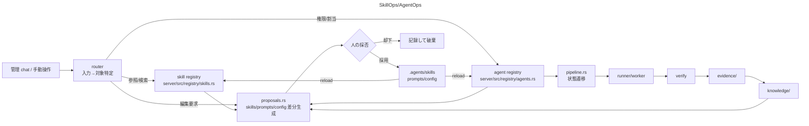

## スキルライフサイクル

<!-- diagram: skill-lifecycle -->
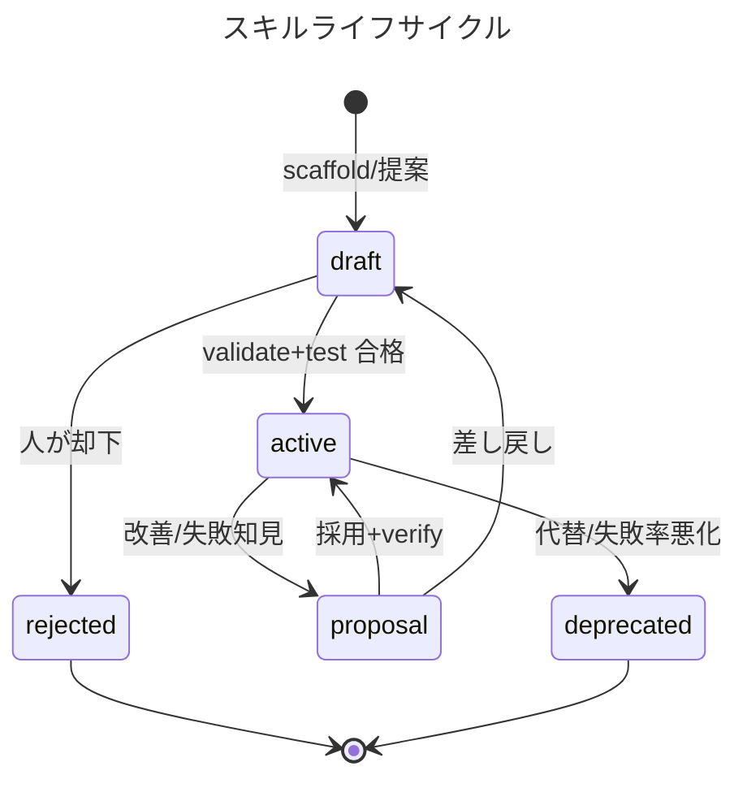

## 自動再起動（code drift）

<!-- diagram: restart-flow -->
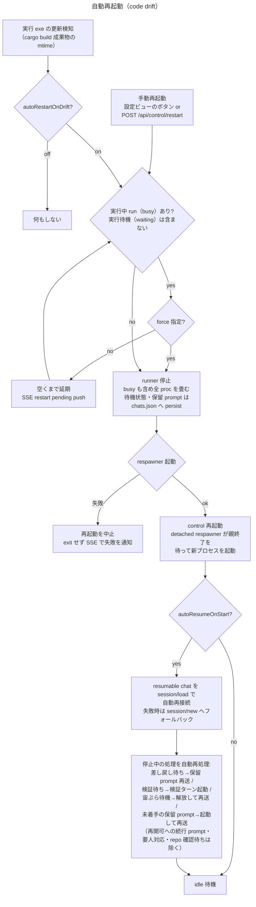

## 環境起動（docs ナビの起動ボタン）

<!-- diagram: env-launch -->
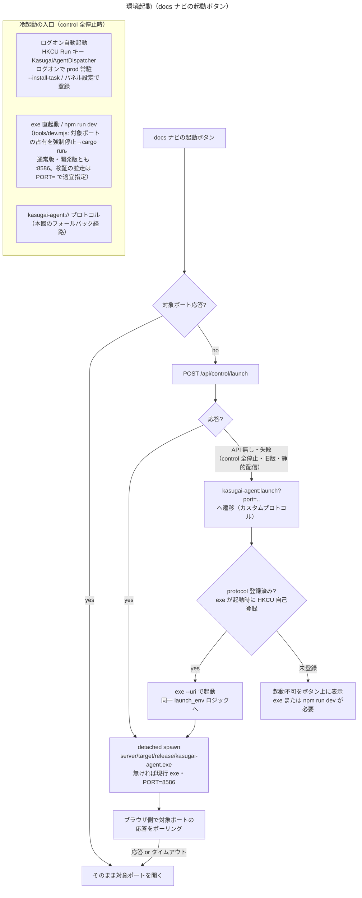

## Devin セッション管理（環境維持）

<!-- diagram: devin-sessions -->
```mermaid
---
title: Devin セッション管理（環境維持）
---
flowchart LR
    NAV[セッションナビ → Devin タブ] --> VIEW[中央ペイン<br/>Devin セッション管理ビュー]
    VIEW --> GET[GET /api/devin-sessions<br/>sessions・live判定・<br/>孤立ファイル数・DBサイズ]
    GET --> DB[(Devin CLI<br/>%APPDATA%/Devin/cli/<br/>sessions.db)]
    GET --> LK[session_locks/<br/>&lt;id&gt;.lock<br/>LockFile バイトロック試行<br/>= live 判定]
    GET --> SM[summaries/<br/>&lt;id&gt;.md]
    DB --> TURN[ターン状態判定<br/>message_nodes 末尾を遡り最初の実ノードで判定<br/>（通知系 system ノードは読み飛ばし）:<br/>assistant+finish=stop → answered<br/>user/tool 末尾 or tool_calls 途中 → working<br/>割込マーカー or 非liveの途中 → interrupted<br/>※ answered は報告済みの意味。<br/>指示の実現性は lastNote で人が確認]
    DB --> NOTE[最終応答抜粋 lastNote<br/>最後の assistant ノード冒頭<br/>+ tool_call_state 失敗数 failedTools]
    VIEW --> DONE[POST /api/devin-sessions/done<br/>{ids} を完了化<br/>live 中は拒否<br/>sessions.db は触らない]
    VIEW --> UNDONE[POST /api/devin-sessions/undone<br/>{ids} を一覧へ戻す]
    VIEW --> DEL[POST /api/devin-sessions/delete<br/>{ids} 行削除<br/>live 中は拒否<br/>FTS は delete トリガーで連動]
    VIEW --> CLS[POST /api/devin-sessions/cleanup<br/>孤立 lock/summary を除去]
    VIEW --> VAC[POST /api/devin-sessions/vacuum<br/>sessions.db を VACUUM]
    VIEW --> ATT[POST /api/devin-sessions/attach<br/>{id} → saved_session_id 付き<br/>kasugai chat を作成<br/>（トランスクリプトを履歴に流し込み:<br/>user=本文/assistant=thinking→thought・<br/>本文→agent・tool_calls→tool 行<br/>※tool 結果行・system は除外）<br/>→ chatSelect で本格 AI チャット]
    DONE --> DF[devin-done.json<br/>kasugai_agent root<br/>done: id→ doneAt/title/wd]
    UNDONE --> DF
    DF --> GET2[GET 応答の各 session に<br/>done/doneAt を付与。<br/>DB 消滅 id は読み時に purge]
    GET2 --> VIEW
    VIEW --> TABS[タブ: 一覧（!done）/ 完了（done）<br/>完了タブは戻す・削除ボタン]
    DEL --> DB
    CLS --> LK
    CLS --> SM
    VAC --> DB
    DEL --> DF2[削除時は done エントリも除去]
    DF2 --> DF
    DONE --> REF[応答後に GET で再描画<br/>（状態と画面の乖離を残さない）]
    UNDONE --> REF
    DEL --> REF
    CLS --> REF
    VAC --> REF
```
