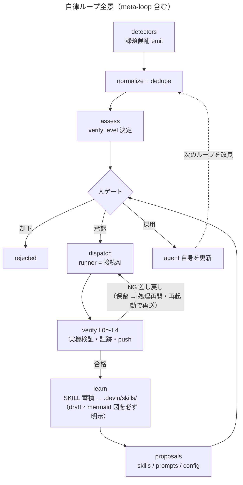
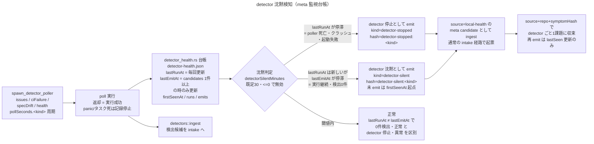

KASUGAI Agent の中核は「LOOP」——課題が生まれてから学習で自分自身を改良する
までの閉じた業務サイクルです。本ページでは LOOP の意味、SDK やプラグイン
ではなく Rust 自前実装を選んだ理由、自律性の位置づけを整理します。

## 自律ループ（LOOP）とは

LOOP はプログラムの for/while ではなく、
**課題の検出から学習までを一巡りする運用サイクル**です。
常駐サーバが外部世界を観測し続け、課題が現れるたびにこのサイクルを
回します。

<!-- diagram: autonomy-loop -->

| 段階 | 内容 |
|---|---|
| detect | detector（github-issues / ci-failure / local-health / manual-chat）が課題候補を emit |
| normalize/dedupe | 統一 candidate 形式に正規化し `source+repo+symptomHash` で重複排除 |
| assess | 課題の性質と検証深度（verifyLevel L0〜L4）を決定 |
| gate | dispatch（対応）判断・external 起票承認・proposal 採否・push 可否など人だけが越えられる判定地点 |
| dispatch | runner（接続AI 実行体）に実装を委譲。起動は ISSUES 一覧の「対応」ボタンによる人判断のみ（自動起動しない） |
| verify | 実機起動・証跡採取・push 可否。NG なら差し戻し prompt を保留し、処理再開・再起動時の自動再処理で retry へ（上限到達は要人対応） |
| learn | 結果・証跡を SKILL（draft・mermaid 図必須）として `.devin/skills/` へ蓄積し proposals を生成 |

LOOP が「要」なのは、これが**自律性そのもの**だからです。

- **終わらない** — 常駐サーバが観測を続け、課題ごとにサイクルを回す
- **閉じている** — verify が「実装したつもり」を実機で弾き、learn が結果を
  次のループの入力に還流する
- **自己書換えする** — learn → proposals → 採用 で agent 自身が更新され、
  ループがループを改良する（meta-loop）

観測系自身も監視対象です。detector ごとの最終実行時刻と最終 emit 時刻を
`detector-health.json` 台帳に記録し、`detectorSilentMinutes`（既定30）を
超えて emit のない detector は `source=local-health` の meta 課題として
このパイプラインへ emit します。「検出0件（正常）」と「detector 停止
（異常）」は lastRunAt と lastEmitAt の区別で分けます。

<!-- diagram: detector-health -->

## 実装方式の比較（Rust 自前 / SDK / プラグイン）

| 観点 | Rust 自前（本システム） | SDK 利用 | プラグイン（MCP/skill 等） |
|---|---|---|---|
| 自律ループの制御 | 完全。state machine を自前で保有 | 部分的。課題ライフサイクルは別途自作 | 不可。ループはホスト側のもの |
| 常駐・スケジューリング | 自前デーモン + 自動再起動 | プロセス管理は自前 | ホストの起動中のみ |
| 状態の正 | control が state/issues/queue を保有し SSE push | SDK セッション状態と二重管理になりやすい | ホストの永続機構に依存 |
| 実機検証（L0〜L4） | EXE 起動・証跡・排他ロックまで実装可能 | SDK の責務外。結局自前で書く | ホストのツール呼出に限定 |
| AI 実行体の交換性 | chatAgents 設定で ACP/HTTP/OpenAI互換を選択。**プロバイダ非依存** | SDK 提供者のモデルに実質ロック | ホストが選んだ AI に従う |
| UI / 可視化 | panel + SSE でリアルタイム表示 | UI は丸ごと自作 | ホスト UI 制約内 |
| セキュリティ | loopback・secrets 一元・人ゲートを code に直接埋め込める | SDK 内部の送信先・ツール実行はブラックボックス | ホストの権限モデルに従う |
| 開発・保守コスト | 最大 | 中（エージェント部は SDK が吸収） | 最小 |

本システムが Rust 自前を選んだのは「SDK を使わないことで速い」からではなく、
**SDK に依存しない分だけ、自律ループと検証ポリシーを完全に自分の仕様にできる**
からです。AI を内蔵するのではなく、外付けの実行体としてオーケストレート
する形です。

## 自律性の位置づけ

| 自律性の要件 | 本システム | 完全自立との差 |
|---|---|---|
| 世界を継続観測する | detectors が常駐ポーリング | 観測対象は定義済みソースのみ |
| 自分で課題を立てる | candidate → issue key で自動起票 | 「何を課題とみなすか」の枠組みは人が定義 |
| 実行して結果を得る | runner が接続AIに委譲 | 「頭脳」は外付けセッション。本体は意志を持たない |
| 現実と照合する | verify L0〜L4 で実機検証・証跡 | 多くの自律実験が欠く部分を実装済み |
| 自分を改良する | learn → proposals → prompts/skills/config を更新 | 採否は人ゲート。意図的に自立を止めている |
| 失敗から回復する | retry・drift 自動再起動・snapshot 復元 | ドメイン内の回復のみ |

### 評価

- **入口としては正しい** — 観測→行動→実機検証→学習還流という骨格は
  自律システムの正しい形
- **完全自立ではない** — 人ゲートは除去不能な仕様。課題の枠組みは人が
  定義し、判断・実装の「頭脳」は外付けAIに委譲している
- **現実的な位置づけ** — 「人の監督下で自己改良する閉域自律システム」

完全自立に向かう次の壁は「proposals の採否を機械化する = 自己改良の
検証器を作る」ことです。その第一歩として **vet（機械検査）** を実装済み
（`server/src/proposals.rs`）—— path 許可範囲・secret 混入・構文を静的に
検査し、不合格は accept 不能とする採否の前提検査です。採否そのものは
人ゲートのままです。採否自体の機械化は verify を自分自身のコードに適用
する問題になり、L4（Issue 主旨との照合）よりはるかに難しい領域です。
