KASUGAI Agent の配布形態と、CDN によるアセット更新の仕組みです。
正本は `diagrams/asset-update.mmd` と README §13 です。

## 配布形態

- **基本は zip 一式** — exe + `config.example.json` + `panel/` + `docs/` +
  `prompts/`。exe 隣接に `config.json` を置くと、そこが root と判定される
  （配布版モード）。exe 単体では動きません
- **CDN は上乗せ** — panel・docs・prompts 等の更新をネット経由で配る
  チャネルです。Rust コアの変更だけが exe 再配布を必要とし、
  アセット更新では exe を配り直さなくて済みます

## 更新フロー

```mermaid
---
title: アセット更新（CDN 配布）
---
flowchart TD
    TRIG[更新確認<br/>起動時 / 定期 cdnCheckMinutes /<br/>POST /api/assets/check] --> EN{cdnBaseUrl 設定?}
    EN -->|未設定| SKIP[何もしない<br/>（ZIP・ローカル配布のみ）]
    EN -->|設定済| MF[manifest.json 取得<br/>channels / version / minExeVersion /<br/>files + sha256]
    MF -->|取得失敗| KEEP[現行継続<br/>オフライン耐性・lastError を SSE push]
    MF --> PIN{cdnManifestSha256<br/>ピン指定あり?}
    PIN -->|あり・不一致| KEEP
    PIN -->|なし or 一致| CMP{exe version >=<br/>minExeVersion?}
    CMP -->|no| NEED[exe 更新が必要<br/>SSE assets で通知のみ・適用しない]
    CMP -->|yes| DIFF{チャネルごと<br/>remote != installed?}
    DIFF -->|同一| DONE[最新・何もしない]
    DIFF -->|差分あり| GATE{assetAutoApply.&#60;ch&#62;?}
    GATE -->|on<br/>panel/docs 既定| DL[.staging/&#60;ch&#62;/ へ全ファイル DL<br/>各 sha256 を検証]
    DL -->|1件でも不一致| DISCARD[staging 破棄・現行維持]
    DL -->|全件一致| SWAP[assets/&#60;ch&#62;/ を差替<br/>現行は &#60;ch&#62;.bak/ へ退避]
    SWAP --> SSE[installed 版を assets/state.json へ記録<br/>SSE assets push<br/>都度ディスク配信なので再起動不要]
    GATE -->|off<br/>prompts 既定=人ゲート| PROP[proposal 起票<br/>kind=prompt・changes=prompts/*<br/>同 version の起票済なら重複しない]
    PROP --> HUMAN{人の採否}
    HUMAN -->|採用| APPLY[proposal 適用<br/>root 配下へ書込み]
    HUMAN -->|却下| DROP[記録して破棄]
    SSE -.->|rollback API| RB[&#60;ch&#62;.bak/ を復元<br/>version/prevVersion を入替<br/>巻き戻した版を held＝自動適用抑制<br/>（より新しい版が来れば解除）]
```

<!-- diagram: asset-update -->


### 3層モデル

| 層 | 役割 |
|---|---|
| ローカル（`panel/`・`docs/`） | zip 初回配布の基底。オフラインでも動く |
| `assets/<ch>/`（オーバーレイ） | CDN から検証済みで取得した最新版。存在すれば優先配信 |
| CDN | 更新の「配信元」。ランタイムに直接配信させず、取得→検証→ローカル配置 |

panel の JS は制御 API 全権を持つ信頼コードなので、**CDN をブラウザから
直接参照させません**。exe が取得し、sha256 を全件検証してから
`assets/<ch>/` に配置し、そこから loopback で配信します。

### チャネルと人ゲート

| チャネル | `assetAutoApply` 既定 | 適用経路 |
|---|---|---|
| `panel` | on | 自動: staging DL → sha256 検証 → 差替 → SSE push |
| `docs` | on | 同上 |
| `prompts` | **off** | proposal 起票 → 人の採否（採用で root 配下へ書込み） |

`prompts` のような行動系アセットは自律動作を左右するため人ゲートです。
同じ version の proposal は重複起票しません。

## manifest 形式

`{cdnBaseUrl}/manifest.json`:

```json
{
  "minExeVersion": "0.2.0",
  "channels": {
    "panel": {
      "version": "0.2.0-20261126",
      "files": { "index.html": "<sha256>", "i18n/ja.json": "<sha256>" }
    }
  }
}
```

- ファイル URL は `{cdnBaseUrl}/<channel>/<rel>`
- exe 版が `minExeVersion` 未満なら適用せず通知のみ（版スキュー防止）
- `cdnManifestSha256` に manifest 自体の sha256 をピンすると信頼起点になる

## config / API

| config キー | 既定 | 意味 |
|---|---|---|
| `cdnBaseUrl` | `""`（無効） | CDN のベース URL |
| `cdnCheckMinutes` | `0`（手動のみ） | 定期確認の間隔。起動時は設定済なら常に1回確認 |
| `cdnManifestSha256` | `""` | manifest ピン（任意） |
| `assetAutoApply` | panel/docs on・prompts off | チャネル別の自動適用 |

| API | 用途 |
|---|---|
| `GET /api/assets` | 状態（installed/latest/update/hasBackup/lastError） |
| `POST /api/assets/check` | manifest 確認 + 自動適用 + gated proposal 起票 |
| `POST /api/assets/apply` `{channel}` | 手動適用（gated でも人の明示操作なら可） |
| `POST /api/assets/rollback` `{channel}` | `<ch>.bak/` へ1世代戻す |

設定ビュー「システム」タブのアセット更新カードで確認・適用・ロールバック
ができます。状態変化は SSE `assets` で即時反映されます。

## 配布物の作り方

```bat
node tools/make-dist.mjs
```

`dist/kasugai-agent-<ver>.zip`（初回配布用）と `dist/cdn/`（manifest +
チャネルファイル、そのまま静的ホスティングへ公開）を生成します。
出力末尾に manifest の sha256 を表示するので、`cdnManifestSha256`
ピンに利用できます。
